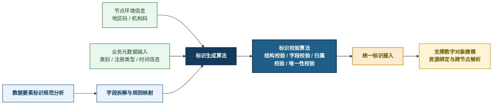
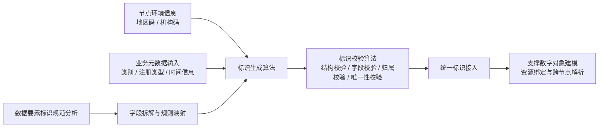
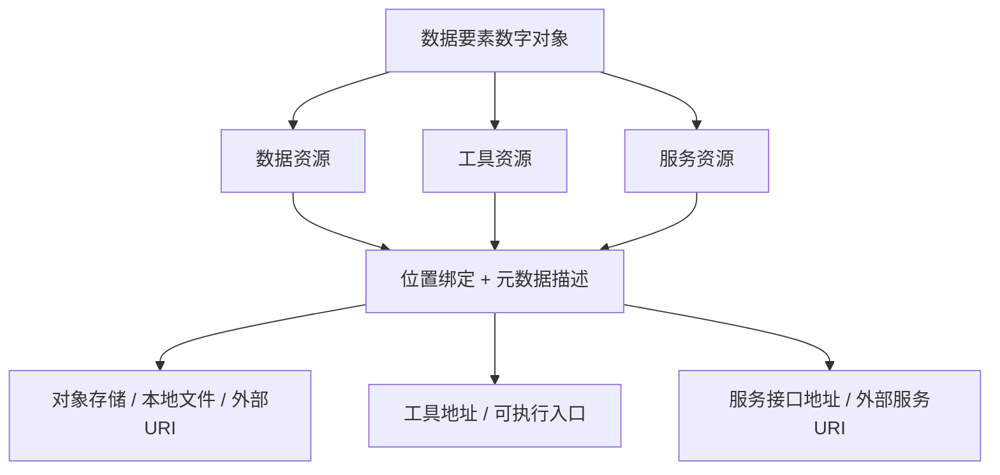

# 中期检查材料说明

本目录用于整理中期检查阶段建议提交或备查的文档材料，当前内容已经从“简版提交口径”扩展为“可直接支撑软工检查与答辩”的详细版。

## 当前文档清单

1. `需求分析文档.md`
2. `概要设计文档.md`
3. `测试文档.md`
4. `数据库设计文档.md`

## 推荐提交组合

建议你至少提交以下材料：

1. 中期报告
2. 中期答辩 PPT
3. 需求分析文档
4. 概要设计文档
5. 数据库设计文档
6. 测试文档

## 可作为备查材料的内容

1. `..\中期报告.md`
2. `..\中期报告-新版.docx`
3. `..\中期答辩PPT-图示版-新版.pptx`
4. `..\中期答辩图示草稿.md`
5. `..\..\dris-enterprise-backend-v2\docs\` 下的详细接口、测试样例和设计说明

## 与现有后端文档的关系

本目录下文档强调：

1. 中期检查提交口径
2. 软件工程材料完整性
3. 毕设答辩可读性

`dris-enterprise-backend-v2/docs` 下现有文档强调：

1. 详细接口说明
2. 详细测试样例
3. 跨节点设计细节
4. 联调记录与实现过程

两部分材料互补，建议一套用于提交，一套作为答辩备查材料。
