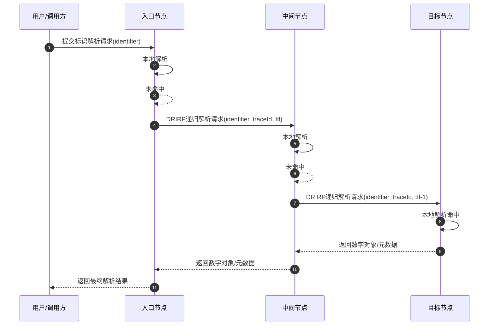
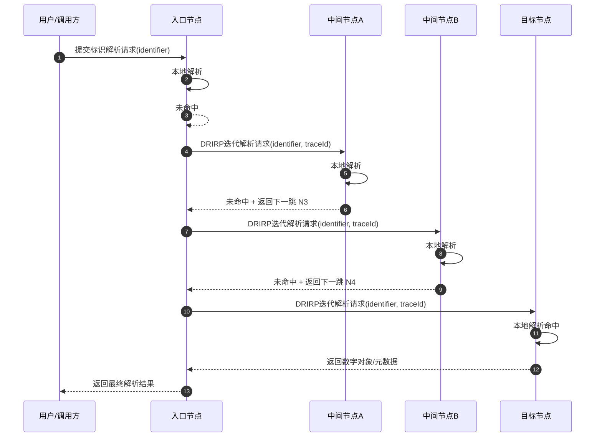
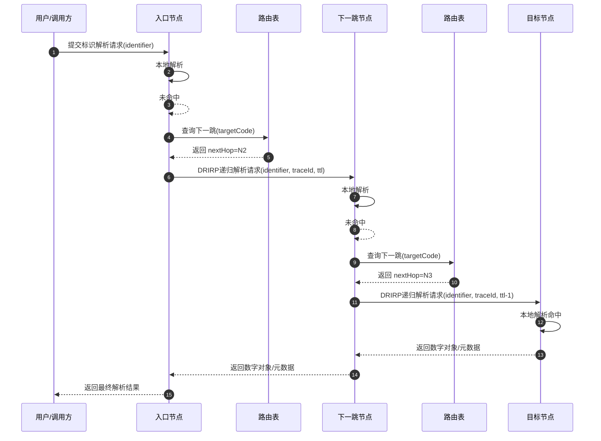
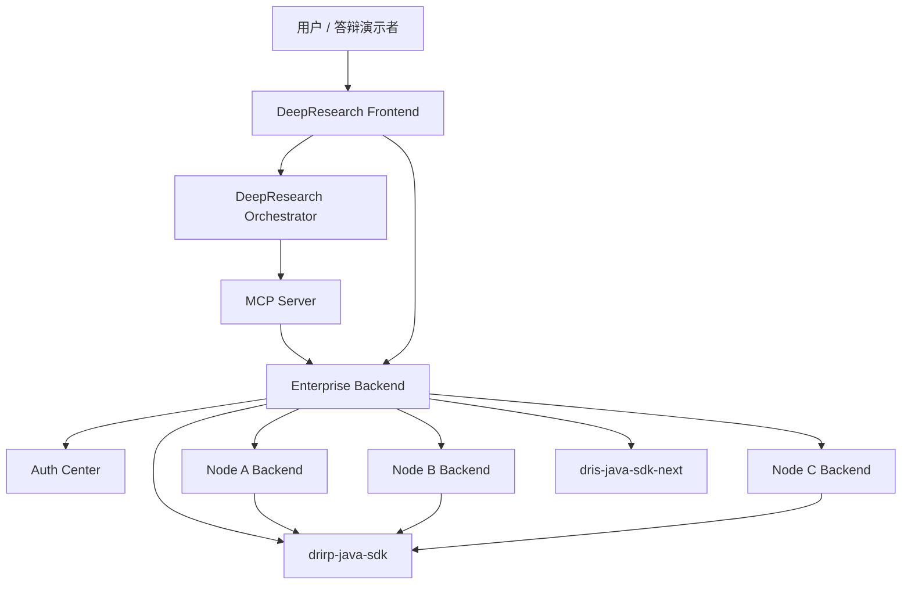
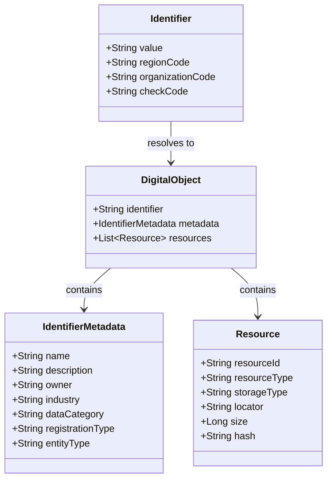
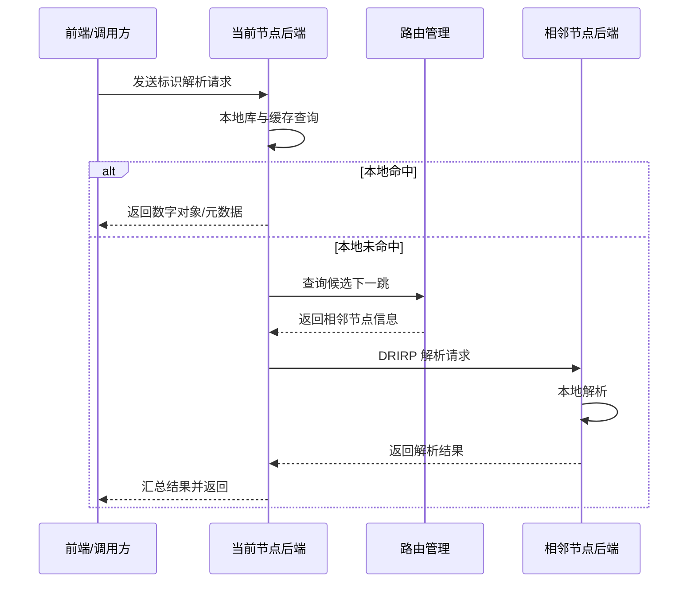

# 中期答辩图示草稿

## 1. 系统总体架构图

答辩用途：

1. 说明系统不是单一后端，而是由核心 SDK、企业后端、认证中心、MCP 与前端共同构成。
2. 说明系统支持多节点部署，后端之间通过 DRIRP 完成跨节点交互。
3. 说明系统既服务于传统业务访问，也支持面向智能体和研究前端的开放接入。

建议讲解重点：

1. 底层是 `dris-java-sdk-next` 和 `drirp-java-sdk`，负责标识规则、核心模型和跨节点协议。
2. 中间是 `dris-enterprise-backend-v2`，承载标识注册、解析、资源绑定、搜索、审计等业务。
3. 旁路有 `dris-auth-center` 提供统一认证能力。
4. 上层通过 `dris-mcp-server` 与 `DeepResearch` 完成智能体和研究前端接入。

Mermaid 草稿：

一句话结论：

“系统采用分层解耦设计，将标识核心、业务后端、认证接入和智能体访问分离，既保证复用性，也便于多节点部署。”

## 2. 核心类图

答辩用途：

1. 说明标识不是一个孤立字符串，而是数字对象的入口。
2. 说明数字对象内部如何组织元数据和资源。
3. 说明资源不仅可以是文件，也可以是工具和服务。

建议讲解重点：

1. `Identifier` 是全局唯一入口。
2. `DigitalObject` 是聚合根。
3. `IdentifierMetadata` 负责描述对象属性。
4. `Resource` 负责描述实体资源、工具资源或服务资源。

Mermaid 草稿：

一句话结论：

“本系统以数字对象为中心组织标识、元数据和资源，使标识解析结果不仅是描述信息，还能进一步关联真实资源和服务入口。”

## 3. 关键时序图

建议选题：

跨节点标识解析流程

答辩用途：

1. 体现系统具有多节点协同能力。
2. 体现本节点解析失败后如何转发到其他节点继续解析。
3. 体现你的系统区别于单点标识管理系统的地方。

建议讲解重点：

1. 用户向当前节点发起解析。
2. 当前节点先做本地解析。
3. 若本地没有命中，则根据路由表向相邻节点发起解析请求。
4. 远端节点返回数字对象或元数据结果。
5. 当前节点汇总后返回给调用方。

Mermaid 草稿：

一句话结论：

“系统在本地未命中时可基于路由信息继续向相邻节点发起解析请求，从而实现多节点环境下的分布式标识解析。”

## 4. 推荐放入 PPT 的顺序

1. 课题背景与问题提出
2. 研究目标与主要内容
3. 系统总体架构图
4. 核心类图
5. 关键时序图
6. 目前已完成情况
7. 当前问题与后续计划
8. 总结

## 5. 每张图的答辩说法

### 架构图

“这里展示的是系统总体架构。底层由标识核心 SDK 和跨节点协议 SDK 提供能力支撑，中间由企业后端承载主要业务，旁路通过认证中心提供安全接入，上层通过 MCP 和 DeepResearch 前端向智能体或研究型应用开放。”

### 类图

“这里我重点说明系统的数据模型。标识不是孤立字符串，而是数字对象的唯一入口。数字对象中既包含元数据，也包含资源信息，因此解析标识后，不仅可以获得对象描述，还可以进一步关联资源位置、工具入口或服务地址。”

### 时序图

“这里展示的是跨节点解析流程。系统优先在本地完成解析，本地未命中时再依据节点路由向相邻节点发起请求，最终返回解析结果。这体现了系统面向多节点场景的分布式解析能力。”
