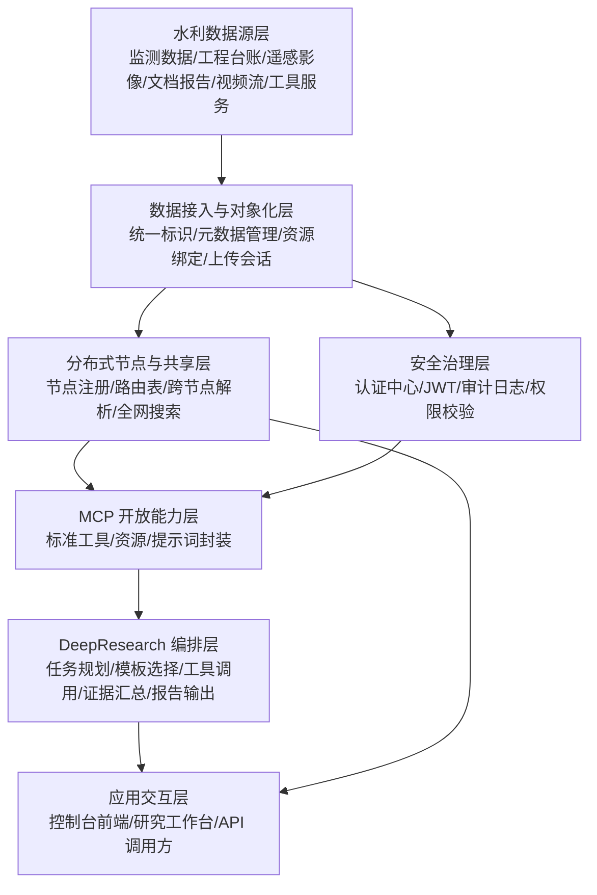

# 水利数据基础设施与 DeepResearch 系统技术方案

## 1. 文档定位

本文档面向当前 `dris-system-deploy-20260310` 工程，给出一版按照“水利数据基础设施 + DeepResearch”思路整理的总体技术方案。文档重点覆盖两部分：

1. 系统架构
2. 主要功能

本文档既贴合当前仓库已有实现，也兼顾水利行业场景落地，适合作为开题汇报、方案评审、阶段答辩和后续详细设计输入。

## 2. 建设目标

面向水利行业中分散、多源、异构的数据资源，建设一个具备统一标识、统一建模、跨节点解析、开放接入与智能研究能力的数据基础设施底座，并在其上提供面向业务人员和研究人员的 DeepResearch 智能研究能力。

核心目标如下：

1. 对水利数据对象建立统一标识体系，实现稳定引用与共享。
2. 对元数据、文件资源、工具资源、服务资源进行统一建模。
3. 支持流域、省、市、县等多级节点部署，形成分布式解析与检索网络。
4. 通过认证、审计、治理机制保障共享过程可控、可追踪。
5. 通过 MCP + Orchestrator + Frontend 形成面向智能体和研究任务的开放能力。

## 3. 适用场景

本方案适用于以下典型水利场景：

1. 雨情、水情、工情、墒情等监测数据目录化与统一引用。
2. 水库、河道、泵站、闸坝、堤防等工程对象的数据资源接入与共享。
3. 监测站点、传感器、视频流、遥感影像、报告文档等多类型资源管理。
4. 跨区域、跨层级节点的数据发现、解析、检索和专题研究。
5. 面向防汛会商、水资源调度、工程运维、风险排查、专题分析的研究工作台。

## 4. 总体架构

### 4.1 架构思路

系统采用“数据基础设施底座 + 开放工具接入层 + DeepResearch 智能编排层 + 可视化工作台”的四层架构。

其中，底层解决“数据对象如何被统一标识、统一组织和统一访问”的问题；上层解决“如何让研究人员用自然语言直接驱动检索、解析、证据汇总和报告生成”的问题。

### 4.2 分层架构图

### 4.3 当前工程模块映射

当前仓库中的模块与上述架构关系如下：

| 模块 | 架构定位 | 作用 |
| --- | --- | --- |
| `dris-java-sdk-next` | 核心规则层 | 统一标识规则、核心模型、校验与基础操作 |
| `drirp-java-sdk` | 协议通信层 | 跨节点通信协议封装 |
| `dris-enterprise-backend-v2` | 数据基础设施服务层 | 标识、元数据、资源、搜索、节点、审计等核心服务 |
| `dris-auth-center` | 安全治理层 | 用户认证、令牌签发、公钥发布、用户信息获取 |
| `dris-mcp-server` | 开放能力层 | 把后端能力封装为 MCP 工具、资源、提示词 |
| `dris-deepresearch-orchestrator` | 智能编排层 | 研究任务规划、受控调用 MCP、生成结构化报告 |
| `dris-deepresearch-frontend` | 应用交互层 | 多页面控制台、研究工作台、节点与业务展示 |

### 4.4 逻辑交互链路

系统的核心调用链路如下：

`前端/外部调用方 -> Orchestrator -> MCP Server -> DRIS Backend -> SDK/数据库/对象存储/节点网络`

其中：

1. 前端负责发起业务操作或研究任务。
2. Orchestrator 负责把自然语言问题转换为受控研究流程。
3. MCP Server 负责把后端能力暴露为智能体可调用工具。
4. DRIS Backend 负责执行标识、资源、搜索、路由、审计等核心业务。
5. SDK 和 DRIRP 分别提供标识内核能力与跨节点协议能力。

## 5. 系统架构设计

### 5.1 数据对象模型

本系统采用“标识 + 元数据 + 资源”的统一数字对象模型。

1. 标识：解决对象唯一引用问题。
2. 元数据：解决对象语义描述和检索问题。
3. 资源：解决对象真实内容、工具能力或服务接口访问问题。

对于水利场景，一个“数字对象”可以对应：

1. 一份雨量站日统计数据集
2. 一路河道监控视频流
3. 一份水库调度方案 PDF
4. 一个水文分析模型工具
5. 一个水情查询服务接口

### 5.2 多节点架构

系统支持多级节点部署，适合映射水利行业的层级组织结构，例如：

1. 流域级中心节点
2. 省级节点
3. 地市节点
4. 区县节点
5. 专题业务节点

每个节点独立维护本地标识和资源，同时通过路由表和协议通信实现跨节点解析、搜索和批量查询。

这类架构适合水利领域“数据分散存放、分级管理、需要跨域共享”的现实特点。

### 5.3 安全与治理架构

系统采用“认证中心统一签发令牌 + 业务节点校验 + 审计留痕”的治理模式。

1. `dris-auth-center` 提供注册、登录、JWT 签发、公钥发布。
2. 业务写接口要求携带令牌。
3. 注册、更新、删除、资源绑定、查询等关键动作可写入审计日志。
4. 为后续细粒度权限和节点级鉴权预留扩展空间。

### 5.4 智能研究架构

DeepResearch 部分采用“编排器 + MCP 工具层 + 后端数据底座”的组合架构。

1. 编排器负责理解问题、选择模板、控制步骤。
2. MCP 把底层能力转成标准工具接口。
3. 后端提供真实的数据解析、搜索、路由和审计能力。
4. 前端负责展示研究过程、证据卡片和报告结果。

这使系统不仅能做“数据管理”，还能做“基于数据底座的专题研究”。

## 6. 主要功能设计

### 6.1 水利数据统一接入与标识管理

该部分是系统底座的核心。

主要能力包括：

1. 单条标识注册
2. 批量标识注册
3. 标识合法性校验
4. 标识存在性校验
5. 元数据查询、全量更新、补丁更新
6. 标识删除
7. 数字对象解析与批量解析

面向水利场景时，可对以下对象进行统一标识化管理：

1. 监测数据集
2. 工程档案
3. 站点设备信息
4. 专题图层
5. 模型工具
6. 服务接口

### 6.2 资源绑定与共享访问

系统支持三类资源绑定：

1. `resource`：文件或实体资源
2. `tool`：可调用工具能力
3. `service`：服务接口能力

典型功能包括：

1. 创建上传会话
2. 完成上传并生成资源绑定
3. 获取资源组件详情
4. 查询资源版本
5. 删除资源组件
6. 生成下载访问地址

在水利领域，这一能力可以支撑：

1. 监测报表文件接入
2. 遥感影像接入
3. 河湖视频流地址登记
4. 水文模型或调度算法工具挂接
5. 第三方业务系统 API 服务挂接

### 6.3 多节点解析与全网检索

系统支持本地解析、跨节点解析和全网搜索，是分布式场景下的关键能力。

主要功能包括：

1. 节点注册与拓扑维护
2. 路由表维护
3. 单条跨节点解析
4. 跨节点批量元数据解析
5. 跨节点批量数字对象解析
6. 跨节点批量资源组件解析
7. 本地搜索
8. 全局递归搜索
9. 全局迭代搜索

对于水利数据基础设施，这意味着用户可以从当前节点出发，发现其他区域节点上的相关数据对象，而不要求所有数据集中到同一库中。

### 6.4 认证、审计与治理

该部分保证系统从“能用”走向“可治理”。

主要功能包括：

1. 用户注册与登录
2. Token 获取与用户信息查询
3. 业务写接口令牌校验
4. 审计日志分页查询
5. 按标识、时间、操作类型检索审计记录
6. 治理证据展示

对水利业务而言，该能力可支撑：

1. 数据目录接入过程留痕
2. 共享对象变更可追踪
3. 研究结论可回溯到原始证据
4. 专题分析过程可审计

### 6.5 MCP 开放能力

`dris-mcp-server` 将底层能力封装成标准 MCP 工具接口，便于被智能体或研究工作流调用。

当前已暴露的核心工具包括：

1. 元数据解析
2. 数字对象解析
3. 资源组件解析
4. 跨节点批量解析
5. 全局搜索
6. 审计日志查询
7. 节点路由查询

这相当于为水利数据基础设施增加了一层“面向智能体的标准操作面”。

### 6.6 DeepResearch 智能研究

`dris-deepresearch-orchestrator` 负责把研究问题转成受控执行流程。

当前能力包括：

1. 接收自然语言研究问题
2. 归一化用户请求
3. 选择研究模板
4. 按步骤调用 MCP 工具
5. 汇总证据卡片
6. 生成结构化研究报告
7. 输出 Markdown 摘要

现有模板包括：

1. `discovery_overview`
2. `identifier_compare`
3. `audit_trace`
4. `anchor_search`

映射到水利场景，可进一步扩展为：

1. 流域专题数据发现
2. 水库对象多源对比
3. 关键对象变更追踪
4. 防汛专题资料汇编
5. 事件链证据归集

### 6.7 前端控制台与研究工作台

前端应作为统一控制台，而不是单一研究页面。

主要页面能力建议包括：

1. 总览页
2. 节点拓扑页
3. 标识接入页
4. 标识管理页
5. 搜索解析页
6. 审计中心页
7. 研究工作台
8. MCP 工具台
9. 认证中心页

这种设计既满足系统管理，也满足研究展示和答辩演示。

## 7. DeepResearch 核心流程

DeepResearch 的建议执行流程如下：

1. 用户输入研究问题，例如“检索某流域近年雨情与水库调度相关数据对象，并梳理可直接调用的服务资源”。
2. Orchestrator 对问题进行意图识别和任务归一化。
3. 根据问题类型选择研究模板。
4. 调用 MCP 工具执行全局搜索、对象解析、资源解析、审计查询。
5. 对结果进行结构化聚合，形成证据卡片。
6. 输出研究结论、对象列表、证据来源和可导出的 Markdown 报告。

该流程体现了系统从“数据目录系统”升级为“数据底座 + 智能研究工作台”的核心价值。

## 8. 推荐部署形态

结合当前工程，推荐采用如下部署形态：

1. 多节点后端集群：至少 1 个根节点 + 若干下级业务节点
2. 认证中心：统一独立部署
3. MCP Server：独立部署
4. DeepResearch Orchestrator：独立部署
5. Frontend：统一控制台独立部署

当前仓库测试环境已验证以下本地联调形态：

1. 后端 6 节点：`8200` 到 `8205`
2. 认证中心：`8290`
3. MCP：`38082`
4. Orchestrator：`38083`
5. Frontend：`5176`

这一部署方式已经能够支撑演示级多节点水利数据基础设施原型。

## 9. 方案特点

相较于传统“数据目录 + 检索”的单层系统，本方案具备以下特点：

1. 不只管理目录，而是管理“可解析、可访问、可调用”的数字对象。
2. 不要求数据物理集中，支持分布式多节点组织。
3. 不只面向人工检索，也面向 MCP 和智能体调用。
4. 不只做资源登记，还支持证据化研究和报告输出。
5. 兼顾工程实现、演示效果和后续论文扩展空间。

## 10. 后续扩展建议

若按水利行业进一步深化，可优先扩展以下方向：

1. 增加水利领域元数据标准模板，如站点、河段、水库、断面、工程等对象类型。
2. 增加时空检索能力，支持按流域、行政区、时间范围联合检索。
3. 增加时序数据资源类型，适配雨量、水位、流量等监测序列。
4. 增加专题研究模板，如防汛会商、工程安全、河湖治理、水资源调度。
5. 增加知识图谱或事件链建模，把对象、事件、区域、时间关系串联起来。

## 11. 结论

从当前工程基础看，系统已经具备“统一标识、多节点共享、开放接入、智能研究”的完整雏形。若以水利数据基础设施为行业落点，可将现有 DRIS 底座视为统一数据对象管理与共享中枢，将 DeepResearch 视为面向业务专题分析和证据归集的智能工作台。

因此，本方案的定位可以概括为：

“以统一标识和分布式解析为底座，以 MCP 为开放操作面，以 DeepResearch 为上层研究入口的水利数据基础设施原型系统。”
