# PowerEnv Math 训练流程——图文说明

> 以下文字配合三张示意图使用：图1（PowerEnv 整体训练架构）、图2（GSM8K 单轮 Episode 全流程）、图3（Reward 计算详细分解）。可直接嵌入设计文档对应章节。

------

## 图1：PowerEnv Math 训练架构总览

本图展示了 PowerEnv 框架下 Math 训练任务的端到端架构。训练框架（TRL / OpenRLHF / ROLL)位于最上层，通过 PowerEnv 协议网关接入环境。网关同时支持 MCP、GEM、OpenAI API 三种协议，并通过自动协商机制为不同训练框架选择最优协议路径，在内部统一为 Unified API 后下发至 MathEnv 环境层。

MathEnv 内部由三个核心组件协同工作：Observation 模块负责下发数学问题，Action Executor 在 Podman rootless 沙箱中执行求解或形式化证明，Reward Calculator 基于可验证规则计算奖励信号。奖励信号回传至训练框架完成策略梯度更新（PPO / GRPO），随后进入下一轮 episode 迭代。整个流程支持从 Process（开发调试）到 Podman（生产环境）再到 K8s（企业级弹性扩展）的渐进部署。

------

## 图2：GSM8K 单轮 Episode 全流程

本图以 GSM8K 数据集为具体示例，完整展示了一轮训练 episode 的数据流转过程。

流程起始于 GSM8K 数据集（7.5k 训练样本 / 1.3k 测试样本），`env.reset()` 从中采样一道数学题（如 "Janet has 16 ducks, each lays 3 eggs per day..."）并附带 Gold Answer 作为 observation 下发给 LLM policy。模型以 actor 角色生成推理响应：先在 `<think>` 标签内输出 Chain-of-Thought 推理链，再以 JSON 格式输出最终答案 `{"answer": 64}`。该响应作为 action 传入 `env.step()`，由 MathEnv 在 Podman 沙箱中执行奖励评估。

奖励计算分为两条并行路径：**格式分（r_fmt）** 检查输出是否为合法 JSON 且包含 `<think>` 推理标签；**正确分（r_acc）** 从 JSON 提取 answer 字段与 Gold Answer 做精确比对。两项加权求和得到总 reward，随后与 observation、done 标志等一起组成返回元组，交由 GRPO 模块进行 group sampling（G=8）和 advantage 估计，完成一次策略梯度更新后循环进入下一个 episode。

------

## 图3：Reward 计算详细分解

本图将 Reward 计算机制拆解为四个阶段，详细展示了从 LLM 原始输出到最终奖励信号的完整处理链路。

**Stage 1——答案提取：** 首先对 LLM 的原始输出进行解析。按优先级依次尝试三种提取策略：GSM8K 标准的 `#### N` 正则匹配、LaTeX `\boxed{N}` 格式匹配、以及提取文本中最后一个数字的兜底启发式方法。这一层级化设计保证了即使模型输出格式不完全标准，也能最大程度提取到有效答案。

**Stage 2——归一化：** 对提取到的答案文本进行清洗，去除美元符号、逗号分隔符、多余空格及单位后缀等干扰项，将其转换为可比较的纯数值形式。

**Stage 3——可验证比对：** 将归一化后的模型答案与 Gold Answer 做精确匹配。这是 GSM8K verifiable reward 的核心——完全基于规则判定，无需 LLM-as-judge，零歧义、零随机性。

**Stage 4——奖励信号生成：** 奖励由格式分和正确分两部分加权组成。格式分（r_fmt）要求输出同时满足合法 JSON 和包含 `<think>` 推理标签两个条件，任一不满足即为 0；正确分（r_acc）取决于答案是否匹配 Gold Answer。最终 `r = w₁ × r_fmt + w₂ × r_acc`。这一设计使得训练初期即使答案错误，只要模型学会了正确的输出格式，也能获得部分奖励信号，有效缓解了 reward 稀疏问题，加速策略收敛。

