# DEIS 技术架构文档：多模态数据管理与 DeepResearch 设计

## 1. 引言

DEIS（Data Infrastructure Identifier System）是一个面向数据基础设施的统一标识管理系统。本文档聚焦两个核心技术主题：

1. **多模态数据如何通过数联网进行存储与管理**——从标识编码、资源建模、对象存储到跨节点分布式解析的完整数据生命周期。
2. **DeepResearch 智能研究系统的设计与实现**——如何将传统数据管理能力升级为 AI 可驱动的研究平台。

---

## 2. 多模态数据在数联网中的存储与管理

### 2.1 数联网总体架构

数联网采用 **层级化多节点拓扑**，模拟国家→省→市→县四级体系，每个节点拥有独立的数据库、标识空间和服务端口，通过 DRIRP（Distributed Resource Identifier Resolution Protocol）协议互联：

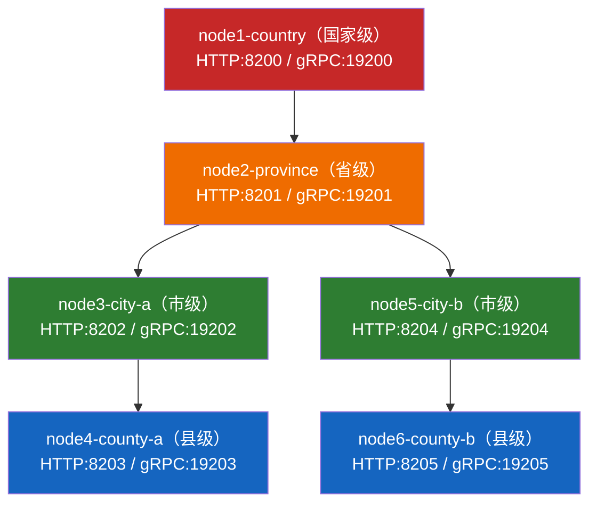

每个节点运行独立的 `dris-enterprise-backend-v2` 实例（Spring Boot 2.7 + MySQL），对外提供 REST API，对等节点间通过 gRPC 通道进行标识解析与路由转发。

### 2.2 统一标识编码——多模态数据的身份基础

系统为每一份数据资源分配一个 **30 位定长标识码**，这是多模态数据在数联网中被寻址、解析和管理的唯一身份：

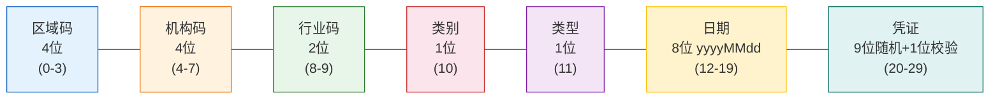

| 字段     | 长度  | 字符集             | 含义                                       |
| -------- | ----- | ------------------ | ------------------------------------------ |
| 区域码   | 4 位  | `[0-9]`          | 行政区划（如 `1100` 北京）               |
| 机构码   | 4 位  | `[A-HJ-NP-Z]`    | 注册机构（Base-34，排除 I/O）              |
| 行业码   | 2 位  | `[0-9]`          | 行业分类（01=能源, 02=交通, 03=卫生…）    |
| 数据类别 | 1 位  | `[1239]`         | 1=公共数据, 2=企业数据, 3=个人数据, 9=其他 |
| 注册类型 | 1 位  | `[123]`          | 1=数据资源, 2=数据资产, 3=数据产品/服务    |
| 日期     | 8 位  | `[0-9]`          | 注册日期（yyyyMMdd）                       |
| 凭证     | 10 位 | `[0-9A-HJ-NP-Z]` | 9 位随机值 + 1 位校验位                    |

**校验算法**（mod-34 加权校验）：对前 29 个字符逐位计算 `charToNumber(c) × (i+1)` 的加权和，取 `sum % 34` 映射回 Base-34 字母表，得到第 30 位校验位。该算法可检出常见的输入错误和位置互换错误。

**标识注册流程**：

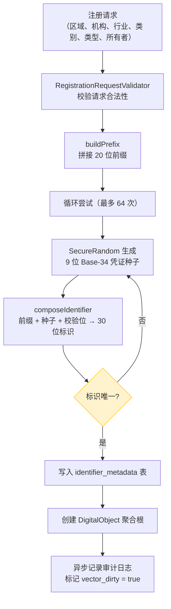

### 2.3 多模态数据的三层模型

系统将多模态数据建模为 **三层结构**，对应 DDD 领域驱动设计中的聚合根模式：

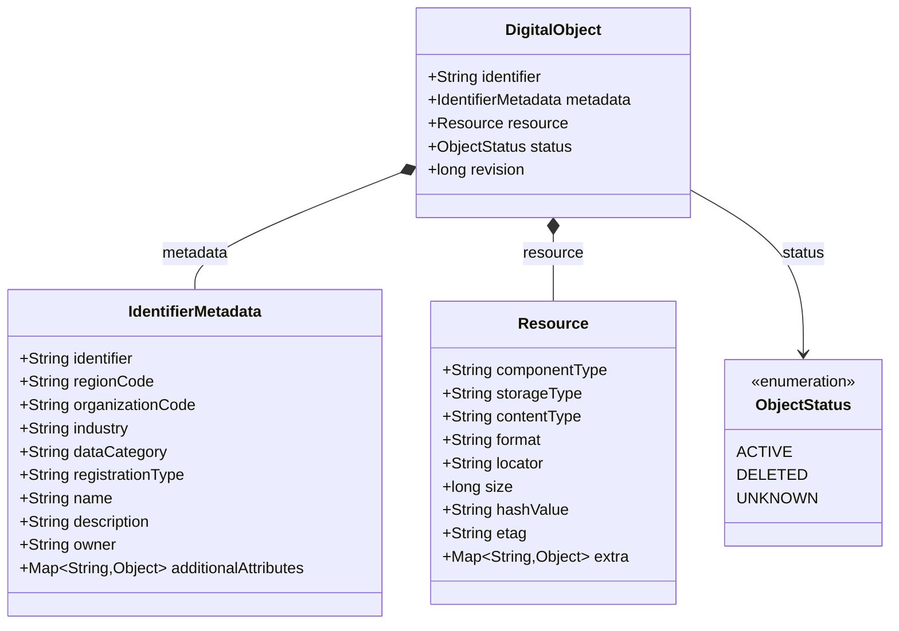

#### 2.3.1 元数据层（IdentifierMetadata）

元数据是数据的"描述信息"，存储在 MySQL `identifier_metadata` 表中：

| 字段                      | 类型           | 用途                                             |
| ------------------------- | -------------- | ------------------------------------------------ |
| `identifier`            | VARCHAR(30) PK | 30 位标识码，主键                                |
| `region_code`           | VARCHAR(4)     | 区域码                                           |
| `organization_code`     | VARCHAR(4)     | 机构码                                           |
| `industry`              | VARCHAR(128)   | 行业名称                                         |
| `data_category`         | VARCHAR(32)    | 数据类别（public/enterprise/individual/others）  |
| `registration_type`     | VARCHAR(32)    | 注册类型（resource/asset/product_service）       |
| `name`                  | VARCHAR(255)   | 数据资源名称                                     |
| `description`           | TEXT           | 描述                                             |
| `entity_type`           | VARCHAR(128)   | 实体类型                                         |
| `owner`                 | VARCHAR(100)   | 所有者                                           |
| `additional_attributes` | TEXT           | **可扩展 JSON 属性**（灵活承载任意元数据） |
| `vector_dirty`          | TINYINT(1)     | 向量索引脏标记                                   |
| `revision`              | BIGINT         | 乐观并发控制版本号                               |

**关键设计**：`additional_attributes` 字段采用 JSON 文本存储，使得系统可以在不修改表结构的情况下扩展任意自定义元数据，适配不同行业、不同类型数据的描述需求。

#### 2.3.2 资源层（Resource）——多模态数据的承载

资源层是多模态数据的实际"物理承载"描述，存储在 MySQL `resource` 表中：

| 字段               | 类型              | 用途                                                                                        |
| ------------------ | ----------------- | ------------------------------------------------------------------------------------------- |
| `identifier`     | VARCHAR(30) PK/FK | 关联的标识码                                                                                |
| `component_type` | VARCHAR(32)       | 组件类型：**resource**（数据资源）/ **tool**（工具）/ **service**（服务） |
| `storage_type`   | VARCHAR(64)       | 存储类型：**cos**（腾讯COS）/ **s3** / **local**                          |
| `content_type`   | VARCHAR(128)      | 语义内容类型：doc / dataset / image / table / file / tool / service                         |
| `format`         | VARCHAR(128)      | 文件格式：pdf / json / csv / parquet / xlsx / png / jpeg / zip 等                           |
| `locator`        | TEXT              | **资源定位符 URI**（如 `cos://bucket/key`）                                         |
| `size_bytes`     | BIGINT            | 文件大小                                                                                    |
| `hash_value`     | VARCHAR(255)      | 完整性哈希                                                                                  |
| `etag`           | VARCHAR(255)      | 对象存储 ETag                                                                               |
| `version_id`     | VARCHAR(255)      | 存储提供商的版本 ID                                                                         |
| `extra_json`     | TEXT              | 可扩展 JSON 属性                                                                            |

### 2.4 多模态数据类型注册表

系统通过 `UploadProfiles` 定义了完整的多模态数据类型支持矩阵：

| 配置名                   | 组件类型 | 内容类型 | 格式         | MIME 类型                  | 说明             |
| ------------------------ | -------- | -------- | ------------ | -------------------------- | ---------------- |
| `doc_pdf`              | resource | doc      | pdf          | application/pdf            | PDF 文档         |
| `doc_word`             | resource | doc      | docx         | application/vnd.openxml... | Word 文档        |
| `data_json`            | resource | dataset  | json         | application/json           | JSON 数据集      |
| `data_jsonl`           | resource | dataset  | jsonl        | application/x-ndjson       | JSONL 流式数据   |
| `data_csv`             | resource | dataset  | csv          | text/csv                   | CSV 表格数据     |
| `data_parquet`         | resource | dataset  | parquet      | application/octet-stream   | 列式存储数据     |
| `table_excel`          | resource | table    | xlsx         | application/vnd.openxml... | Excel 表格       |
| `image_png`            | resource | image    | png          | image/png                  | PNG 图片         |
| `image_jpeg`           | resource | image    | jpeg         | image/jpeg                 | JPEG 图片        |
| `image_webp`           | resource | image    | webp         | image/webp                 | WebP 图片        |
| `generic_file`         | resource | file     | bin          | application/octet-stream   | 通用二进制文件   |
| `tool_zip_cli`         | tool     | tool     | zip          | application/zip            | CLI 工具包       |
| `service_openapi_json` | service  | service  | openapi_json | application/json           | OpenAPI 服务描述 |
| `service_openapi_yaml` | service  | service  | openapi_yaml | application/yaml           | OpenAPI 服务描述 |

系统将多模态数据统一抽象为三类组件（`ComponentType`）：

- **resource**：静态数据资源（文档、数据集、图片、表格）
- **tool**：可执行工具（ZIP 打包的 CLI 工具）
- **service**：在线服务（以 OpenAPI 规范描述的 API 端点）

### 2.5 对象存储与上传机制

多模态数据的实际文件内容不存储在关系数据库中，而是存储在 **腾讯云对象存储（Tencent COS）** 中，通过预签名 URL 实现客户端直传：

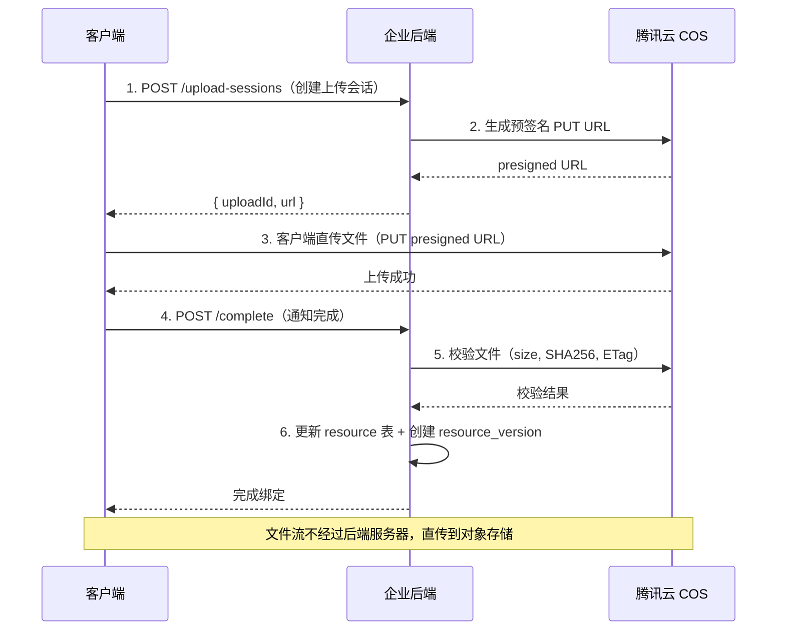

**关键设计点**：

- **客户端直传**：文件流不经过后端服务器，降低带宽压力，提升传输效率
- **预签名安全**：URL 仅在有效期内可用，且绑定了操作类型（PUT）
- **完整性校验**：上传完成后后端通过 COS API 验证文件大小、SHA256 哈希和 ETag
- **版本管理**：每次资源更新都在 `resource_version` 表创建新记录，版本号单调递增

**资源定位符格式**：

- COS 存储：`cos://bucket-name/object-key`
- 本地存储：`local://bucket-name/object-key`
- S3 兼容存储：`s3://bucket-name/object-key`

### 2.6 分布式解析——跨节点数据寻址

当数据分布在不同节点时，系统通过 **DRIRP 协议** 实现跨节点解析：

#### 2.6.1 协议设计

DRIRP 使用统一消息信封（Protobuf 序列化），支持 HTTP 和 gRPC 双传输通道：

```protobuf
message DrirpMessage {
  int32  code             = 1;   // 操作码：RESOLVE=10, QUERY=20, REGISTER=30 ...
  string rid              = 2;   // 请求标识
  string body             = 4;   // JSON 载荷
  int64  ts               = 5;   // 时间戳（毫秒）
  string auth             = 6;   // HMAC-SHA256 签名
  string traceId          = 12;  // 链路追踪 ID
  string nonce            = 13;  // 防重放随机数
  string idempotencyKey   = 14;  // 幂等键
}
```

#### 2.6.2 解析流程

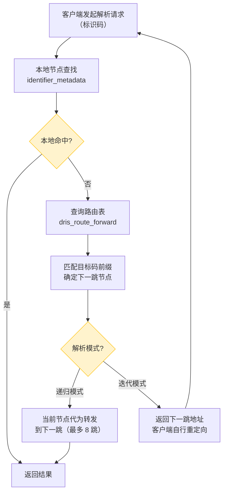

#### 2.6.3 安全与可靠性保障

| 机制         | 实现方式                                                                              |
| ------------ | ------------------------------------------------------------------------------------- |
| 认证         | HMAC-SHA256 签名（对 `code\|rid\|ts\|version\|traceId\|nonce\|idempotencyKey\|body` 计算） |
| 防重放       | 时间戳偏差检查（±5 分钟） + Nonce 唯一性缓存                                         |
| 幂等重试     | 基于 `idempotencyKey` 的服务端结果缓存                                              |
| 指数退避重试 | 初始 100ms，最大 2s，抖动比 0.2，最多 3 次                                            |
| 熔断器       | 三态（CLOSED → OPEN → HALF_OPEN），5 次连续失败触发，30s 冷却                       |
| 限流器       | 令牌桶算法，可配置 QPS 和突发容量                                                     |
| 环路检测     | 维护已访问 URL 集合，防止路由环路                                                     |
| 跳数限制     | 最多 8 跳，超出返回超时                                                               |

### 2.7 语义搜索与向量索引

系统在关系数据库之上构建了向量检索能力，支持对多模态数据的语义搜索：

- **嵌入生成**：Hash-based 本地嵌入，128 维向量
- **索引算法**：ANN LSH（近似最近邻 - 局部敏感哈希）
- **同步机制**：`VectorIndexAutoSyncScheduler` 定时扫描 `vector_dirty` 标记，增量同步
- **搜索模式**：

| 模式     | 说明                                    |
| -------- | --------------------------------------- |
| KEYWORD  | 纯关键词匹配 + 同义词扩展               |
| SEMANTIC | 向量近邻搜索                            |
| HYBRID   | 混合搜索（关键词 + 语义，加权融合评分） |

- **搜索保护**：结果缓存（30s TTL）、QPS 限流（100 QPS）、熔断器

### 2.8 数据全生命周期审计

每份多模态数据的全生命周期操作都被审计记录：

| 审计表                 | 记录内容                                               |
| ---------------------- | ------------------------------------------------------ |
| `identifier_history` | 标识级操作记录：操作类型、操作人、角色、是否成功、消息 |
| `api_audit_log`      | API 请求级记录：链路 ID、HTTP 方法、路径、状态码、耗时 |

审计采用异步线程池写入，不阻塞业务主线程。

### 2.9 多模态数据管理小结

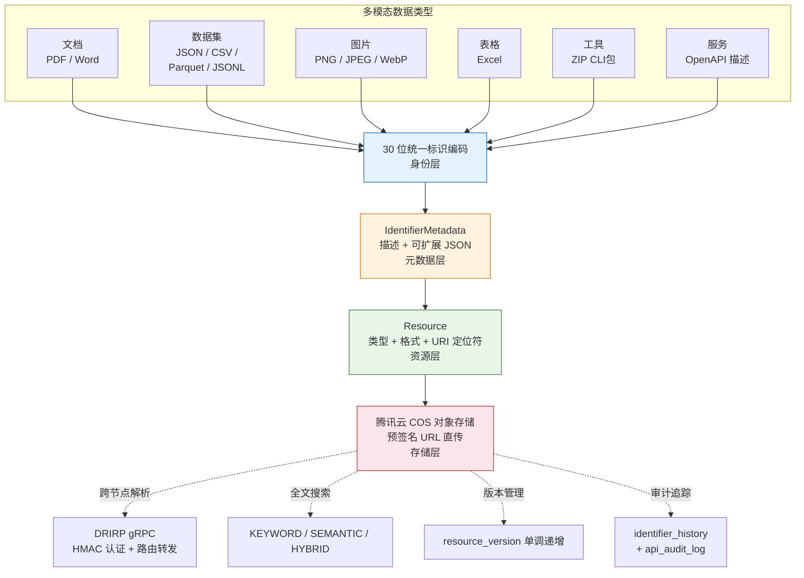

---

## 3. DeepResearch 智能研究系统设计

### 3.1 设计目标与产品定位

DeepResearch 不是传统的后台管理页面，而是 **面向数字对象研究任务的智能工作台**。它的核心价值在于：

- 用户不需要理解复杂的 REST API 和节点路由路径
- 系统能将自然语言问题自动拆解为结构化研究步骤
- 系统能自动编排搜索、批量解析、审计查询等多种工具调用
- 系统能将离散的工具返回结果整合为结构化研究报告
- 系统能展示证据来源和工具调用轨迹，增强可信度

**设计原则**：

```
核心系统负责业务权威，MCP Server 负责 AI 能力适配，DeepResearch 负责研究型交互呈现。
```

### 3.2 三层架构设计

DeepResearch 构建在 DEIS 核心系统之上，形成清晰的三层分离：

```
┌─────────────────────────────────────────────────────────────┐
│  Layer 3：智能研究交互层                                      │
│                                                             │
│  ┌──────────────────────┐  ┌────────────────────────────┐   │
│  │ DeepResearch Frontend │  │ DeepResearch Orchestrator  │   │
│  │ Vue 3, port 5176      │  │ Node.js/TS, port 38083     │   │
│  │ 研究工作台 UI          │  │ 研究规划 + 执行编排         │   │
│  └──────────┬───────────┘  └─────────────┬──────────────┘   │
│             │ REST/SSE                   │ MCP Streamable HTTP│
├─────────────┼────────────────────────────┼──────────────────┤
│  Layer 2：AI 能力适配层                   │                   │
│                                          │                   │
│  ┌───────────────────────────────────────┴──────────────┐   │
│  │ MCP Server (Node.js/TS, port 38082)                  │   │
│  │ 9 Tools + 2 Resources + 2 Prompts                    │   │
│  │ MCP Streamable HTTP Transport (/mcp)                 │   │
│  └───────────────────────────────┬──────────────────────┘   │
│                                  │ REST                      │
├──────────────────────────────────┼──────────────────────────┤
│  Layer 1：核心业务能力层          │                           │
│                                  │                           │
│  ┌──────────────────┐  ┌────────┴─────────┐                 │
│  │ Auth Center      │  │ Enterprise       │                 │
│  │ JWT RS256        │  │ Backend v2       │                 │
│  │ port 8290        │  │ Spring Boot      │                 │
│  └──────────────────┘  │ port 8190        │                 │
│                        └────────┬─────────┘                 │
│                     ┌───────────┼───────────┐               │
│                     ▼           ▼           ▼               │
│               MySQL      腾讯云 COS    DRIRP 节点网络         │
└─────────────────────────────────────────────────────────────┘
```

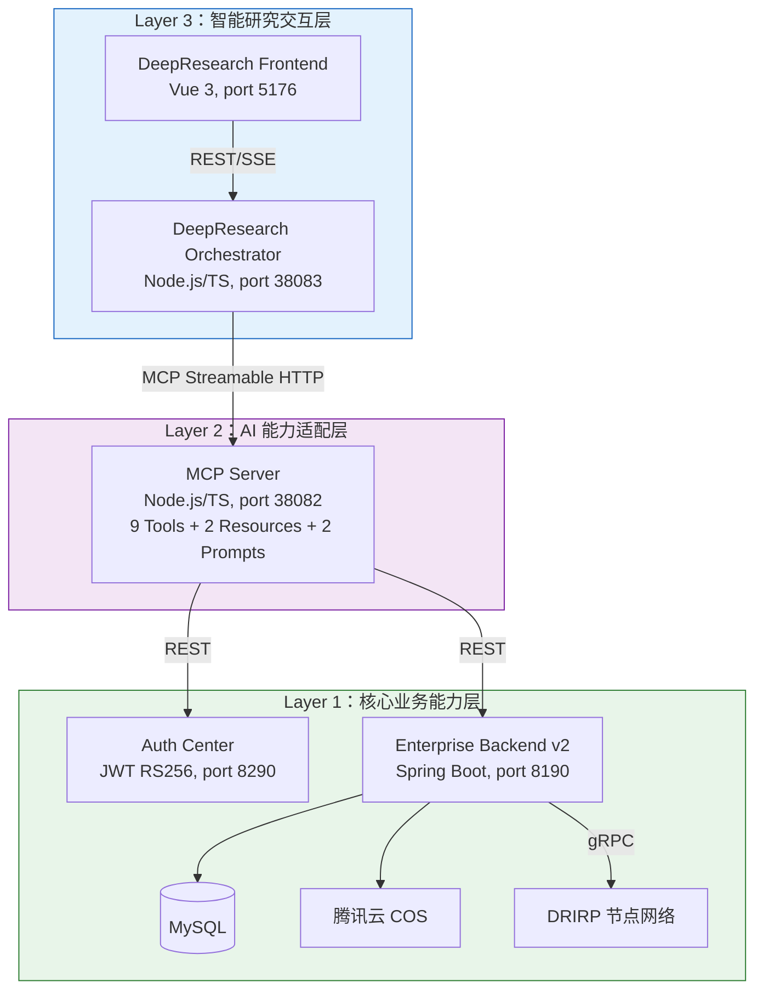

**数据流**：

```
用户浏览器 (5176)
    │ REST / SSE
    ▼
DeepResearch Orchestrator (38083)
    │ MCP Streamable HTTP
    ▼
MCP Server (38082)
    │ REST
    ▼
Enterprise Backend (8190)
    │
    ├──► MySQL 数据库
    ├──► 腾讯云 COS
    └──► DRIRP 对等节点 (gRPC)
```

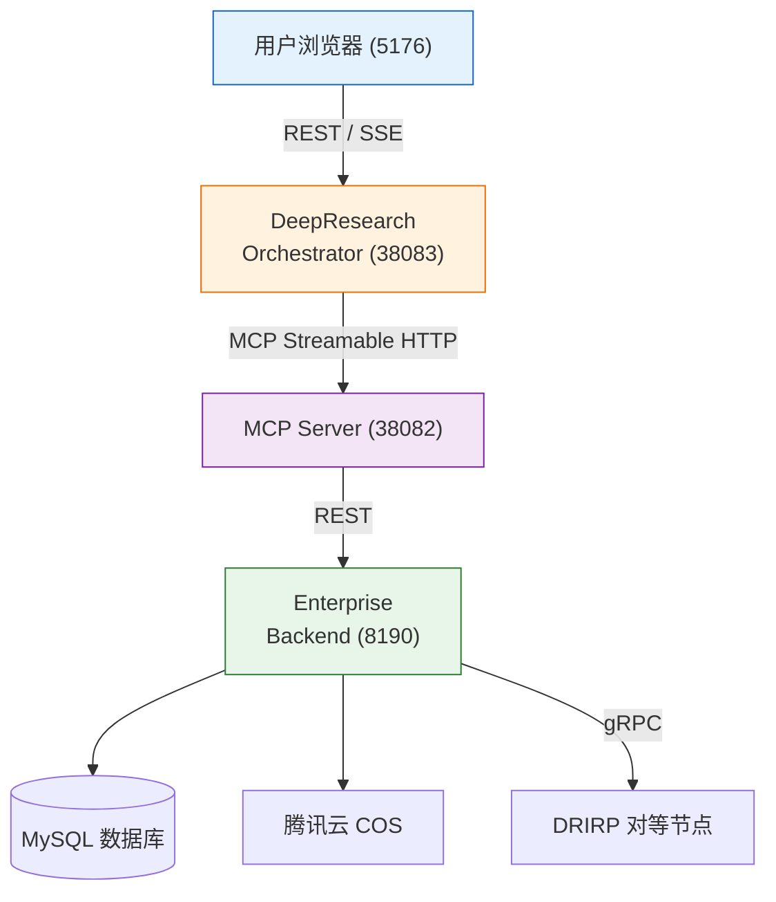

### 3.3 MCP Server——AI 能力适配层

MCP Server 是连接 AI 世界与传统业务系统的桥梁。它将 DRIS 后端的 REST API 封装为符合 [Model Context Protocol](https://modelcontextprotocol.io) 标准的工具（Tools）、资源（Resources）和提示词模板（Prompts），使 AI Agent 可以通过标准化协议调用系统能力。

#### 3.3.1 MCP 工具清单（9 个）

| 工具名                                  | 功能                       | 后端映射                                         | 标注       |
| --------------------------------------- | -------------------------- | ------------------------------------------------ | ---------- |
| `resolve_metadata`                    | 解析单个标识的元数据       | `GET /api/v2/identifiers/{id}/metadata`        | 只读、幂等 |
| `resolve_object`                      | 解析单个标识的完整数字对象 | `GET /api/v2/identifiers/{id}/object`          | 只读、幂等 |
| `resolve_component`                   | 解析单个标识的资源组件     | `GET /api/v2/identifiers/{id}/component`       | 只读、幂等 |
| `batch_resolve_metadata_distributed`  | 跨节点批量元数据解析       | `POST .../resolve/batch/distributed`           | 只读、幂等 |
| `batch_resolve_object_distributed`    | 跨节点批量对象解析         | `POST .../resolve/batch/object/distributed`    | 只读、幂等 |
| `batch_resolve_component_distributed` | 跨节点批量组件解析         | `POST .../resolve/batch/component/distributed` | 只读、幂等 |
| `search_global`                       | 分布式全局搜索             | `POST /api/v2/search/global`                   | 只读       |
| `query_audit_logs`                    | 审计日志查询               | `GET /api/v2/audit/identifier-history`         | 只读       |
| `get_node_routes`                     | 节点路由拓扑               | `GET /api/v2/node/routes`                      | 只读       |

所有工具均标注为 **只读、非破坏性、幂等、封闭世界**，确保 AI 调用的安全性。

#### 3.3.2 MCP 资源与提示词

**资源**：

- `dris://system/capabilities`——系统能力清单（静态 JSON）
- `dris://node/topology`——实时节点拓扑（动态获取）

**提示词模板**：

- `cross_node_batch_analysis`——引导 AI 执行跨节点批量分析
- `identifier_provenance_analysis`——引导 AI 执行标识溯源分析

#### 3.3.3 返回结构标准化

所有 MCP 工具返回统一的 `DrisApiEnvelope` 信封结构：

```typescript
{
  ok: boolean,        // 是否成功
  code: string,       // 业务状态码
  message: string,    // 可读消息
  status: number,     // HTTP 状态码
  data: T             // 业务数据
}
```

同时通过 `structuredContent` 保留原始结构化数据，供 Orchestrator 程序化提取。

#### 3.3.4 会话管理

MCP Server 使用 Streamable HTTP 传输协议，每个客户端连接通过 `mcp-session-id` 标识独立会话。服务端维护 `Map<sessionId, SessionState>` 管理生命周期，支持 POST（请求/响应）、GET（SSE 订阅）、DELETE（会话终止）三种 HTTP 方法。

### 3.4 DeepResearch Orchestrator——研究编排引擎

Orchestrator 是 DeepResearch 的"大脑"，负责将用户的研究问题转化为有序的工具调用计划并执行。

#### 3.4.1 内部架构

```
┌──────────────────────────────────────────────────────────┐
│                   Research Orchestrator                   │
│                                                          │
│  ┌────────────────────────────────────────────────────┐  │
│  │ Server Layer (createHttpApp.ts, researchService.ts) │  │
│  │ Express REST + SSE 流式输出                         │  │
│  └─────────────────────┬──────────────────────────────┘  │
│                        │                                  │
│  ┌─────────────────────┼──────────────────────────────┐  │
│  │ Planner Layer        │                              │  │
│  │                      ▼                              │  │
│  │  ┌──────────────┐  ┌──────────────┐                │  │
│  │  │  Heuristic   │  │  LLM         │                │  │
│  │  │  Planner     │  │  Planner     │                │  │
│  │  │  规则匹配     │  │  模型推理     │                │  │
│  │  └──────────────┘  └──────────────┘                │  │
│  │       ↑ fallback ←──── if error                    │  │
│  └─────────────────────┬──────────────────────────────┘  │
│                        │                                  │
│  ┌─────────────────────┼──────────────────────────────┐  │
│  │ Executor Layer       │                              │  │
│  │                      ▼                              │  │
│  │  ┌──────────────────────────────┐                  │  │
│  │  │ McpResearchClient            │                  │  │
│  │  │ MCP SDK 客户端封装            │                  │  │
│  │  └──────────────────────────────┘                  │  │
│  │  ┌──────────────────────────────┐                  │  │
│  │  │ runPlan（执行引擎）           │                  │  │
│  │  │ 逐步调用 MCP 工具             │                  │  │
│  │  └──────────────────────────────┘                  │  │
│  └─────────────────────┬──────────────────────────────┘  │
│                        │                                  │
│  ┌─────────────────────┼──────────────────────────────┐  │
│  │ Report Layer         │                              │  │
│  │                      ▼                              │  │
│  │  ┌──────────────┐  ┌──────────────┐                │  │
│  │  │ buildReport  │  │ llmSummary   │                │  │
│  │  │ 结构化报告    │  │ LLM执行摘要  │                │  │
│  │  └──────────────┘  └──────────────┘                │  │
│  │  ┌──────────────┐                                  │  │
│  │  │ resourcePre. │                                  │  │
│  │  │ 资源内容预览  │                                  │  │
│  │  └──────────────┘                                  │  │
│  └────────────────────────────────────────────────────┘  │
└──────────────────────────────────────────────────────────┘
```

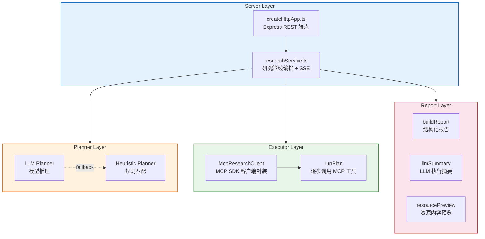

#### 3.4.2 研究模板系统

Orchestrator 定义了四种研究模板，覆盖常见的数据研究场景：

| 模板 ID                | 名称     | 适用场景                 | 必要输入      | 调用的 MCP 工具                                      |
| ---------------------- | -------- | ------------------------ | ------------- | ---------------------------------------------------- |
| `discovery_overview` | 研究综述 | 广泛探索性研究           | 研究问题      | search_global → batch_resolve_* → query_audit_logs |
| `identifier_compare` | 标识对比 | 多标识并行对比分析       | 标识列表      | batch_resolve_* → query_audit_logs                  |
| `audit_trace`        | 审计追踪 | 单标识全生命周期追踪     | 标识          | resolve_* → query_audit_logs                        |
| `anchor_search`      | 锚点搜索 | 从特定节点出发的定向搜索 | 问题+锚点节点 | search_global（指定节点） → batch_resolve_*         |

#### 3.4.3 双模式规划器

**启发式规划器**（`heuristicPlanner.ts`，487 行）——无需 LLM 即可工作的规则引擎：

```
用户输入
    │
    ▼
1. 标识提取
   ├─ 从 identifiersText 解析（逗号/换行分隔）
   └─ 从 question 中正则提取（/\b[0-9A-Za-z]{16,}\b/g）
    │
    ▼
2. 搜索意图推断
   ├─ 中英文分词 + 停用词过滤
   ├─ 实体类型过滤器推断（dataset/device/service/tool…）
   ├─ 格式过滤器推断（csv/json/parquet/pdf…）
   └─ 锚点节点推断
    │
    ▼
3. 模板选择信号分析
   ├─ 有锚点节点 → anchor_search
   ├─ 多标识 + 比较意图关键词 → identifier_compare
   ├─ 有标识 + 审计意图关键词 → audit_trace
   └─ 其他 → discovery_overview
    │
    ▼
4. 参数归一化
   limit: 夹紧到 [1, 20]
   ttl: 夹紧到 [1, 16]
   审计: 最多 3 个标识
```

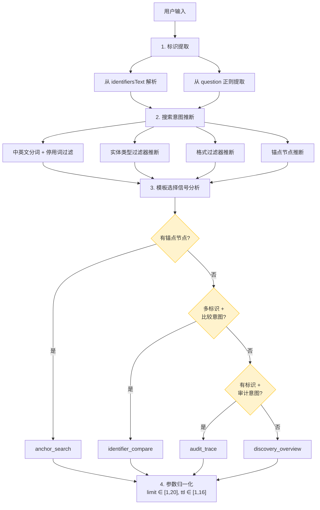

**LLM 规划器**（`llmPlanner.ts`）——利用大语言模型进行智能选择：

```
用户输入 + 启发式上下文（识别到的标识、默认选择）
    │
    ▼
组装 System/User Prompt → 发送到 OpenAI 兼容 API
    │
    ▼
LLM 返回 JSON → Zod Schema 严格校验
{
  templateId: "discovery_overview" | "identifier_compare" | ...,
  rationale: ["原因1", "原因2", ...],     // 1-6 条
  explicitIdentifiers?: ["...", "..."]    // 可选，最多 12 个
}
    │
    ├─ 校验通过 → 使用 LLM 选择的模板
    └─ 校验失败 → 降级为启发式规划
```

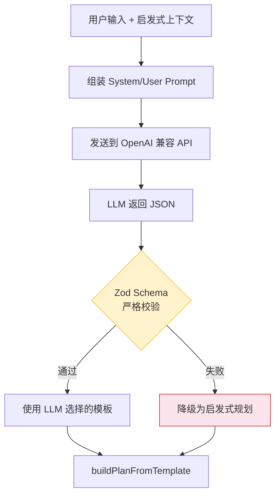

**自动模式**（`auto`，默认）：先尝试 LLM 规划，若 LLM 不可用或返回异常则自动降级为启发式规划，保证 100% 可用。

#### 3.4.4 执行引擎——runPlan

执行引擎按照研究计划逐步调用 MCP 工具，每一步生成带有完整追踪信息的 `ToolExecutionStep`：

```typescript
interface ToolExecutionStep {
  id: string;              // 步骤唯一 ID
  title: string;           // 步骤标题
  toolName: string;        // 调用的 MCP 工具名
  description: string;     // 步骤描述
  status: StepStatus;      // pending → running → success/error/skipped
  startedAt?: string;      // 开始时间
  endedAt?: string;        // 结束时间
  durationMs?: number;     // 耗时（ms）
  args?: Record<string, unknown>;  // 调用参数
  summary?: string;        // 结果摘要
  result?: unknown;        // 原始结果
}
```

以 `discovery_overview` 模板为例，执行顺序为：

```
Step 1: get_node_routes          → 获取节点拓扑路由（必选首步）
Step 2: search_global            → 全局搜索候选标识
Step 3: [选择标识]                → 从搜索结果中选取标识（最多 8 个）
Step 4: batch_resolve_metadata   → 跨节点批量解析元数据
Step 5: batch_resolve_object     → 跨节点批量解析数字对象
Step 6: batch_resolve_component  → 跨节点批量解析资源组件
Step 7: query_audit_logs         → 查询审计日志（每标识，最多 3 个）
```

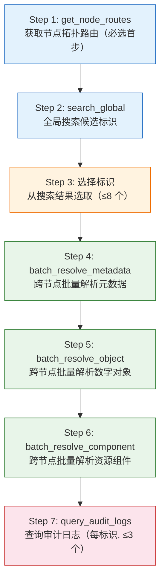

#### 3.4.5 报告生成器——buildReport

报告生成器是 Orchestrator 中最复杂的模块（~1020 行），负责将所有工具输出合并为结构化研究报告：

**Step 1：构建资源全景图（ResourceLandscape）**

```
所有搜索结果 ──┐
所有元数据解析 ─┤
所有对象解析 ──┤───► 按标识合并 ───► ResourceProfile[]
所有组件解析 ──┤                    （每个标识一个完整画像）
所有审计记录 ──┤
节点路由信息 ──┘
```

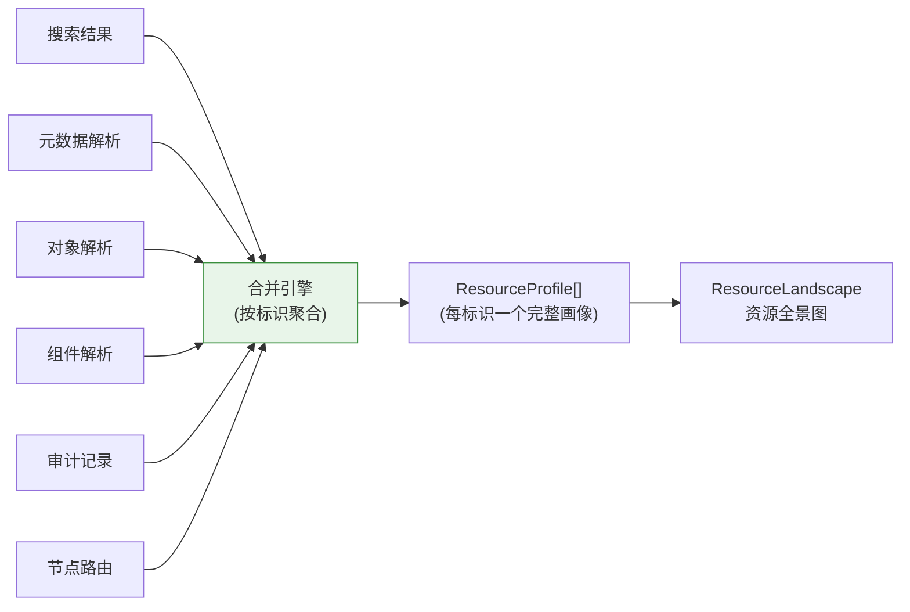

每个 `ResourceProfile` 包含 30+ 个字段，完整描述了一个数据资源的元数据、对象状态、组件绑定、存储位置、审计历史、搜索评分和跨节点信息。

**Step 2：资源分类与排序**

系统将每个资源自动分类为：

- **service/API**：componentType = service 或 format 含 openapi
- **tool**：componentType = tool 或 format = zip
- **downloadable data**：有定位符且 format 为数据格式（csv/json/parquet…）
- **locatable resource**：有定位符的其他资源

按相关性评分和完整度排序。

**Step 3：生成摘要段落（SummarySection[]）**

| 段落          | 内容                                         |
| ------------- | -------------------------------------------- |
| 研究目标      | 用户问题与模板类型                           |
| 发现范围      | 搜索返回数量、选中数量                       |
| 资源全景      | 资源类型分布、行业分布、节点分布             |
| 关键资源画像  | 每个标识的名称、类型、格式、定位符、审计摘要 |
| 内容采样      | 资源内容预览（可选）                         |
| 跨节点证据    | 解析成功/失败分布、涉及节点                  |
| 审计/治理信号 | 操作类型分布、最新操作时间                   |
| 结论          | 综合评价                                     |

**Step 4：生成证据卡片（EvidenceCard[]）**

每张证据卡片包含：

```typescript
{
  title: "资源名称",
  subtitle: "标识码",
  tone: "neutral" | "good" | "warn" | "bad",   // 语气标注
  metrics: [{ label: "格式", value: "CSV" }, ...],
  bullets: ["描述要点1", "描述要点2", ...]
}
```

**Step 5：Markdown 报告导出**

将所有段落和证据卡片组装为完整的 Markdown 文档，用户可直接导出。

#### 3.4.6 可选增强：LLM 执行摘要

在结构化报告生成后，系统可选地调用 LLM 生成一段自然语言执行摘要：

```
System Prompt：
  "你是 DRIS 数字对象研究领域的分析助手。
   请关注与主题相关的数据资源、跨节点覆盖、可用性和治理证据。"

User Prompt：
  研究计划 + 报告段落 + 证据卡片 + 执行步骤

输出：2-5 条事实性要点，以流式 SSE 逐字符推送给前端
```

#### 3.4.7 可选增强：资源内容预览

对于包含 HTTP 定位符的资源，Orchestrator 可自动获取轻量内容预览：

```
1. 从搜索结果/组件解析中收集 HTTP 定位符
2. 按搜索评分排序，取 top-N（默认 3 个）
3. 并发发送 HTTP GET 请求（Range: bytes=0-4095，最多 4KB）
4. 检测内容类型（魔数检测 + Content-Type + URL 推断）：
   ├─ CSV → 表头 + 前2行样本
   ├─ JSON → 顶层键 / 数组长度 + 格式化样本
   ├─ HTML → title + meta + 正文摘录
   ├─ XML → 根标签 + 行样本
   ├─ 文本 → 前 N 行
   └─ 二进制 → 类型信息（ZIP/OLE 等）
5. 将预览结果写入报告的"内容采样"段落
```

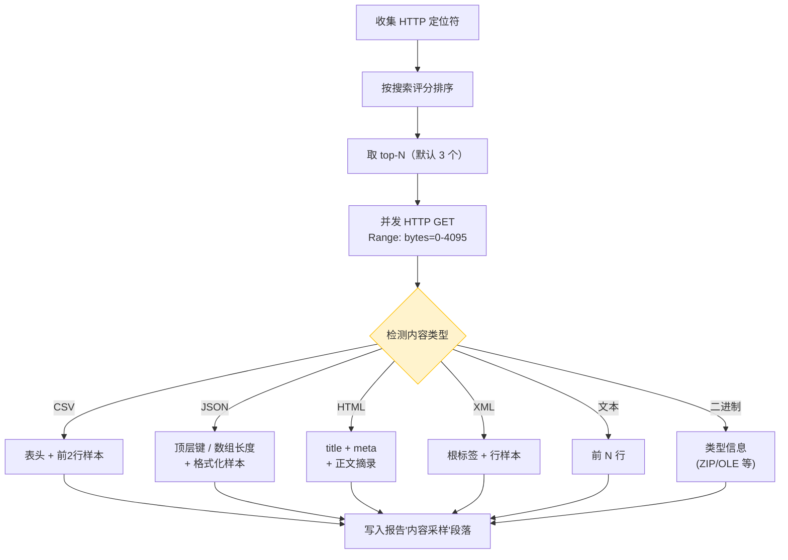

### 3.5 SSE 流式事件协议

Orchestrator 通过 Server-Sent Events 向前端实时推送研究进度，定义了 7 种事件类型：

```
┌─────────── 时间轴 ────────────────────────────────────────────────┐
│                                                                   │
│  meta ──► plan ──► step ──► step ──► ... ──► report ──► done     │
│                  (多个step事件)           ↗                        │
│                            summary_delta ──► summary_delta ...    │
│                            (LLM 流式摘要，与 report 并行或后续)      │
│                                                                   │
│  任何阶段出错 ──► error                                            │
└───────────────────────────────────────────────────────────────────┘
```

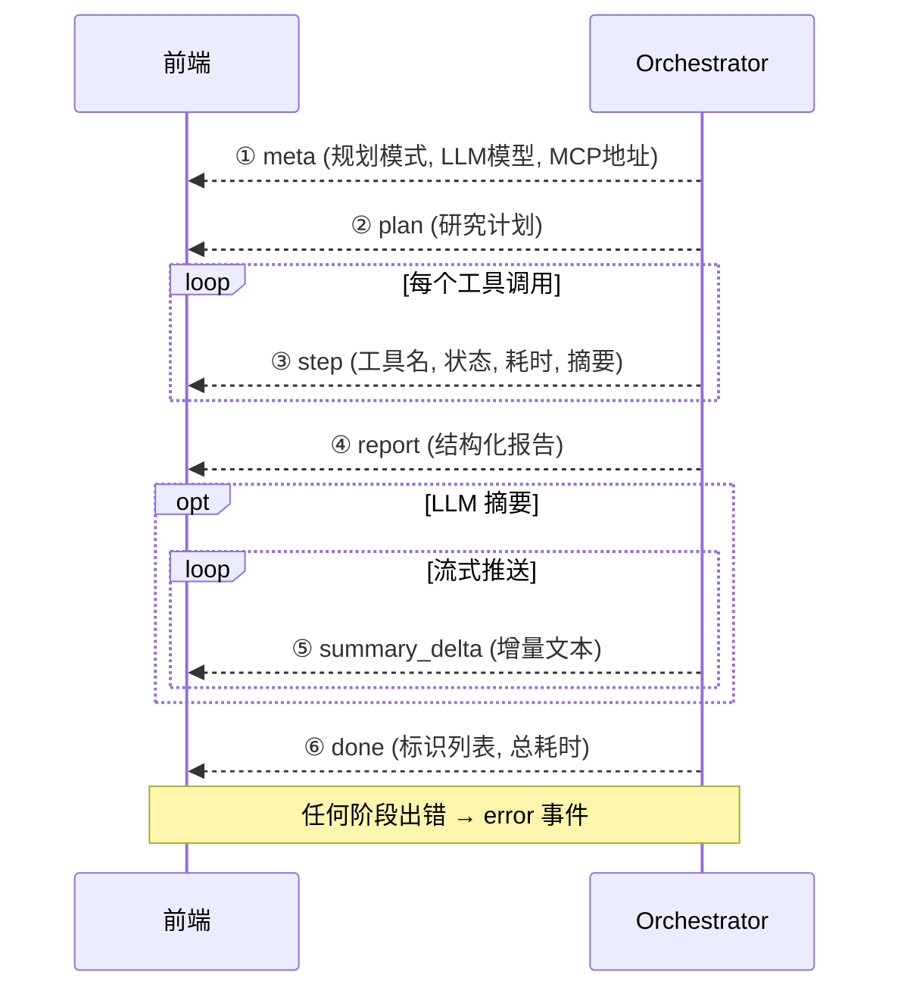

| 事件类型          | 触发时机     | 负载                                         |
| ----------------- | ------------ | -------------------------------------------- |
| `meta`          | 研究开始     | 规划模式、LLM 模型、MCP 地址                 |
| `plan`          | 规划完成     | 完整研究计划（模板、步骤列表、理由）         |
| `step`          | 每步执行后   | 工具名、参数、状态、耗时、摘要               |
| `report`        | 报告生成后   | 完整结构化报告（段落 + 证据卡片 + Markdown） |
| `summary_delta` | LLM 流式推送 | 增量文本 + 累积文本                          |
| `done`          | 研究完成     | 聚焦标识列表、总耗时                         |
| `error`         | 任何错误     | 错误消息                                     |

### 3.6 前端研究工作台

#### 3.6.1 双执行模式

前端支持两种研究执行模式：

| 模式                  | 驱动方            | 通信方式           | 适用场景               |
| --------------------- | ----------------- | ------------------ | ---------------------- |
| **Agent 模式**  | Orchestrator 编排 | SSE 流式事件       | 标准研究流程，推荐使用 |
| **Manual 模式** | 浏览器直接驱动    | 前端 → MCP Server | 开发调试、直接工具调用 |

Agent 模式下，前端通过 `agentClient.ts` 与 Orchestrator 通信，解析 SSE 事件并实时更新 UI。

Manual 模式下，前端通过 `researchRunner.ts` 在浏览器中运行完整的研究流程（与 Orchestrator 逻辑对称），直接调用 MCP Server。

#### 3.6.2 三栏式 UI 布局

```
┌─────────────────────────────────────────────────────────────────┐
│  DRIS + MCP + DeepResearch   跨节点研究工作台                     │
├──────────────┬────────────────────────┬─────────────────────────┤
│  左栏：配置    │  中栏：执行              │  右栏：洞察              │
│              │                        │                         │
│ ▸ 执行方式    │ ▸ 执行时间线             │ ▸ 证据卡片               │
│   Agent/手动  │   Step 1: 路由 ✓ 120ms  │   ┌────────────────┐   │
│              │   Step 2: 搜索 ✓ 450ms  │   │ 交通数据集 A     │   │
│ ▸ 服务地址    │   Step 3: 元数据 ✓ 380ms │   │ tone: good      │   │
│              │   Step 4: 对象 ✓ 290ms  │   │ 格式: CSV        │   │
│ ▸ LLM 模型   │   Step 5: 组件 ✓ 310ms  │   │ 节点: node3      │   │
│              │   Step 6: 审计 ✓ 200ms  │   └────────────────┘   │
│ ▸ 研究问题    │                        │   ┌────────────────┐   │
│ [输入框]     │ ▸ 研究报告快照           │   │ 气象服务 B       │   │
│              │   （段落式报告展示）       │   │ tone: warn       │   │
│ ▸ 标识列表    │                        │   │ 格式: OpenAPI    │   │
│ [多行输入]    │ ▸ 流式 LLM 摘要         │   │ 审计: 3 条       │   │
│              │   "分析发现 5 个数据     │   └────────────────┘   │
│ ▸ 搜索参数    │    资源分布在 3 个节     │                         │
│   模式/策略   │    点，其中…"           │ ▸ 洞察面板               │
│   限制/TTL   │                        │   摘要段落列表            │
│              │                        │                         │
│ [开始研究]    │                        │                         │
└──────────────┴────────────────────────┴─────────────────────────┘
```

```mermaid
flowchart TD
    Header["DRIS + MCP + DeepResearch 跨节点研究工作台"]

    subgraph Left["左栏：配置"]
        L1["执行方式: Agent / 手动"]
        L2["服务地址配置"]
        L3["LLM 模型选择"]
        L4["研究问题输入"]
        L5["标识列表输入"]
        L6["搜索参数\n模式/策略/TTL"]
        L7["开始研究"]
        L1 --- L2 --- L3 --- L4 --- L5 --- L6 --- L7
    end

    subgraph Center["中栏：执行"]
        C1["执行时间线"]
        C2["Step 1: 路由 120ms"]
        C3["Step 2: 搜索 450ms"]
        C4["Step 3-6: 解析"]
        C5["研究报告快照"]
        C6["流式 LLM 摘要"]
        C1 --- C2 --- C3 --- C4 --- C5 --- C6
    end

    subgraph Right["右栏：洞察"]
        R1["证据卡片"]
        R2["交通数据集 A - good"]
        R3["气象服务 B - warn"]
        R4["洞察面板"]
        R5["摘要段落列表"]
        R1 --- R2 --- R3 --- R4 --- R5
    end

    Header --> Left
    Header --> Center
    Header --> Right

    style Header fill:#1a1a2e,color:#fff
    style Left fill:#f0f4ff,stroke:#4a6fa5
    style Center fill:#fff8f0,stroke:#c87533
    style Right fill:#f0fff4,stroke:#33a853
```

#### 3.6.3 关键前端组件

| 组件                      | 文件                          | 功能                        |
| ------------------------- | ----------------------------- | --------------------------- |
| `ResearchWorkspacePage` | `ResearchWorkspacePage.vue` | 研究工作台主页面（~652 行） |
| `ExecutionTimeline`     | `ExecutionTimeline.vue`     | 工具执行时间线展示          |
| `InsightPanel`          | `InsightPanel.vue`          | 证据卡片与摘要段落展示      |
| `agentClient`           | `agentClient.ts`            | Orchestrator SSE 客户端     |
| `researchRunner`        | `researchRunner.ts`         | 前端直接研究执行器          |
| `mcpClient`             | `mcpClient.ts`              | 浏览器端 MCP 客户端         |

### 3.7 DeepResearch 端到端执行流程

以 Agent 模式下的 `discovery_overview`（研究综述）为例，完整流程如下：

```
┌──────────────────────────────────────────────────────────────────┐
│ Phase 1：规划                                                     │
│                                                                  │
│  用户输入："分析北京地区的交通数据资源"                                │
│      │                                                           │
│      ▼                                                           │
│  Orchestrator 接收 → 表单归一化                                    │
│      │                                                           │
│      ▼                                                           │
│  规划器（auto 模式）：                                              │
│    ├─ 尝试 LLM 规划器 → 调用 OpenAI 兼容 API                       │
│    │   LLM 返回：{ templateId: "discovery_overview",              │
│    │              rationale: ["用户未指定标识, 需要先搜索",           │
│    │                         "问题涉及特定地区数据资源"] }            │
│    │                                                             │
│    └─ 若 LLM 失败 → 启发式规划器                                   │
│        ├─ 正则提取标识 → 无匹配                                     │
│        ├─ 分词 → ["分析", "北京", "地区", "交通", "数据", "资源"]     │
│        ├─ 推断过滤器 → entityType=dataset                          │
│        └─ 选择模板 → discovery_overview（无标识，探索性问题）          │
│      │                                                           │
│      ▼                                                           │
│  ◄ SSE: plan 事件 ►                                               │
├──────────────────────────────────────────────────────────────────┤
│ Phase 2：执行                                                     │
│                                                                  │
│  Step 1: get_node_routes                                         │
│    → MCP Server → Backend → 返回路由表                             │
│    ◄ SSE: step 事件（status: success, 120ms）►                    │
│                                                                  │
│  Step 2: search_global                                           │
│    → 关键词 ["北京", "交通", "数据"]                                │
│    → 过滤器 { entityType: "dataset" }                             │
│    → MCP Server → Backend → 跨节点联邦搜索 → 返回候选标识           │
│    ◄ SSE: step 事件（status: success, "Search returned 12 items"）│
│                                                                  │
│  Step 3: [选择标识]                                               │
│    → 从 12 条搜索结果中选取前 8 个标识                               │
│                                                                  │
│  Step 4-6: batch_resolve_metadata/object/component                │
│    → 发送 8 个标识 → MCP Server → Backend → DRIRP 跨节点解析      │
│    → 每步返回后 ◄ SSE: step 事件 ►                                 │
│                                                                  │
│  Step 7: query_audit_logs（最多 3 个标识）                         │
│    → 返回审计记录 → ◄ SSE: step 事件 ►                             │
├──────────────────────────────────────────────────────────────────┤
│ Phase 3：报告                                                     │
│                                                                  │
│  buildReport：                                                    │
│    1. 合并所有工具输出 → ResourceLandscape                          │
│    2. 为每个标识构建 ResourceProfile                                │
│    3. 资源分类与排序                                                │
│    4. 生成 SummarySection[]（研究目标→发现→全景→画像→证据→结论）     │
│    5. 生成 EvidenceCard[]（每资源一张卡 + 总览卡 + 审计卡）          │
│    6. 组装 Markdown 报告                                           │
│    ◄ SSE: report 事件 ►                                           │
│                                                                  │
│  resourcePreview（可选）：                                         │
│    → HTTP Range 请求获取前 4KB → 检测内容类型 → 生成预览             │
│    → 追加到报告"内容采样"段落                                       │
│                                                                  │
│  llmSummary（可选，流式）：                                        │
│    → 发送报告摘要给 LLM → 逐字符推送                                │
│    ◄ SSE: summary_delta 事件 × N ►                                │
├──────────────────────────────────────────────────────────────────┤
│ Phase 4：完成                                                     │
│                                                                  │
│  ◄ SSE: done 事件 { focusedIdentifiers: [...], durationMs: ... }►│
└──────────────────────────────────────────────────────────────────┘
```

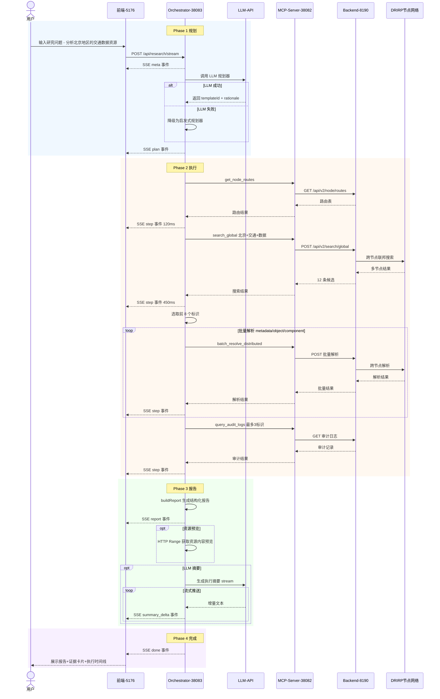

### 3.8 降级与容错策略

DeepResearch 在各层面实现了优雅降级：

| 场景             | 降级策略                                   |
| ---------------- | ------------------------------------------ |
| LLM 不可用       | 自动降级为启发式规划器，100% 可用          |
| 搜索无结果       | 发出 skipped 步骤事件，跳过后续批量解析    |
| 批量解析部分失败 | 保留已成功部分，报告中标注 partial_success |
| 单个工具超时     | 记录 error 状态，后续独立步骤继续执行      |
| 审计服务不可用   | 主体报告照常生成，审计区显示降级提示       |
| 资源预览获取失败 | 静默跳过，不影响报告主体                   |
| LLM 摘要生成失败 | 结构化报告已完整输出，摘要区显示提示       |
| MCP Server 断连  | 返回 error 事件，展示错误信息              |

### 3.9 DeepResearch API 接口

| 方法 | 路径                     | 功能                                   |
| ---- | ------------------------ | -------------------------------------- |
| GET  | `/health`              | 健康检查（规划模式、LLM 配置状态）     |
| GET  | `/api/llm/models`      | 列出可用 LLM 模型                      |
| POST | `/api/research/run`    | 同步执行研究（等待完成后返回完整结果） |
| POST | `/api/research/stream` | SSE 流式执行研究（实时推送进度）       |

### 3.10 LLM 集成设计

系统与大语言模型的集成采用 **OpenAI 兼容 API** 标准，可接入任何兼容端点：

```
┌─────────────────────────────────────────────────┐
│             LLM 集成点                           │
│                                                 │
│  1. 规划阶段：选择研究模板                        │
│     POST /chat/completions                      │
│     输入：用户问题 + 启发式上下文                  │
│     输出：JSON { templateId, rationale }         │
│     校验：Zod Schema 严格校验                    │
│                                                 │
│  2. 报告阶段：生成执行摘要                        │
│     POST /chat/completions (stream=true)         │
│     输入：研究计划 + 报告段落 + 证据卡片           │
│     输出：2-5 条事实性要点（SSE 流式推送）          │
│                                                 │
│  两个集成点均为可选，系统在无 LLM 时完全可用       │
│                                                 │
│  配置：                                          │
│    LLM_BASE_URL   = OpenAI 兼容端点             │
│    LLM_API_KEY    = API 密钥                    │
│    LLM_MODEL      = 模型 ID                     │
│    LLM_TIMEOUT_MS = 超时（默认 30s）             │
└─────────────────────────────────────────────────┘
```

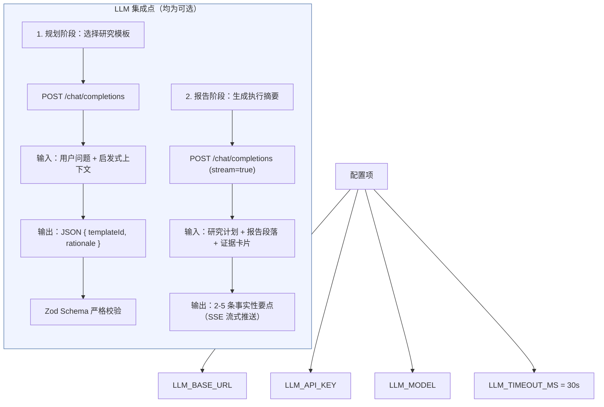

---

## 4. 关键技术决策总结

| 设计决策    | 选择                         | 理由                               |
| ----------- | ---------------------------- | ---------------------------------- |
| 标识编码    | 30 位定长 Base-34            | 人类可读、可校验、编码信息丰富     |
| 对象存储    | 腾讯云 COS 预签名直传        | 文件流不经服务器，降低带宽压力     |
| 跨节点协议  | DRIRP gRPC + HTTP 双通道     | gRPC 高性能，HTTP 兼容性强         |
| 跨节点认证  | HMAC-SHA256 + Nonce          | 无状态认证，防重放攻击             |
| AI 接入方式 | 外部 MCP Server 适配         | 不侵入核心后端，标准协议，可扩展   |
| 研究规划    | 启发式 + LLM 双模式          | 无 LLM 可用时 100% 降级可用        |
| 研究输出    | 结构化报告先行，LLM 摘要后补 | 先展示完整证据，再补充自然语言解读 |
| 前端交互    | SSE 流式事件 7 种类型        | 实时展示研究进度，渐进式呈现结果   |
| 前端模式    | Agent 模式 + Manual 模式     | 兼顾标准研究和开发调试需求         |
| 向量检索    | ANN LSH 128 维               | 轻量级语义搜索，无需外部向量数据库 |

---

## 5. 部署与端口规划

| 服务                      | 端口        | 角色          |
| ------------------------- | ----------- | ------------- |
| Enterprise Backend        | 8190        | 核心业务服务  |
| Auth Center               | 8290        | 认证中心      |
| MCP Server                | 38082       | AI 能力适配层 |
| DeepResearch Orchestrator | 38083       | 研究编排引擎  |
| DeepResearch Frontend     | 5176        | 研究工作台 UI |
| 多节点后端（6 节点）      | 8200-8205   | 分布式数联网  |
| 多节点 gRPC（6 节点）     | 19200-19205 | DRIRP 通道    |

---

## 6. DeepResearch 多智能体工作流设计

### 6.1 设计理念——有界域智能体

DeepResearch 采用 **Planner-Executor-Reporter 三阶段管线式多智能体架构**，而非自由对话式 Agent。核心设计理念是：

- **有界模板约束**：LLM 只能从 4 个预定义研究模板中选择，不能自由发明工具调用序列
- **确定性执行**：一旦模板选定，工具调用顺序完全确定，保证结果可复现
- **渐进式增强**：结构化报告先行，LLM 摘要后补，每一层可独立失败而不丢失核心数据
- **双通道冗余**：前端可通过 Orchestrator（完整管线）或直连 MCP Server（轻量管线）两条路径执行研究

```
┌────────────────────────────────────────────────────────────────┐
│                 DeepResearch 多智能体工作流                       │
│                                                                │
│  ┌─────────┐     ┌──────────┐     ┌──────────┐                │
│  │ Planner │────►│ Executor │────►│ Reporter │                │
│  │  Agent  │     │  Agent   │     │  Agent   │                │
│  └────┬────┘     └────┬─────┘     └────┬─────┘                │
│       │               │               │                       │
│  选择研究模板     顺序调用 MCP 工具   合并输出 → 报告            │
│  (LLM/启发式)    (搜索→解析→审计)    (段落+卡片+Markdown)       │
│       │               │               │                       │
│       │          ┌────┴────┐     ┌────┴────┐                  │
│       │          │ MCP     │     │ LLM     │                  │
│       │          │ Server  │     │ Summary │                  │
│       │          │ 9 Tools │     │ (可选)   │                  │
│       │          └─────────┘     └─────────┘                  │
│       │                                                       │
│       └── 自适应反馈：搜索结果 → 动态标识选择 → 影响下游解析     │
└────────────────────────────────────────────────────────────────┘
```

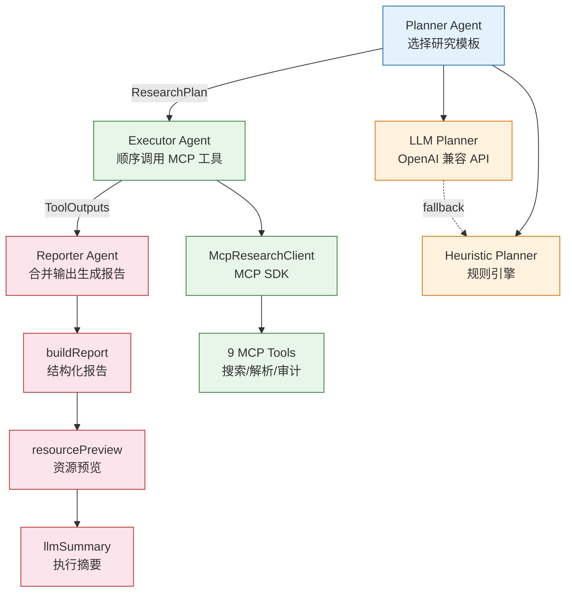

### 6.2 智能体角色定义

系统由五个功能性智能体角色组成，其中三个核心角色构成管线，两个增强角色提供可选能力：

| 角色                  | 职责                                     | 实现文件                                                            | LLM 依赖 |
| --------------------- | ---------------------------------------- | ------------------------------------------------------------------- | -------- |
| **Coordinator** | 总编排，串联所有阶段，管理生命周期       | `researchService.ts`                                              | 无       |
| **Planner**     | 分析用户意图，选择研究模板，生成执行计划 | `plannerService.ts` / `heuristicPlanner.ts` / `llmPlanner.ts` | 可选     |
| **Executor**    | 按计划顺序调用 MCP 工具，收集原始输出    | `runPlan.ts` / `mcpResearchClient.ts`                           | 无       |
| **Reporter**    | 合并工具输出，构建结构化报告             | `buildReport.ts`                                                  | 无       |
| **Enhancer**    | 资源内容预览 + LLM 执行摘要              | `resourcePreview.ts` / `llmSummary.ts`                          | 部分可选 |

```mermaid
flowchart TD
    COORD["Coordinator\nresearchService.ts\n总编排"]

    COORD -->|"1. createPlannedResearch()"| PLAN["Planner\n分析意图 + 选择模板"]
    COORD -->|"2. executeResearchPlan()"| EXEC["Executor\n顺序调用 MCP 工具"]
    COORD -->|"3. buildResearchReport()"| REPORT["Reporter\n合并输出 + 生成报告"]
    COORD -->|"4. 可选增强"| ENH["Enhancer\n资源预览 + LLM 摘要"]

    PLAN -->|ResearchPlan| COORD
    EXEC -->|ToolOutputs + Steps| COORD
    REPORT -->|ResearchReport| COORD
    ENH -->|"增强后的 Report"| COORD

    COORD -->|SSE 事件流| FE["前端\n实时展示"]

    style COORD fill:#1565c0,color:#fff
    style PLAN fill:#fff3e0,stroke:#ef6c00
    style EXEC fill:#e8f5e9,stroke:#2e7d32
    style REPORT fill:#fce4ec,stroke:#c62828
    style ENH fill:#f3e5f5,stroke:#7b1fa2
```

### 6.3 Coordinator——总编排智能体

Coordinator 是整个工作流的中枢，实现在 `researchService.ts` 的 `runResearchInternal()` 函数中。它负责：

1. **表单归一化**：将用户输入标准化为 `ResearchFormState`
2. **调度 Planner**：根据配置选择启发式或 LLM 规划
3. **管理 MCP 连接**：创建/销毁 `McpResearchClient` 生命周期
4. **调度 Executor**：传入计划和 MCP 客户端执行工具调用
5. **调度 Reporter**：合并工具输出生成结构化报告
6. **调度 Enhancer**：可选地收集资源预览和 LLM 摘要
7. **SSE 事件分发**：在每个阶段通过 `emitEvent()` 实时推送进度
8. **渐进式报告**：报告最多发送 3 次（初始 → 增加预览 → 增加摘要）

```typescript
// 简化的 Coordinator 编排逻辑
async function runResearchInternal(env, request, hooks) {
  // 1. 归一化
  const form = normalizeResearchForm(request);
  // 2. 规划
  const plan = await createPlannedResearch(env, form);
  emit("meta"); emit("plan");
  // 3. 执行
  const client = new McpResearchClient();
  await client.connect(form.mcpUrl);
  const executed = await executeResearchPlan(client, form, plan, {
    onStep: (step) => emit("step", step)   // 每步实时推送
  });
  // 4. 报告
  let report = buildResearchReport(form, plan, executed.outputs);
  emit("report", report);                  // 第 1 次报告
  // 5. 增强：资源预览
  if (env.RESOURCE_PREVIEW_ENABLED) {
    const previews = await collectResourcePreviews(env, executed.outputs);
    report = buildResearchReport(form, plan, executed.outputs, previews);
    emit("report", report);                // 第 2 次报告（含预览）
  }
  // 6. 增强：LLM 摘要
  if (env.LLM_SUMMARY_ENABLED && isLlmConfigured(env)) {
    const summary = await generateExecutiveSummaryStream(env, plan, report,
      (delta, acc) => emit("summary_delta", delta, acc)  // 流式推送
    );
    report = prependExecutiveSummary(report, summary);
    emit("report", report);                // 第 3 次报告（含摘要）
  }
  emit("done");
  await client.disconnect();
}
```

```mermaid
flowchart TD
    A["1. 表单归一化\nnormalizeResearchForm"] --> B["2. 创建研究计划\ncreatePlannedResearch"]
    B --> C["SSE: meta + plan 事件"]
    C --> D["3. 连接 MCP Server\nclient.connect"]
    D --> E["4. 执行研究计划\nexecuteResearchPlan\n每步 SSE: step 事件"]
    E --> F["5. 构建结构化报告\nbuildResearchReport"]
    F --> G["SSE: report 事件 v1"]
    G --> H{"资源预览\n已启用?"}
    H -->|是| I["6. collectResourcePreviews\n重建报告"]
    I --> J["SSE: report 事件 v2"]
    H -->|否| K{"LLM 摘要\n已启用?"}
    J --> K
    K -->|是| L["7. generateExecutiveSummaryStream\n流式 SSE: summary_delta"]
    L --> M["prependExecutiveSummary\n重建报告"]
    M --> N["SSE: report 事件 v3"]
    K -->|否| O["SSE: done 事件"]
    N --> O
    O --> P["8. 断开 MCP 连接\nclient.disconnect"]

    style H fill:#fff3cd,stroke:#ffc107
    style K fill:#fff3cd,stroke:#ffc107
```

### 6.4 自适应反馈——搜索驱动的动态标识选择

多智能体工作流中最关键的自适应机制是 **搜索结果驱动的动态标识选择**。这是 Executor Agent 内部的单点反馈回路：

```
用户输入（可能无标识）
      │
      ▼
Planner 生成执行计划，标记 searchEnabled = true
      │
      ▼
Executor: Step 1 → get_node_routes（获取拓扑）
      │
      ▼
Executor: Step 2 → search_global（全局搜索）
      │
      ▼
selectIdentifiers()                ◄── 自适应反馈点
  ├─ 合并 explicitIdentifiers（用户显式指定）
  ├─ 合并 searchItems 中提取的标识（搜索发现）
  └─ 去重 + 截断到 limit（最多 8 个）
      │
      ▼
focusedIdentifiers 决定下游所有解析和审计的目标
      │
      ├─ Step 3: batch_resolve_metadata(focusedIdentifiers)
      ├─ Step 4: batch_resolve_object(focusedIdentifiers)
      ├─ Step 5: batch_resolve_component(focusedIdentifiers)
      └─ Step 6-N: query_audit_logs(focusedIdentifiers[:3])
```

```mermaid
flowchart TD
    UI["用户输入\n问题 + 可选标识"] --> PLAN["Planner\nsearchEnabled = true"]
    PLAN --> S1["Step 1: get_node_routes"]
    S1 --> S2["Step 2: search_global"]
    S2 --> SEL["selectIdentifiers\n自适应反馈点"]

    EXP["explicitIdentifiers\n用户显式指定"] --> SEL
    SEARCH["searchItems\n搜索发现的标识"] --> SEL

    SEL --> FID["focusedIdentifiers\n合并 + 去重 + 截断"]
    FID --> S3["Step 3: batch_resolve_metadata"]
    FID --> S4["Step 4: batch_resolve_object"]
    FID --> S5["Step 5: batch_resolve_component"]
    FID --> S6["Step 6+: query_audit_logs\n每标识, 最多 3 个"]

    style SEL fill:#e8f5e9,stroke:#2e7d32,stroke-width:3px
    style FID fill:#fff3cd,stroke:#ffc107
```

这种设计使得用户即使不知道任何标识码，也能通过自然语言问题（如"分析北京地区的交通数据资源"）发起研究——系统会先搜索发现候选标识，然后自动对发现的标识进行深度解析。

### 6.5 双执行通道——Orchestrator 模式 vs Direct MCP 模式

系统支持两条执行通道，分别适用于不同场景：

```
┌─────────────────────────────────────────────────────────────────┐
│                      Agent 模式（推荐）                           │
│                                                                 │
│  前端 ──SSE──► Orchestrator ──MCP──► MCP Server ──REST──► 后端  │
│               │                                                 │
│               ├─ Planner Agent（LLM/启发式）                     │
│               ├─ Executor Agent（MCP 工具调用）                   │
│               ├─ Reporter Agent（结构化报告）                     │
│               └─ Enhancer Agent（预览 + LLM 摘要）               │
│                                                                 │
│  特点：完整研究管线，支持 LLM 规划和摘要，渐进式报告              │
├─────────────────────────────────────────────────────────────────┤
│                     Direct MCP 模式（手动）                       │
│                                                                 │
│  前端 ──MCP Streamable HTTP──► MCP Server ──REST──► 后端        │
│  │                                                              │
│  ├─ researchRunner.ts（浏览器内执行）                             │
│  ├─ 模板驱动的确定性工具调用                                      │
│  └─ 浏览器内构建报告（无 LLM 增强）                               │
│                                                                 │
│  特点：无需 Orchestrator，适合开发调试和轻量场景                   │
└─────────────────────────────────────────────────────────────────┘
```

```mermaid
flowchart TD
    FE["前端 Vue 3\nport 5176"]

    subgraph AgentMode["Agent 模式（推荐）"]
        AC["agentClient.ts\nSSE 客户端"]
        ORC["Orchestrator\nport 38083"]
        AC -->|SSE 流式事件| ORC
    end

    subgraph DirectMode["Direct MCP 模式（手动）"]
        RR["researchRunner.ts\n浏览器内执行"]
        MC["mcpClient.ts\nMCP SDK"]
        RR --> MC
    end

    FE -->|Agent 模式| AC
    FE -->|Manual 模式| RR

    ORC -->|MCP Streamable HTTP| MCP["MCP Server\nport 38082"]
    MC -->|MCP Streamable HTTP| MCP
    MCP -->|REST| BE["Enterprise Backend\nport 8190"]

    style AgentMode fill:#e3f2fd,stroke:#1565c0
    style DirectMode fill:#fff3e0,stroke:#ef6c00
```

两种模式的核心研究逻辑（模板选择 → 工具调用序列 → 报告生成）保持对称，`researchRunner.ts`（前端，620 行）与 `runPlan.ts` + `buildReport.ts`（Orchestrator）实现相同的模板驱动工具编排和报告构建逻辑。

### 6.6 LLM 在工作流中的有界角色

LLM 在整个多智能体工作流中仅参与两个严格约束的环节，且均可降级：

```mermaid
flowchart TD
    subgraph Touch1["LLM 触点 1：规划阶段"]
        Q["用户问题 + 启发式上下文"] --> PROMPT1["System Prompt\n领域规划器角色定义"]
        PROMPT1 --> CALL1["POST /chat/completions\n单次调用, 非流式"]
        CALL1 --> RESP1["JSON 响应"]
        RESP1 --> ZOD1{"Zod Schema\n严格校验"}
        ZOD1 -->|通过| USE1["使用 LLM 选择的模板"]
        ZOD1 -->|失败| FALL1["降级为启发式规划"]
    end

    subgraph Touch2["LLM 触点 2：摘要阶段"]
        EVIDENCE["结构化报告\n段落 + 证据卡片 + 步骤"] --> PROMPT2["System Prompt\n研究分析助手角色定义"]
        PROMPT2 --> CALL2["POST /chat/completions\nstream=true, 流式"]
        CALL2 --> RESP2["增量文本\nSSE summary_delta"]
        RESP2 --> PREPEND["前置到报告摘要段落"]
    end

    FALL1 -.->|"完全可用保障"| NOTE["系统在无 LLM 时\n使用启发式规划\n+ 纯结构化报告\n完全可用"]

    style Touch1 fill:#e3f2fd,stroke:#1565c0
    style Touch2 fill:#f3e5f5,stroke:#7b1fa2
    style NOTE fill:#e8f5e9,stroke:#2e7d32
    style ZOD1 fill:#fff3cd,stroke:#ffc107
```

**关键约束**：

- LLM **不能**自由调用工具——所有工具调用序列由模板确定
- LLM **不能**修改执行计划——执行流程硬编码在 `runPlan.ts` 中
- LLM **不能**迭代反思——规划和摘要均为单次调用（single-shot）
- LLM **不能**访问原始数据——仅接收结构化上下文作为输入

这种设计确保了：

1. **可预测性**：研究结果可复现，不因 LLM 随机性产生不同工具调用路径
2. **安全性**：LLM 永远不会执行破坏性操作
3. **可用性**：LLM 不可用时系统 100% 降级运行

### 6.8 渐进式报告增强机制

Reporter Agent 生成的报告经过最多三轮渐进式增强，每轮产生一个 SSE `report` 事件：

```
Round 1：基础结构化报告
  ├─ 合并所有工具原始输出 → ResourceLandscape
  ├─ 为每个标识构建 ResourceProfile（30+ 字段）
  ├─ 资源分类与排序（service/tool/data/locatable）
  ├─ 生成 SummarySection[]（研究目标→发现→全景→画像→证据→结论）
  ├─ 生成 EvidenceCard[]（每资源一卡 + 总览卡 + 审计卡，最多 16 张）
  └─ 组装 Markdown 报告
       │
       ▼  SSE: report 事件 v1

Round 2：资源内容预览增强（可选）
  ├─ 从工具输出中收集 HTTP 定位符
  ├─ 并发 HTTP Range 请求（前 4KB，并发度 2）
  ├─ 内容类型检测（CSV/JSON/HTML/XML/文本/二进制）
  ├─ 生成预览摘要，注入报告的"内容采样"段落
  └─ 重建完整报告
       │
       ▼  SSE: report 事件 v2

Round 3：LLM 执行摘要增强（可选）
  ├─ 将结构化报告、计划、步骤序列化为 JSON
  ├─ 发送到 LLM（System Prompt：研究分析助手）
  ├─ 流式接收 2-5 条事实性要点
  │    └─ 每个 token → SSE: summary_delta 事件
  ├─ 前置到报告的 summarySections[0]
  └─ 重建完整报告
       │
       ▼  SSE: report 事件 v3（最终版）
```

```mermaid
flowchart TD
    R1["Round 1: 基础结构化报告\nbuildResearchReport"]
    R1 -->|"SSE: report v1"| FE1["前端展示基础报告"]

    R2{"资源预览\n已启用?"}
    FE1 --> R2
    R2 -->|是| RP["Round 2: 资源内容预览\ncollectResourcePreviews"]
    RP -->|重建报告| R2_EMIT["SSE: report v2"]
    R2_EMIT --> R3

    R2 -->|否| R3{"LLM 摘要\n已启用?"}
    R3 -->|是| LS["Round 3: LLM 执行摘要\ngenerateExecutiveSummaryStream"]
    LS -->|"SSE: summary_delta x N"| STREAM["前端逐字显示摘要"]
    LS -->|重建报告| R3_EMIT["SSE: report v3 最终版"]

    R3 -->|否| DONE["SSE: done 事件"]
    R3_EMIT --> DONE

    style R1 fill:#e3f2fd,stroke:#1565c0
    style RP fill:#fff3e0,stroke:#ef6c00
    style LS fill:#f3e5f5,stroke:#7b1fa2
    style R2 fill:#fff3cd,stroke:#ffc107
    style R3 fill:#fff3cd,stroke:#ffc107
```

### 6.9 多智能体工作流设计小结

| 设计维度 | 选择                                    | 理由                           |
| -------- | --------------------------------------- | ------------------------------ |
| 架构模式 | 单 Coordinator + 有界域智能体管线       | 可预测、可审计、易调试         |
| LLM 角色 | 有界顾问（规划 + 摘要），非控制器       | 系统不依赖 LLM 可用性          |
| 执行模式 | 模板驱动确定性执行，无迭代反思          | 结果可复现，安全可控           |
| 反馈机制 | 搜索后单点自适应标识选择                | 支持零标识探索，又避免自由循环 |
| 报告策略 | 三轮渐进式增强（基础→预览→摘要）      | 每层独立失败不影响主体         |
| 双通道   | Orchestrator 模式 + Direct MCP 模式     | 兼顾完整研究和轻量调试         |
| MCP 边界 | 所有数据访问通过 MCP 工具，不直接调后端 | 工具层独立可测、可替换         |
