# 水利部技术架构文档：多模态数据管理与 DeepResearch 设计

## 1. 引言

DEIS（Data Infrastructure Identifier System）是一个面向数据基础设施的统一标识管理系统。本文档聚焦两个核心技术主题：

1. **多模态数据如何通过数联网进行存储与管理**——从标识编码、资源建模、对象存储到跨节点分布式解析的完整数据生命周期。
2. **DeepResearch 智能研究系统的设计与实现**——如何将传统数据管理能力升级为 AI 可驱动的研究平台。

## 2. 多模态数据在数联网中的存储与管理

### 2.1 数联网总体架构

数联网采用 **层级化多节点拓扑**，模拟国家→省→市→县四级体系，每个节点拥有独立的数据库、标识空间和服务端口，通过 DRIRP（Distributed Resource Identifier Resolution Protocol）协议互联：

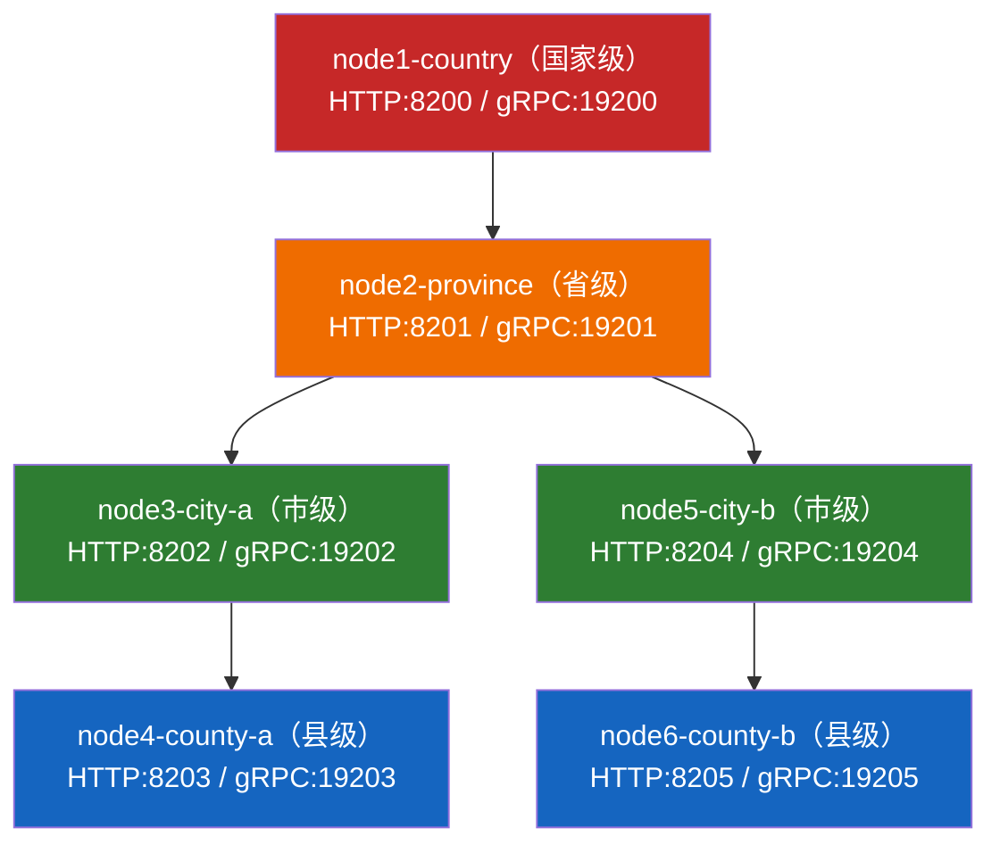

每个节点运行独立的 `dris-enterprise-backend-v2` 实例（Spring Boot 2.7 + MySQL），对外提供 REST API，对等节点间通过 gRPC 通道进行标识解析与路由转发。

### 2.2 统一标识编码——多模态数据的身份基础

系统为每一份数据资源分配一个 **30 位定长标识码**，这是多模态数据在数联网中被寻址、解析和管理的唯一身份：

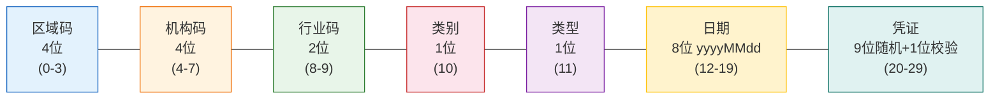


| 字段     | 长度  | 字符集             | 含义                                       |
| -------- | ----- | ------------------ | ------------------------------------------ |
| 区域码   | 4 位  | `[0-9]`          | 行政区划（如 `1100` 北京）               |
| 机构码   | 4 位  | `[A-HJ-NP-Z]`    | 注册机构（Base-34，排除 I/O）              |
| 行业码   | 2 位  | `[0-9]`          | 行业分类（01=能源, 02=交通, 03=卫生…）    |
| 数据类别 | 1 位  | `[1239]`         | 1=公共数据, 2=企业数据, 3=个人数据, 9=其他 |
| 注册类型 | 1 位  | `[123]`          | 1=数据资源, 2=数据资产, 3=数据产品/服务    |
| 日期     | 8 位  | `[0-9]`          | 注册日期（yyyyMMdd）                       |
| 凭证     | 10 位 | `[0-9A-HJ-NP-Z]` | 9 位随机值 + 1 位校验位                    |

**校验算法**（mod-34 加权校验）：对前 29 个字符逐位计算 `charToNumber(c) × (i+1)` 的加权和，取 `sum % 34` 映射回 Base-34 字母表，得到第 30 位校验位。该算法可检出常见的输入错误和位置互换错误。

**标识注册流程**：

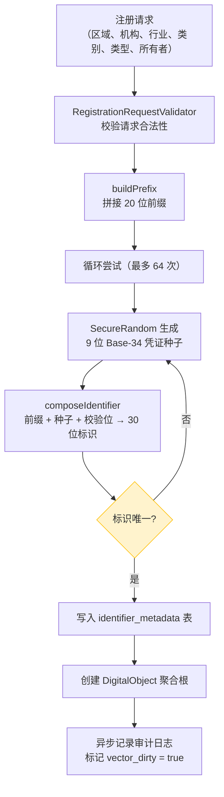

### 2.3 多模态数据的三层模型

系统将多模态数据建模为 **三层结构**，对应 DDD 领域驱动设计中的聚合根模式：

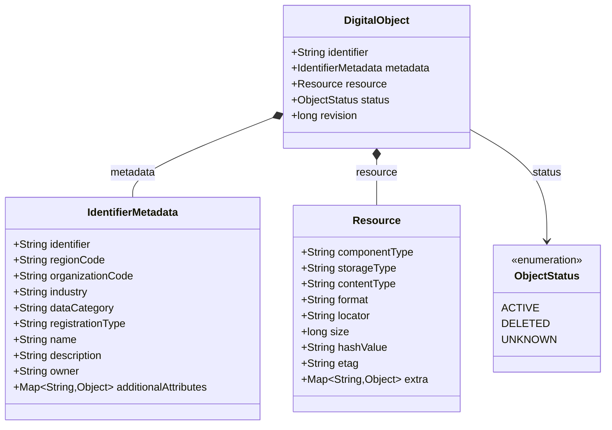

#### 2.3.1 元数据层（IdentifierMetadata）

元数据是数据的"描述信息"，存储在 MySQL `identifier_metadata` 表中：

| 字段                      | 类型           | 用途                                             |
| ------------------------- | -------------- | ------------------------------------------------ |
| `identifier`            | VARCHAR(30) PK | 30 位标识码，主键                                |
| `region_code`           | VARCHAR(4)     | 区域码                                           |
| `organization_code`     | VARCHAR(4)     | 机构码                                           |
| `industry`              | VARCHAR(128)   | 行业名称                                         |
| `data_category`         | VARCHAR(32)    | 数据类别（public/enterprise/individual/others）  |
| `registration_type`     | VARCHAR(32)    | 注册类型（resource/asset/product_service）       |
| `name`                  | VARCHAR(255)   | 数据资源名称                                     |
| `description`           | TEXT           | 描述                                             |
| `entity_type`           | VARCHAR(128)   | 实体类型                                         |
| `owner`                 | VARCHAR(100)   | 所有者                                           |
| `additional_attributes` | TEXT           | **可扩展 JSON 属性**（灵活承载任意元数据） |
| `vector_dirty`          | TINYINT(1)     | 向量索引脏标记                                   |
| `revision`              | BIGINT         | 乐观并发控制版本号                               |

**关键设计**：`additional_attributes` 字段采用 JSON 文本存储，使得系统可以在不修改表结构的情况下扩展任意自定义元数据，适配不同行业、不同类型数据的描述需求。

#### 2.3.2 资源层（Resource）——多模态数据的承载

资源层是多模态数据的实际"物理承载"描述，存储在 MySQL `resource` 表中：

| 字段               | 类型              | 用途                                                                                        |
| ------------------ | ----------------- | ------------------------------------------------------------------------------------------- |
| `identifier`     | VARCHAR(30) PK/FK | 关联的标识码                                                                                |
| `component_type` | VARCHAR(32)       | 组件类型：**resource**（数据资源）/ **tool**（工具）/ **service**（服务） |
| `storage_type`   | VARCHAR(64)       | 存储类型：**cos**（腾讯COS）/ **s3** / **local**                          |
| `content_type`   | VARCHAR(128)      | 语义内容类型：doc / dataset / image / table / file / tool / service                         |
| `format`         | VARCHAR(128)      | 文件格式：pdf / json / csv / parquet / xlsx / png / jpeg / zip 等                           |
| `locator`        | TEXT              | **资源定位符 URI**（如 `cos://bucket/key`）                                         |
| `size_bytes`     | BIGINT            | 文件大小                                                                                    |
| `hash_value`     | VARCHAR(255)      | 完整性哈希                                                                                  |
| `etag`           | VARCHAR(255)      | 对象存储 ETag                                                                               |
| `version_id`     | VARCHAR(255)      | 存储提供商的版本 ID                                                                         |
| `extra_json`     | TEXT              | 可扩展 JSON 属性                                                                            |

### 2.4 多模态数据类型注册表

系统通过 `UploadProfiles` 定义了完整的多模态数据类型支持矩阵：

| 配置名                   | 组件类型 | 内容类型 | 格式         | MIME 类型                  | 说明             |
| ------------------------ | -------- | -------- | ------------ | -------------------------- | ---------------- |
| `doc_pdf`              | resource | doc      | pdf          | application/pdf            | PDF 文档         |
| `doc_word`             | resource | doc      | docx         | application/vnd.openxml... | Word 文档        |
| `data_json`            | resource | dataset  | json         | application/json           | JSON 数据集      |
| `data_jsonl`           | resource | dataset  | jsonl        | application/x-ndjson       | JSONL 流式数据   |
| `data_csv`             | resource | dataset  | csv          | text/csv                   | CSV 表格数据     |
| `data_parquet`         | resource | dataset  | parquet      | application/octet-stream   | 列式存储数据     |
| `table_excel`          | resource | table    | xlsx         | application/vnd.openxml... | Excel 表格       |
| `image_png`            | resource | image    | png          | image/png                  | PNG 图片         |
| `image_jpeg`           | resource | image    | jpeg         | image/jpeg                 | JPEG 图片        |
| `image_webp`           | resource | image    | webp         | image/webp                 | WebP 图片        |
| `generic_file`         | resource | file     | bin          | application/octet-stream   | 通用二进制文件   |
| `tool_zip_cli`         | tool     | tool     | zip          | application/zip            | CLI 工具包       |
| `service_openapi_json` | service  | service  | openapi_json | application/json           | OpenAPI 服务描述 |
| `service_openapi_yaml` | service  | service  | openapi_yaml | application/yaml           | OpenAPI 服务描述 |

系统将多模态数据统一抽象为三类组件（`ComponentType`）：

- **resource**：静态数据资源（文档、数据集、图片、表格）
- **tool**：可执行工具（ZIP 打包的 CLI 工具）
- **service**：在线服务（以 OpenAPI 规范描述的 API 端点）

### 2.5 对象存储与上传机制

多模态数据的实际文件内容不存储在关系数据库中，而是存储在 **腾讯云对象存储（Tencent COS）** 中，通过预签名 URL 实现客户端直传：

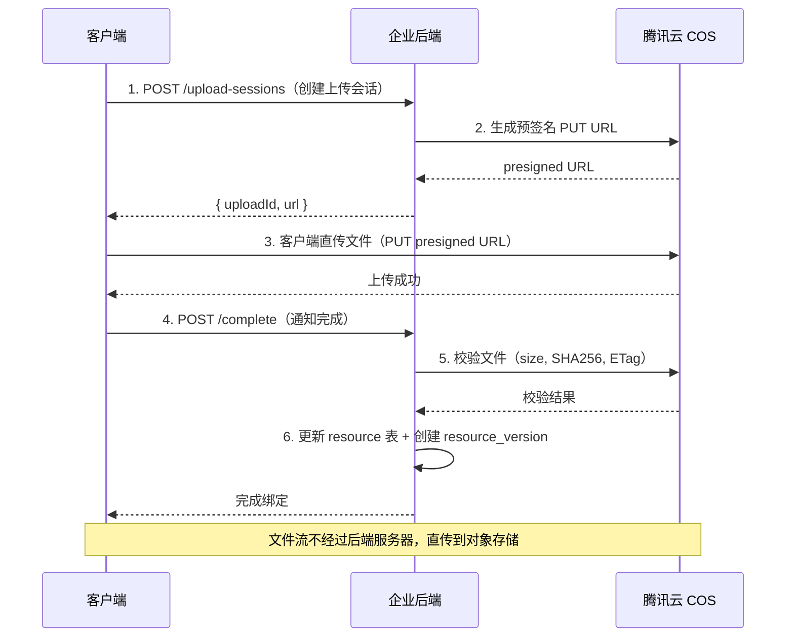

**关键设计点**：

- **客户端直传**：文件流不经过后端服务器，降低带宽压力，提升传输效率
- **预签名安全**：URL 仅在有效期内可用，且绑定了操作类型（PUT）
- **完整性校验**：上传完成后后端通过 COS API 验证文件大小、SHA256 哈希和 ETag
- **版本管理**：每次资源更新都在 `resource_version` 表创建新记录，版本号单调递增

**资源定位符格式**：

- COS 存储：`cos://bucket-name/object-key`
- 本地存储：`local://bucket-name/object-key`
- S3 兼容存储：`s3://bucket-name/object-key`

### 2.6 分布式解析——跨节点数据寻址

当数据分布在不同节点时，系统通过 **DRIRP 协议** 实现跨节点解析：

#### 2.6.1 协议设计

DRIRP 使用统一消息信封（Protobuf 序列化），支持 HTTP 和 gRPC 双传输通道：

```protobuf
message DrirpMessage {
  int32  code             = 1;   // 操作码：RESOLVE=10, QUERY=20, REGISTER=30 ...
  string rid              = 2;   // 请求标识
  string body             = 4;   // JSON 载荷
  int64  ts               = 5;   // 时间戳（毫秒）
  string auth             = 6;   // HMAC-SHA256 签名
  string traceId          = 12;  // 链路追踪 ID
  string nonce            = 13;  // 防重放随机数
  string idempotencyKey   = 14;  // 幂等键
}
```

#### 2.6.2 解析流程

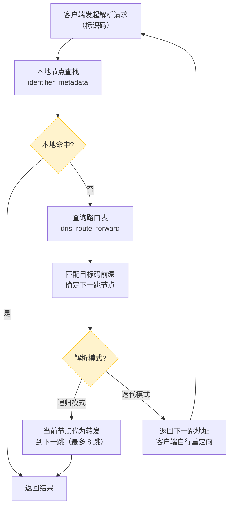

#### 2.6.3 安全与可靠性保障

| 机制         | 实现方式                                                                              |
| ------------ | ------------------------------------------------------------------------------------- |
| 认证         | HMAC-SHA256 签名（对 `code\|rid\|ts\|version\|traceId\|nonce\|idempotencyKey\|body` 计算） |
| 防重放       | 时间戳偏差检查（±5 分钟） + Nonce 唯一性缓存                                         |
| 幂等重试     | 基于 `idempotencyKey` 的服务端结果缓存                                              |
| 指数退避重试 | 初始 100ms，最大 2s，抖动比 0.2，最多 3 次                                            |
| 熔断器       | 三态（CLOSED → OPEN → HALF_OPEN），5 次连续失败触发，30s 冷却                       |
| 限流器       | 令牌桶算法，可配置 QPS 和突发容量                                                     |
| 环路检测     | 维护已访问 URL 集合，防止路由环路                                                     |
| 跳数限制     | 最多 8 跳，超出返回超时                                                               |

### 2.7 语义搜索与向量索引

系统在关系数据库之上构建了向量检索能力，支持对多模态数据的语义搜索：

- **嵌入生成**：Hash-based 本地嵌入，128 维向量
- **索引算法**：ANN LSH（近似最近邻 - 局部敏感哈希）
- **同步机制**：`VectorIndexAutoSyncScheduler` 定时扫描 `vector_dirty` 标记，增量同步
- **搜索模式**：

| 模式     | 说明                                    |
| -------- | --------------------------------------- |
| KEYWORD  | 纯关键词匹配 + 同义词扩展               |
| SEMANTIC | 向量近邻搜索                            |
| HYBRID   | 混合搜索（关键词 + 语义，加权融合评分） |

- **搜索保护**：结果缓存（30s TTL）、QPS 限流（100 QPS）、熔断器

### 2.8 数据全生命周期审计

每份多模态数据的全生命周期操作都被审计记录：

| 审计表                 | 记录内容                                               |
| ---------------------- | ------------------------------------------------------ |
| `identifier_history` | 标识级操作记录：操作类型、操作人、角色、是否成功、消息 |
| `api_audit_log`      | API 请求级记录：链路 ID、HTTP 方法、路径、状态码、耗时 |

审计采用异步线程池写入，不阻塞业务主线程。

### 2.9 多模态数据管理小结

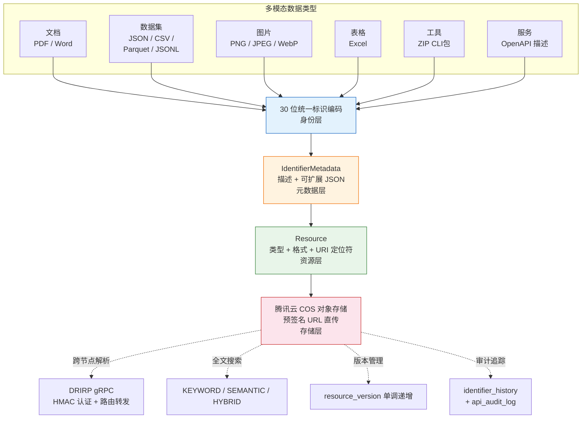

## 3. DeepResearch 多智能体工作流设计

### 3.1 设计理念——有界域智能体

DeepResearch 采用 **Planner-Executor-Reporter 三阶段管线式多智能体架构**，而非自由对话式 Agent。核心设计理念是：

- **有界模板约束**：LLM 只能从 4 个预定义研究模板中选择，不能自由发明工具调用序列
- **确定性执行**：一旦模板选定，工具调用顺序完全确定，保证结果可复现
- **渐进式增强**：结构化报告先行，LLM 摘要后补，每一层可独立失败而不丢失核心数据
- **双通道冗余**：前端可通过 Orchestrator（完整管线）或直连 MCP Server（轻量管线）两条路径执行研究


```
┌────────────────────────────────────────────────────────────────┐
│                 DeepResearch 多智能体工作流                       │
│                                                                │
│  ┌─────────┐     ┌──────────┐     ┌──────────┐                │
│  │ Planner │────►│ Executor │────►│ Reporter │                │
│  │  Agent  │     │  Agent   │     │  Agent   │                │
│  └────┬────┘     └────┬─────┘     └────┬─────┘                │
│       │               │               │                       │
│  选择研究模板     顺序调用 MCP 工具   合并输出 → 报告            │
│  (LLM/启发式)    (搜索→解析→审计)    (段落+卡片+Markdown)       │
│       │               │               │                       │
│       │          ┌────┴────┐     ┌────┴────┐                  │
│       │          │ MCP     │     │ LLM     │                  │
│       │          │ Server  │     │ Summary │                  │
│       │          │ 9 Tools │     │ (可选)   │                  │
│       │          └─────────┘     └─────────┘                  │
│       │                                                       │
│       └── 自适应反馈：搜索结果 → 动态标识选择 → 影响下游解析     │
└────────────────────────────────────────────────────────────────┘
```

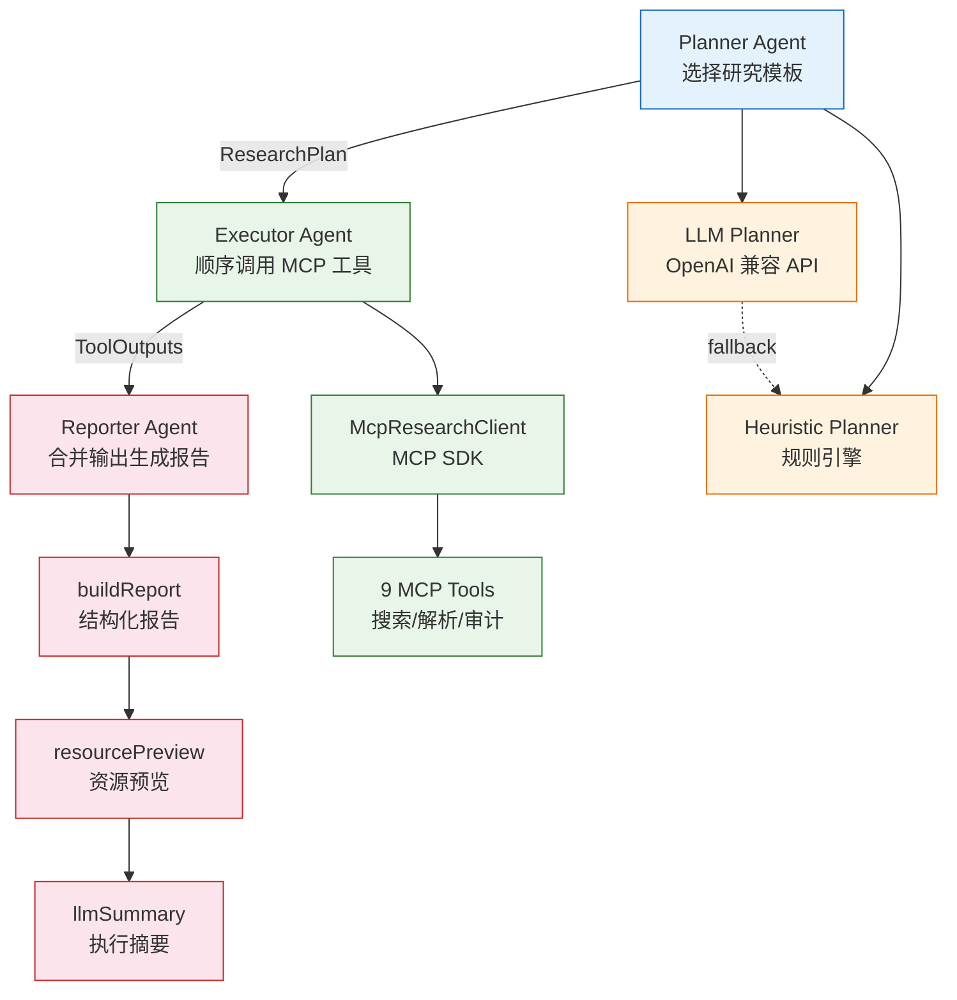

### 3.2 智能体角色定义

系统由五个功能性智能体角色组成，其中三个核心角色构成管线，两个增强角色提供可选能力：

| 角色                  | 职责                                     | 实现文件                                                            | LLM 依赖 |
| --------------------- | ---------------------------------------- | ------------------------------------------------------------------- | -------- |
| **Coordinator** | 总编排，串联所有阶段，管理生命周期       | `researchService.ts`                                              | 无       |
| **Planner**     | 分析用户意图，选择研究模板，生成执行计划 | `plannerService.ts` / `heuristicPlanner.ts` / `llmPlanner.ts` | 可选     |
| **Executor**    | 按计划顺序调用 MCP 工具，收集原始输出    | `runPlan.ts` / `mcpResearchClient.ts`                           | 无       |
| **Reporter**    | 合并工具输出，构建结构化报告             | `buildReport.ts`                                                  | 无       |
| **Enhancer**    | 资源内容预览 + LLM 执行摘要              | `resourcePreview.ts` / `llmSummary.ts`                          | 部分可选 |

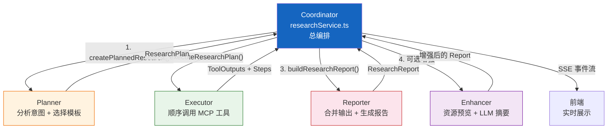

### 3.3 Coordinator——总编排智能体

Coordinator 是整个工作流的中枢，实现在 `researchService.ts` 的 `runResearchInternal()` 函数中。它负责：

1. **表单归一化**：将用户输入标准化为 `ResearchFormState`
2. **调度 Planner**：根据配置选择启发式或 LLM 规划
3. **管理 MCP 连接**：创建/销毁 `McpResearchClient` 生命周期
4. **调度 Executor**：传入计划和 MCP 客户端执行工具调用
5. **调度 Reporter**：合并工具输出生成结构化报告
6. **调度 Enhancer**：可选地收集资源预览和 LLM 摘要
7. **SSE 事件分发**：在每个阶段通过 `emitEvent()` 实时推送进度
8. **渐进式报告**：报告最多发送 3 次（初始 → 增加预览 → 增加摘要）

```typescript
// 简化的 Coordinator 编排逻辑
async function runResearchInternal(env, request, hooks) {
  // 1. 归一化
  const form = normalizeResearchForm(request);
  // 2. 规划
  const plan = await createPlannedResearch(env, form);
  emit("meta"); emit("plan");
  // 3. 执行
  const client = new McpResearchClient();
  await client.connect(form.mcpUrl);
  const executed = await executeResearchPlan(client, form, plan, {
    onStep: (step) => emit("step", step)   // 每步实时推送
  });
  // 4. 报告
  let report = buildResearchReport(form, plan, executed.outputs);
  emit("report", report);                  // 第 1 次报告
  // 5. 增强：资源预览
  if (env.RESOURCE_PREVIEW_ENABLED) {
    const previews = await collectResourcePreviews(env, executed.outputs);
    report = buildResearchReport(form, plan, executed.outputs, previews);
    emit("report", report);                // 第 2 次报告（含预览）
  }
  // 6. 增强：LLM 摘要
  if (env.LLM_SUMMARY_ENABLED && isLlmConfigured(env)) {
    const summary = await generateExecutiveSummaryStream(env, plan, report,
      (delta, acc) => emit("summary_delta", delta, acc)  // 流式推送
    );
    report = prependExecutiveSummary(report, summary);
    emit("report", report);                // 第 3 次报告（含摘要）
  }
  emit("done");
  await client.disconnect();
}
```


### 3.4 自适应反馈——搜索驱动的动态标识选择

多智能体工作流中最关键的自适应机制是 **搜索结果驱动的动态标识选择**。这是 Executor Agent 内部的单点反馈回路：

```
用户输入（可能无标识）
      │
      ▼
Planner 生成执行计划，标记 searchEnabled = true
      │
      ▼
Executor: Step 1 → get_node_routes（获取拓扑）
      │
      ▼
Executor: Step 2 → search_global（全局搜索）
      │
      ▼
selectIdentifiers()                ◄── 自适应反馈点
  ├─ 合并 explicitIdentifiers（用户显式指定）
  ├─ 合并 searchItems 中提取的标识（搜索发现）
  └─ 去重 + 截断到 limit（最多 8 个）
      │
      ▼
focusedIdentifiers 决定下游所有解析和审计的目标
      │
      ├─ Step 3: batch_resolve_metadata(focusedIdentifiers)
      ├─ Step 4: batch_resolve_object(focusedIdentifiers)
      ├─ Step 5: batch_resolve_component(focusedIdentifiers)
      └─ Step 6-N: query_audit_logs(focusedIdentifiers[:3])
```

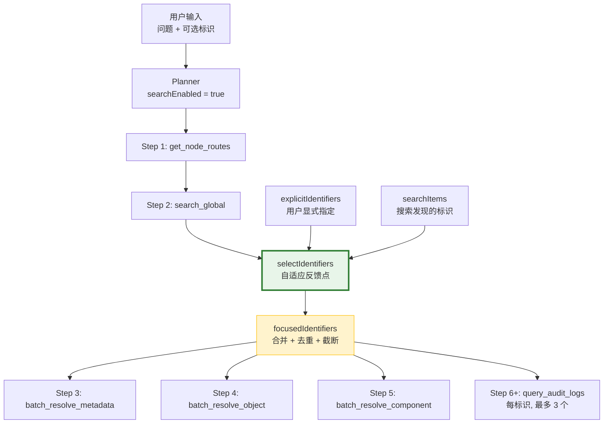

这种设计使得用户即使不知道任何标识码，也能通过自然语言问题（如"分析北京地区的交通数据资源"）发起研究——系统会先搜索发现候选标识，然后自动对发现的标识进行深度解析。

### 3.5 双执行通道——Orchestrator 模式 vs Direct MCP 模式

系统支持两条执行通道，分别适用于不同场景Direct MCP 模式（手动）

两种模式的核心研究逻辑（模板选择 → 工具调用序列 → 报告生成）保持对称，`researchRunner.ts`（前端，620 行）与 `runPlan.ts` + `buildReport.ts`（Orchestrator）实现相同的模板驱动工具编排和报告构建逻辑。

### 3.6 LLM 在工作流中的有界角色

LLM 在整个多智能体工作流中仅参与两个严格约束的环节，且均可降级：

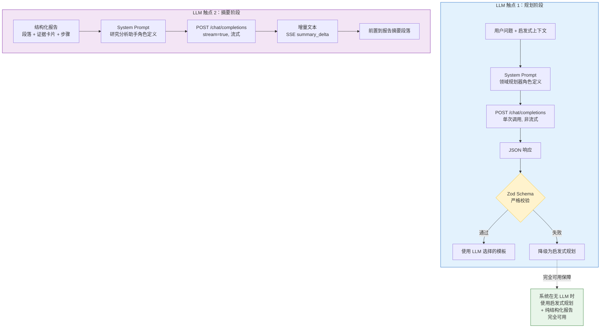

**关键约束**：

- LLM **不能**自由调用工具——所有工具调用序列由模板确定
- LLM **不能**修改执行计划——执行流程硬编码在 `runPlan.ts` 中
- LLM **不能**迭代反思——规划和摘要均为单次调用（single-shot）
- LLM **不能**访问原始数据——仅接收结构化上下文作为输入

这种设计确保了：

1. **可预测性**：研究结果可复现，不因 LLM 随机性产生不同工具调用路径
2. **安全性**：LLM 永远不会执行破坏性操作
3. **可用性**：LLM 不可用时系统 100% 降级运行

### 3.8 渐进式报告增强机制

Reporter Agent 生成的报告经过最多三轮渐进式增强，每轮产生一个 SSE `report` 事件：

```
Round 1：基础结构化报告
  ├─ 合并所有工具原始输出 → ResourceLandscape
  ├─ 为每个标识构建 ResourceProfile（30+ 字段）
  ├─ 资源分类与排序（service/tool/data/locatable）
  ├─ 生成 SummarySection[]（研究目标→发现→全景→画像→证据→结论）
  ├─ 生成 EvidenceCard[]（每资源一卡 + 总览卡 + 审计卡，最多 16 张）
  └─ 组装 Markdown 报告
       │
       ▼  SSE: report 事件 v1

Round 2：资源内容预览增强（可选）
  ├─ 从工具输出中收集 HTTP 定位符
  ├─ 并发 HTTP Range 请求（前 4KB，并发度 2）
  ├─ 内容类型检测（CSV/JSON/HTML/XML/文本/二进制）
  ├─ 生成预览摘要，注入报告的"内容采样"段落
  └─ 重建完整报告
       │
       ▼  SSE: report 事件 v2

Round 3：LLM 执行摘要增强（可选）
  ├─ 将结构化报告、计划、步骤序列化为 JSON
  ├─ 发送到 LLM（System Prompt：研究分析助手）
  ├─ 流式接收 2-5 条事实性要点
  │    └─ 每个 token → SSE: summary_delta 事件
  ├─ 前置到报告的 summarySections[0]
  └─ 重建完整报告
       │
       ▼  SSE: report 事件 v3（最终版）
```

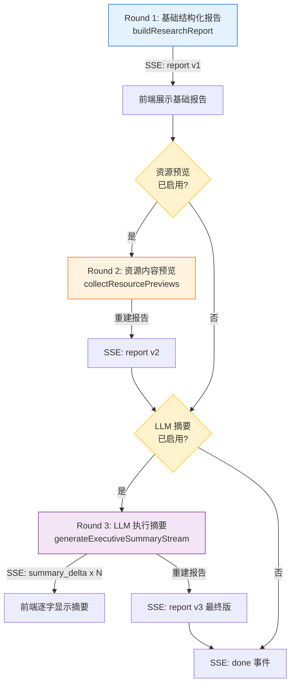

<style>#mermaid-1774243131147{font-family:sans-serif;font-size:16px;fill:#333;}#mermaid-1774243131147 .error-icon{fill:#552222;}#mermaid-1774243131147 .error-text{fill:#552222;stroke:#552222;}#mermaid-1774243131147 .edge-thickness-normal{stroke-width:2px;}#mermaid-1774243131147 .edge-thickness-thick{stroke-width:3.5px;}#mermaid-1774243131147 .edge-pattern-solid{stroke-dasharray:0;}#mermaid-1774243131147 .edge-pattern-dashed{stroke-dasharray:3;}#mermaid-1774243131147 .edge-pattern-dotted{stroke-dasharray:2;}#mermaid-1774243131147 .marker{fill:#333333;}#mermaid-1774243131147 .marker.cross{stroke:#333333;}#mermaid-1774243131147 svg{font-family:sans-serif;font-size:16px;}#mermaid-1774243131147 .actor{stroke:hsl(259.6261682243,59.7765363128%,87.9019607843%);fill:#ECECFF;}#mermaid-1774243131147 text.actor > tspan{fill:black;stroke:none;}#mermaid-1774243131147 .actor-line{stroke:grey;}#mermaid-1774243131147 .messageLine0{stroke-width:1.5;stroke-dasharray:none;stroke:#333;}#mermaid-1774243131147 .messageLine1{stroke-width:1.5;stroke-dasharray:2,2;stroke:#333;}#mermaid-1774243131147 #arrowhead path{fill:#333;stroke:#333;}#mermaid-1774243131147 .sequenceNumber{fill:white;}#mermaid-1774243131147 #sequencenumber{fill:#333;}#mermaid-1774243131147 #crosshead path{fill:#333;stroke:#333;}#mermaid-1774243131147 .messageText{fill:#333;stroke:#333;}#mermaid-1774243131147 .labelBox{stroke:hsl(259.6261682243,59.7765363128%,87.9019607843%);fill:#ECECFF;}#mermaid-1774243131147 .labelText,#mermaid-1774243131147 .labelText > tspan{fill:black;stroke:none;}#mermaid-1774243131147 .loopText,#mermaid-1774243131147 .loopText > tspan{fill:black;stroke:none;}#mermaid-1774243131147 .loopLine{stroke-width:2px;stroke-dasharray:2,2;stroke:hsl(259.6261682243,59.7765363128%,87.9019607843%);fill:hsl(259.6261682243,59.7765363128%,87.9019607843%);}#mermaid-1774243131147 .note{stroke:#aaaa33;fill:#fff5ad;}#mermaid-1774243131147 .noteText,#mermaid-1774243131147 .noteText > tspan{fill:black;stroke:none;}#mermaid-1774243131147 .activation0{fill:#f4f4f4;stroke:#666;}#mermaid-1774243131147 .activation1{fill:#f4f4f4;stroke:#666;}#mermaid-1774243131147 .activation2{fill:#f4f4f4;stroke:#666;}#mermaid-1774243131147:root{--mermaid-font-family:sans-serif;}#mermaid-1774243131147:root{--mermaid-alt-font-family:sans-serif;}#mermaid-1774243131147 sequence{fill:apa;}</style>

<style>#mermaid-1774243131158{font-family:sans-serif;font-size:16px;fill:#333;}#mermaid-1774243131158 .error-icon{fill:#552222;}#mermaid-1774243131158 .error-text{fill:#552222;stroke:#552222;}#mermaid-1774243131158 .edge-thickness-normal{stroke-width:2px;}#mermaid-1774243131158 .edge-thickness-thick{stroke-width:3.5px;}#mermaid-1774243131158 .edge-pattern-solid{stroke-dasharray:0;}#mermaid-1774243131158 .edge-pattern-dashed{stroke-dasharray:3;}#mermaid-1774243131158 .edge-pattern-dotted{stroke-dasharray:2;}#mermaid-1774243131158 .marker{fill:#333333;}#mermaid-1774243131158 .marker.cross{stroke:#333333;}#mermaid-1774243131158 svg{font-family:sans-serif;font-size:16px;}#mermaid-1774243131158 .label{font-family:sans-serif;color:#333;}#mermaid-1774243131158 .label text{fill:#333;}#mermaid-1774243131158 .node rect,#mermaid-1774243131158 .node circle,#mermaid-1774243131158 .node ellipse,#mermaid-1774243131158 .node polygon,#mermaid-1774243131158 .node path{fill:#ECECFF;stroke:#9370DB;stroke-width:1px;}#mermaid-1774243131158 .node .label{text-align:center;}#mermaid-1774243131158 .node.clickable{cursor:pointer;}#mermaid-1774243131158 .arrowheadPath{fill:#333333;}#mermaid-1774243131158 .edgePath .path{stroke:#333333;stroke-width:1.5px;}#mermaid-1774243131158 .flowchart-link{stroke:#333333;fill:none;}#mermaid-1774243131158 .edgeLabel{background-color:#e8e8e8;text-align:center;}#mermaid-1774243131158 .edgeLabel rect{opacity:0.5;background-color:#e8e8e8;fill:#e8e8e8;}#mermaid-1774243131158 .cluster rect{fill:#ffffde;stroke:#aaaa33;stroke-width:1px;}#mermaid-1774243131158 .cluster text{fill:#333;}#mermaid-1774243131158 div.mermaidTooltip{position:absolute;text-align:center;max-width:200px;padding:2px;font-family:sans-serif;font-size:12px;background:hsl(80,100%,96.2745098039%);border:1px solid #aaaa33;border-radius:2px;pointer-events:none;z-index:100;}#mermaid-1774243131158:root{--mermaid-font-family:sans-serif;}#mermaid-1774243131158:root{--mermaid-alt-font-family:sans-serif;}#mermaid-1774243131158 flowchart-v2{fill:apa;}</style>
