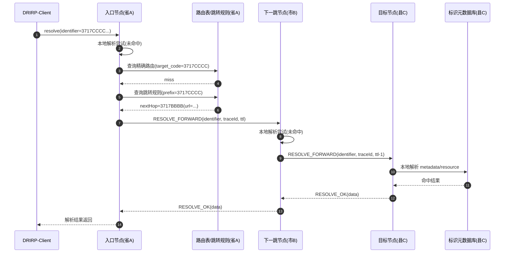
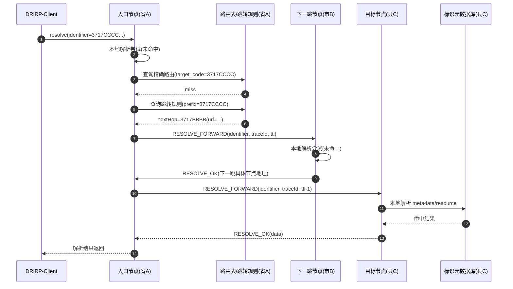
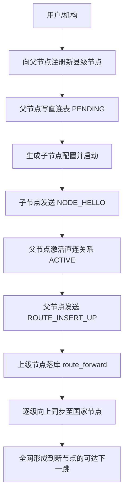

# 跨节点分布解析步骤设计（基于多层级节点架构）

## 1. 背景与目标

本文档基于当前多层级节点架构（国家/省/市/县，编码 = `regionCode + orgCode`），给出跨节点分布式解析（Resolve）的步骤设计与交互流程图。

目标：

- 本地优先：先走本地解析，命中即返回。
- 跨节点可达：本地未命中时，按路由/跳转能力找到下一跳并递归解析。
- 路由可演进：新增下级节点后，逐级同步可达路由，减少跨层回源。
- 可观测：每次跨节点调用具备 `traceId/rid`，便于链路追踪。

---

## 2. 当前实现现状（代码侧）

当前后端已经具备：

- 节点注册：`/api/v2/node/register`
- 启动握手：子节点启动后发送 `NODE_HELLO`
- 路由上报：激活后向父节点发送 `ROUTE_INSERT_UP`
- 路由存储：`dris_route_forward`
- 直连关系存储：`dris_direct_descendant`

当前尚未完成：

- 统一的跨节点 `resolve` 主流程（`DrirpResolutionService` 仍为占位）

因此本文档重点是“跨节点分布解析步骤设计”，用于下一阶段实现。

---

## 3. 关键数据结构设计

### 3.1 路由表（已存在）

表：`dris_route_forward`

核心字段：

- `target_code`：目标节点编码（`region+org`）
- `next_hop_code`：下一跳节点编码
- `next_hop_drirp_url`：下一跳 DRIRP 地址
- `hop_count`：到目标的跳数
- `route_version`：版本号

作用：用于“已知目标编码”的精确下一跳转发。

### 3.2 直连表（已存在）

表：`dris_direct_descendant`

核心字段：

- `child_code`
- `child_drirp_url`
- `relation_status`（`PENDING/ACTIVE`）
- `health_status`

作用：用于管理父子关系、握手激活状态及直连可达性。

### 3.3 跳转能力（逻辑层）

图中“跳转表”可作为逻辑能力实现，不一定必须新增物理表。

建议优先级：

1. 先查 `route_forward` 精确匹配（`target_code`）。
2. 未命中时查“前缀跳转规则”（可由路由聚合得到，或后续新增表维护）。
3. 仍未命中则向上游执行路由查询（Route Query Up）。

---

## 4. 跨节点分布解析主流程（建议）

### Step A：入口与本地优先

1. 客户端向当前节点发起 `resolve(identifier)`。
2. 当前节点解析标识中的目标编码（通常为 `regionCode + orgCode`）。
3. 若目标编码属于本节点：本地数据库解析并返回。

### Step B：下一跳选择

4. 本地非目标节点时，先查 `dris_route_forward` 精确路由。
5. 若无精确路由，尝试跳转规则（前缀跳转）。
6. 若仍未命中，向父节点发起“路由查询上行”。
7. 获得下一跳后，写入/更新本地路由缓存（含版本与过期策略）。

### Step C：跨节点转发解析

8. 使用 DRIRP 发起 `RESOLVE_FORWARD` 到下一跳，携带：
   - `identifier`
   - `traceId/rid`
   - `visitedNodes`（防环）
   - `ttl`（防无限转发）
9. 下一跳重复 Step A/B，直到命中目标节点。
10. 目标节点完成本地解析后，沿调用链回传结果。

### Step D：失败处理

11. 失败场景：
   - 路由缺失
   - 节点不可达
   - 超时/重试耗尽
   - 循环检测/TTL 耗尽
12. 返回统一错误码并附链路信息（`traceId`, `lastHop`, `errorCode`）。

---

## 5. 新增下级节点时的路由收敛流程

1. 父节点受理子节点注册（写入直连表 `PENDING`）。
2. 子节点启动并发送 `NODE_HELLO`，父节点激活为 `ACTIVE`。
3. 父节点向上发送 `ROUTE_INSERT_UP`（目标=子节点编码，下一跳=父节点自己）。
4. 上级节点落库并继续向上同步，直到国家级节点。
5. 全链路节点逐步具备到该新子节点的可达路由。

---

## 6. 交互图（时序图）

---
## 7. 交互图（时序图）

---
## 7. 交互图（新增节点与路由同步）

---

## 8. 实施建议（下一步）

建议在 `DrirpResolutionService` 中按以下顺序落地：

1. 本地解析 + 路由精确命中转发。
2. 加入 `traceId/rid/ttl/visitedNodes`，完成防环。
3. 加入路由上行查询（当本地路由缺失）。
4. 再补跳转规则（前缀聚合）与路由缓存失效策略。
5. 补充集成测试：3 节点、7 节点、路由缺失/节点故障/超时重试。

---

## 9. 双模式并存实现（用于对比实验）

你提出的两种模式都可以实现，建议统一落在 `DrirpResolutionService` 策略层：

- `RECURSIVE`：节点级递归转发（我之前的方案）
- `ITERATIVE`：入口节点迭代跳转（你补充的方案）

建议新增配置项：

- `dris.v2.resolve.mode = recursive | iterative`
- `dris.v2.resolve.max-hops`（默认 8 或 16）
- `dris.v2.resolve.timeout-ms`

### 9.1 模式一：递归转发（Node Forward）

流程：

1. 入口节点收到 `resolve`。
2. 若本地非目标，节点自己查路由并转发到下一跳。
3. 中间节点继续转发，直到目标节点命中。
4. 结果逐层回传。

优点：

- 客户端简单。
- 入口节点压力小（一次出站请求后等待回包）。

缺点：

- 中间节点参与全链路，调用链更长。
- 故障定位依赖每跳日志。

### 9.2 模式二：入口迭代（Gateway Iterate）

流程：

1. 入口节点发起 `resolve` 到当前候选节点。
2. 若收到 `nextHopUrl`（或 `delegateUrl`）则入口节点继续下一跳请求。
3. 直到某节点返回命中数据。

优点：

- 控制平面集中在入口，实验观测更容易（总跳数、每跳耗时）。
- 中间节点只做“建议下一跳”，职责更单一。

缺点：

- 入口节点压力和复杂度更高。
- 若入口与目标距离远，入口网络往返更多。

### 9.3 推荐代码结构

- `ResolveStrategy`（接口）
- `RecursiveResolveStrategy`（递归）
- `IterativeResolveStrategy`（迭代）
- `DrirpResolutionService` 根据配置选择策略

统一响应增加实验字段：

- `mode`
- `hopCount`
- `routeTrace`（节点编码列表）
- `elapsedMs`

---

## 10. drirp-java-sdk 是否需要微改

结论：可以先不改协议，先落地两种模式；但为实验体验建议做 3 个小改动。

当前 SDK 能力现状：

- `DrirpClientImpl`：普通请求（适配递归模式）
- `DrirpRouterClientImpl`：已支持“根据响应中的 `nextUrl/delegateUrl` 自动迭代跳转”
- 已支持 `traceId/rid/retry/maxHops`

建议微改项（低风险）：

1. 扩展 `DrirpRouterClientImpl` 默认跳转字段：
   - 增加 `nextHopDrirpUrl`、`next_hop_drirp_url`
2. 增加循环检测：
   - 维护 `visitedUrl` 集合，若重复访问直接报错，不只依赖 `maxHops`
3. Builder 支持 Router 模式：
   - 在 `DrirpClientBuilder` 增加 `buildRouter()/buildRouterAndConnect()`

这样你就能用同一套构建方式切换：

- 递归实验：`DrirpClientImpl`
- 迭代实验：`DrirpRouterClientImpl`

---

## 11. 对比实验设计建议（毕设可直接用）

固定同一套 7 节点拓扑，分别跑两种模式，比较以下指标：

1. 端到端平均延迟（P50/P95/P99）
2. 请求成功率与超时率
3. 单次解析跨节点跳数
4. 入口节点 CPU/线程占用
5. 跨节点请求总次数（网络开销）
6. 路由未命中恢复耗时（冷启动）

建议测试场景：

- 正常路由命中
- 路由缺失后上行学习
- 中间节点故障
- 环路/错误路由（验证防环）
- 高并发压力（如 100/300/500 并发）

