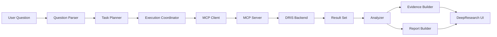

# DeepResearch 功能清单与模块设计（2026-03-08）

## 1. 文档目标

本文档说明 `DeepResearch` 在本系统中的功能定位、功能边界、模块划分、数据流转和阶段性建设内容。

面向对象：

- 毕设论文写作
- 页面功能规划
- 前后端开发实施
- 答辩展示准备

## 2. 产品定位

`DeepResearch` 不是普通后台页面，也不是单一聊天框，而是：

`面向数字对象研究任务的智能工作台`

它负责把用户的研究问题，转化为对 DRIS 系统与 MCP 工具链的有序调用，并将结果加工为：

- 可阅读结论
- 可追溯证据
- 可展示的执行过程
- 可对比的对象与资源信息

## 3. 核心价值

相较于传统接口页面，DeepResearch 具有以下价值：

- 用户不需要理解复杂 API 和节点路径
- 系统能够自动把自然语言问题拆解为多个结构化步骤
- 系统能够自动调用搜索、批量解析、审计查询等多种能力
- 系统能够把离散返回结果整合为研究报告
- 系统能够展示证据来源和工具调用轨迹，增强可信度

## 4. 功能边界

### 4.1 DeepResearch 负责

- 问题输入与研究任务发起
- 任务规划与步骤编排
- MCP tool 调用管理
- 工具结果汇总
- 结论摘要生成
- 证据展示与执行轨迹展示
- 研究会话保存与回放

### 4.2 DeepResearch 不负责

- 数字对象核心业务计算
- DRIRP 底层路由逻辑
- 权威数据存储
- 标识解析规则制定
- 后端权限主逻辑

这些能力继续由：

- `dris-enterprise-backend-v2`
- `dris-auth-center`
- `dris-java-sdk`
- DRIRP 网络

负责。

## 5. 用户角色

建议最少定义两类用户角色。

### 5.1 研究用户

能力：

- 输入研究问题
- 选择模板
- 查看执行过程
- 查看研究结果
- 导出报告

### 5.2 演示/管理员用户

能力：

- 研究用户全部能力
- 查看更详细的 trace 信息
- 查看节点路由信息
- 开启/关闭部分高级工具
- 查看工具调用失败细节

## 6. 功能清单总览

### 6.1 一级功能

- 研究问题输入
- 任务规划
- 工具调用编排
- 结果分析与总结
- 证据管理
- 会话管理
- 报告导出
- 系统可视化展示

### 6.2 二级功能明细

#### A. 研究问题输入

- 自然语言问题输入框
- 标识符列表输入框
- 节点范围选择
- 时间范围选择
- 模板选择
- 快速示例问题

#### B. 任务规划

- 自动拆解研究步骤
- 显示预计调用的工具清单
- 显示输入参数摘要
- 显示执行优先级
- 支持用户确认后执行

#### C. 工具调用编排

- 逐步调用 MCP tools
- 支持串行执行
- 支持局部并行执行
- 支持失败后局部继续
- 记录每一步耗时与状态

#### D. 结果分析与总结

- 结果聚合
- 多对象对比
- 资源信息汇总
- 审计时间线归纳
- 自动生成结论摘要
- 自动标注局部失败说明

#### E. 证据管理

- 证据来源列表
- 节点来源标记
- 接口来源标记
- 时间戳记录
- traceId 记录
- 原始结果展开查看

#### F. 会话管理

- 会话列表
- 新建研究会话
- 保存研究会话
- 重新打开历史会话
- 复现历史执行步骤

#### G. 报告导出

- Markdown 导出
- PDF 导出
- 研究摘要导出
- 执行日志导出

#### H. 系统可视化展示

- 工具调用时间线
- 节点路径图
- 对象对比表
- 资源定位面板
- 审计时间轴
- 结果统计卡片

## 7. 推荐的第一阶段功能范围

为了保证开发可控，建议 DeepResearch 第一阶段只做“最小可演示闭环”。

### 7.1 第一阶段必须实现

- 研究问题输入
- 一个主场景模板
- 工具调用计划展示
- 调用以下 MCP tools：
  - `search_global`
  - `batch_resolve_metadata_distributed`
  - `batch_resolve_object_distributed`
  - `batch_resolve_component_distributed`
  - `query_audit_logs`
- 结果摘要展示
- 工具调用时间线展示
- 对象与资源对比展示
- 审计时间线展示

### 7.2 第一阶段可不做

- 多轮对话管理
- 高级写操作
- 在线编辑研究报告
- 实时协作
- 复杂图数据库视图

## 8. 模块划分

建议将 DeepResearch 拆成以下模块。

### 8.1 Presentation Layer

职责：

- 页面渲染
- 用户输入接收
- 结果面板展示
- 图表展示

建议组件：

- `QuestionInputPanel`
- `ResearchTemplatePanel`
- `ExecutionTimelinePanel`
- `NodePathPanel`
- `ComparisonPanel`
- `AuditPanel`
- `EvidencePanel`
- `FinalReportPanel`

### 8.2 Application Layer

职责：

- 会话调度
- 状态管理
- 任务规划与执行编排
- 调用结果标准化

建议模块：

- `researchSessionStore`
- `taskPlanner`
- `toolExecutionCoordinator`
- `reportAssembler`
- `evidenceAssembler`

### 8.3 Integration Layer

职责：

- 调用 MCP Client
- 透传 token
- 管理 traceId
- 统一错误映射

建议模块：

- `mcpClient`
- `authBridge`
- `traceContextManager`
- `toolResultMapper`

## 9. 数据流设计



## 10. 典型研究任务类型

### 10.1 对象综合分析

输入示例：

- “分析这几个数字对象的元数据、资源和操作历史。”

涉及工具：

- `batch_resolve_metadata_distributed`
- `batch_resolve_object_distributed`
- `batch_resolve_component_distributed`
- `query_audit_logs`

### 10.2 资源可用性评估

输入示例：

- “比较多个对象的资源地址和资源可用性。”

涉及工具：

- `batch_resolve_object_distributed`
- `batch_resolve_component_distributed`

### 10.3 跨节点研究

输入示例：

- “比较不同节点中的对象解析结果和来源路径。”

涉及工具：

- `search_global`
- `batch_resolve_metadata_distributed`
- `get_node_routes`

### 10.4 审计追踪研究

输入示例：

- “帮我分析某个标识最近的修改与操作记录。”

涉及工具：

- `resolve_metadata`
- `resolve_object`
- `query_audit_logs`

## 11. 输出结果设计

DeepResearch 输出不应只是聊天文本，而应包含结构化研究结果。

建议输出模型：

- `question`
- `plan`
- `toolCalls`
- `summary`
- `keyFindings`
- `comparison`
- `auditTimeline`
- `evidence`
- `partialFailures`
- `finalConclusion`

### 11.1 summary

作用：

- 给出简短结论
- 用于页面顶部摘要卡片

### 11.2 keyFindings

作用：

- 罗列核心发现
- 支撑答辩展示

### 11.3 evidence

作用：

- 指出每个结论来自哪些工具和哪些后端结果
- 提升可信度与可追溯性

## 12. 状态机设计

研究任务建议采用以下状态：

- `draft`
- `planning`
- `running`
- `partial_success`
- `success`
- `failed`
- `archived`

状态转换建议：

```text
draft -> planning -> running -> success
                     running -> partial_success
                     running -> failed
success -> archived
partial_success -> archived
```

## 13. 会话模型设计

建议设计以下前端/后端统一对象：

### 13.1 ResearchSession

- `sessionId`
- `title`
- `question`
- `status`
- `createdAt`
- `updatedAt`
- `userId`

### 13.2 ResearchStep

- `stepId`
- `sessionId`
- `index`
- `name`
- `toolName`
- `inputSummary`
- `status`
- `durationMs`

### 13.3 EvidenceItem

- `evidenceId`
- `sessionId`
- `identifier`
- `sourceType`
- `sourceName`
- `nodeCode`
- `traceId`
- `excerpt`
- `createdAt`

## 14. 异常与降级策略

### 14.1 局部失败

如果批量解析中部分标识失败：

- 不终止整个研究任务
- 在结果页显示 `partial_success`
- 在失败列表中展示对应 `identifier` 和 `code/message`

### 14.2 工具失败

如果某个工具失败：

- 允许后续可独立步骤继续执行
- 在报告中显示“本次结论基于部分工具结果”

### 14.3 审计不可用

如果审计接口异常：

- 主体研究报告仍可输出
- 审计区显示降级提示

## 15. 与 MCP 的协作关系

DeepResearch 不直接访问 DRIS 后端，而是通过 MCP 工具层调用能力。

分工如下：

- MCP Server：
  - 工具标准化
  - token 校验
  - 参数转换
  - 错误映射
- DeepResearch：
  - 问题理解
  - 任务规划
  - 工具编排
  - 报告生成
  - 页面展示

## 16. 论文可表达点

你可以把 DeepResearch 描述为：

- 面向数字对象研究任务的智能工作台
- 架设在 MCP 标准能力层之上的任务编排与证据展示系统
- 实现了自然语言驱动、多工具协同、跨节点数据聚合和研究结果可视化

## 17. 实施建议

建议建设顺序：

1. 先完成单场景研究闭环
2. 再补会话持久化
3. 再补报告导出
4. 再补更丰富的交互模板

## 18. 结论

DeepResearch 在本系统中的意义，不是“再做一个前端”，而是把现有数字对象系统从“接口能力集合”升级为“可被 AI 驱动的研究平台”。

其最关键的能力是：

- 自动拆解问题
- 自动调用系统工具
- 自动聚合结果
- 自动展示证据
- 自动形成研究结论
