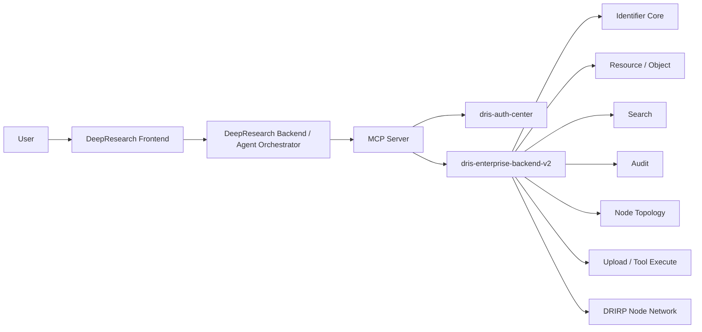
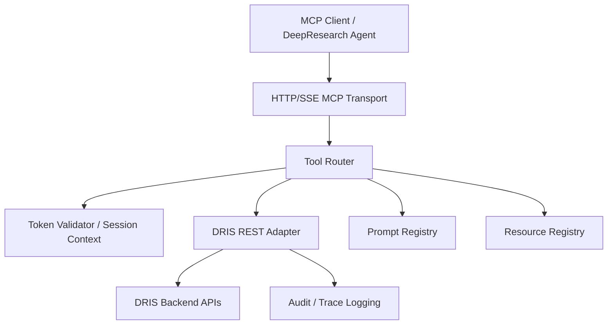
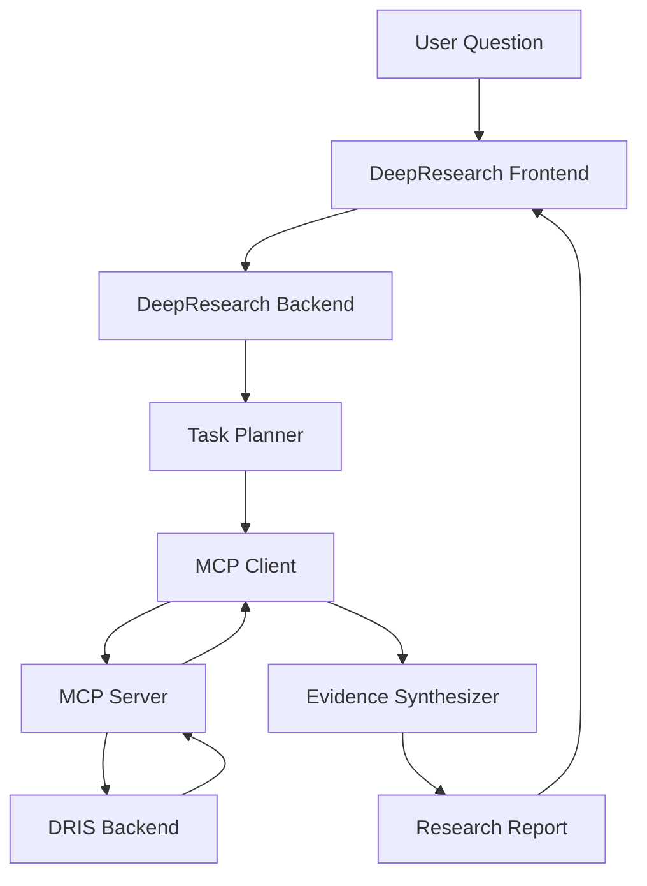
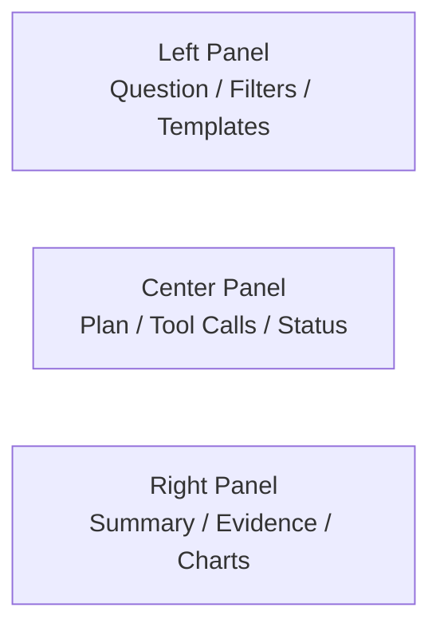
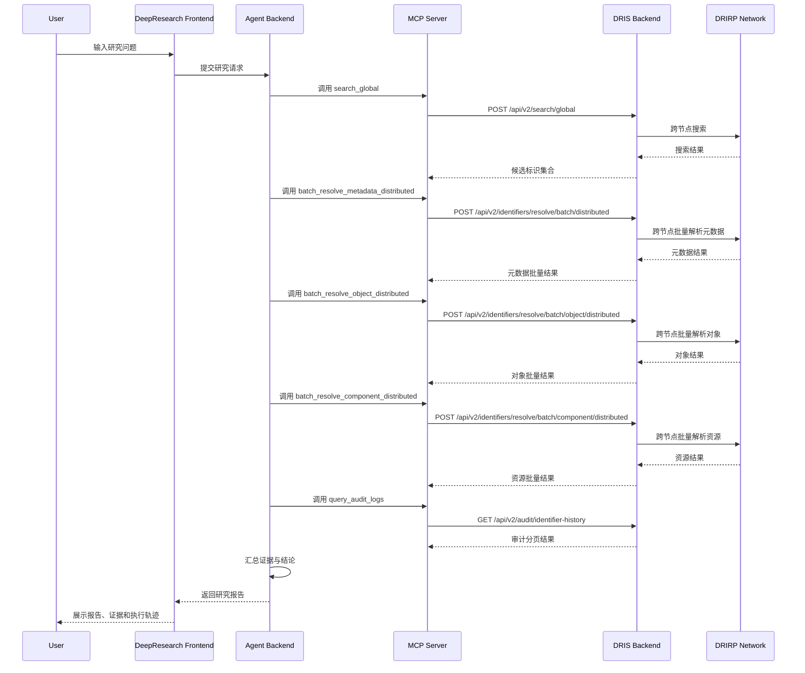
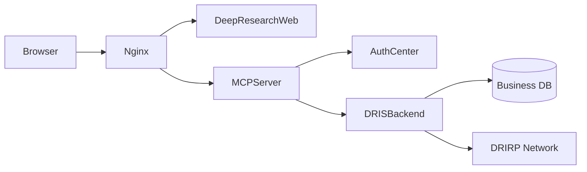

# MCP 与 DeepResearch 接入总体架构设计（2026-03-08）

## 1. 文档目的

本文档面向 `dris-enterprise-backend-v2` 的后续扩展设计，目标是在不破坏现有核心业务系统边界的前提下，引入：

- 一个部署在系统外部的 `MCP Server`
- 一个面向研究型问答与证据汇总的 `DeepResearch` 前端与编排层

设计重点如下：

- 保留现有 DRIS 后端、DRIRP 跨节点解析、认证中心、SDK 的主体地位
- 通过外部适配层让大模型能够标准化调用系统能力
- 通过研究型前端增强系统的展示效果、交互能力和答辩说服力
- 兼顾低耦合、高内聚、可扩展、可演示和可论文表达

## 2. 建设背景

当前系统已经具备较完整的业务基础能力：

- 标识注册、校验、存在性检查
- 单条元数据解析
- 单条数字对象解析
- 单条资源组件解析
- 跨节点单条解析
- 跨节点批量元数据解析
- 跨节点批量数字对象解析
- 跨节点批量资源解析
- 本地搜索与全网搜索
- 审计查询
- 上传、下载预签名、工具执行
- 节点注册、路由维护、DRIRP 转发

但是这些能力当前主要通过传统 REST API 暴露。对于“让大模型、研究代理、智能前端按统一方式调用”的需求，还缺少一层标准化能力适配层。因此需要新增：

- `MCP Server`：对外提供面向 AI 的工具接口
- `DeepResearch`：对最终用户提供自然语言研究界面、执行轨迹和证据展示能力

## 3. 设计目标

### 3.1 总体目标

将现有 DRIS 系统升级为“可被 AI 调用的数字对象研究平台”。

### 3.2 具体目标

- 不重写现有核心后端，只在其外部增加适配层
- 不改变已有后端的业务权威地位
- 把复杂的后端 REST 能力包装为更适合大模型调用的 MCP tools / resources / prompts
- 为用户提供一个“研究型工作台”，而不是传统 CRUD 管理页面
- 让系统演示效果明显体现以下能力：
  - AI 工具调用
  - 跨节点批量解析
  - 数字对象与资源联动分析
  - 审计可追溯
  - 证据化输出

### 3.3 非目标

本轮设计不追求：

- 直接让大模型调用 DRIRP 内部协议
- 在第一阶段开放大规模写操作能力
- 重构认证中心内部数据库结构
- 改动 SDK 的基础协议和接口契约

## 4. 总体定位

本方案将整个系统划分为三层：

- 核心业务能力层：`dris-enterprise-backend-v2`、`dris-auth-center`、DRIRP 节点网络、相关 SDK
- AI 能力适配层：外部 `MCP Server`
- 智能研究交互层：`DeepResearch Frontend + Agent Orchestrator`

可以用一句话概括：

`核心系统负责业务权威，MCP Server 负责 AI 能力适配，DeepResearch 负责研究型交互呈现。`

## 5. 总体架构

### 5.1 总体架构图



### 5.2 架构说明

- 用户不直接面对复杂接口，而是通过研究型前端提交自然语言任务
- DeepResearch 后端负责把用户问题拆分为多个结构化工具调用步骤
- MCP Server 提供统一 AI 工具协议，把工具调用映射到 DRIS 后端 REST API
- DRIS 后端仍然是核心业务系统，负责真正的数据解析、路由、审计、搜索和跨节点访问
- DRIRP 网络继续承担跨节点分布式解析和操作转发，不直接暴露给 LLM

## 6. 系统边界与职责划分

### 6.1 DRIS Enterprise Backend V2

职责：

- 作为权威业务服务层
- 提供标识解析、对象获取、资源获取、批量跨节点解析、搜索、审计等 REST API
- 内部通过 DRIRP 完成跨节点路由与分布式解析

特点：

- 继续复用现有代码与 SDK
- 是所有业务结果的权威来源
- 不感知具体是哪一个大模型或前端在调用自己

### 6.2 Auth Center

职责：

- 用户身份认证与令牌签发
- 未来为 MCP Server 与 DeepResearch 提供统一认证基础

特点：

- 不要求重构核心业务逻辑
- 只需要完成 token 校验、用户身份透传和最基本权限控制

### 6.3 MCP Server

职责：

- 将 DRIS 后端能力包装为 MCP 标准能力
- 提供 tools、resources、prompts
- 统一处理参数校验、错误映射、结果标准化、token 透传、审计 traceId 传递

特点：

- 部署在系统外部，不侵入核心后端
- 是 AI 调用 DRIS 的唯一标准入口
- 不承担核心业务计算，只做适配与编排边界控制

### 6.4 DeepResearch Frontend / Backend

职责：

- 提供自然语言研究问题输入
- 提供工具调用计划展示
- 展示跨节点解析过程、证据来源、结果聚合和最终报告
- 通过 Agent Orchestrator 驱动 MCP Tools 的调用顺序

特点：

- 不是传统后台页面，而是研究工作台
- 重点展示“过程 + 证据 + 结论”
- 演示效果比单纯接口测试页面更强

## 7. 现有后端能力映射

当前系统中可直接为 MCP 包装的核心接口如下。

### 7.1 标识与解析能力

- `POST /api/v2/identifiers/register`
- `POST /api/v2/identifiers/register/batch`
- `GET /api/v2/identifiers/{identifier}/metadata`
- `GET /api/v2/identifiers/{identifier}/object`
- `GET /api/v2/identifiers/{identifier}/component`
- `POST /api/v2/identifiers/resolve/batch`
- `POST /api/v2/identifiers/resolve/batch/distributed`
- `POST /api/v2/identifiers/resolve/batch/object/distributed`
- `POST /api/v2/identifiers/resolve/batch/component/distributed`

### 7.2 搜索能力

- `POST /api/v2/search`
- `POST /api/v2/search/global`

### 7.3 审计能力

- `GET /api/v2/audit/identifier-history`

### 7.4 节点拓扑能力

- `GET /api/v2/node/direct-descendants`
- `GET /api/v2/node/routes`

### 7.5 扩展操作能力

- `POST /api/v2/identifiers/{identifier}/tool/execute`
- `POST /api/v2/downloads/presign`
- `POST /api/v2/identifiers/{identifier}/upload-sessions`
- `POST /api/v2/upload-sessions/{uploadId}/complete`

## 8. MCP Server 详细设计

### 8.1 设计原则

- 外部部署，不直接嵌入 DRIS 后端
- 读能力优先，写能力受控开放
- 工具接口语义化，不简单照搬底层 REST 路径
- 返回结构标准化，减少大模型调用歧义
- 保留 traceId、节点来源、部分失败信息等研究需要的上下文

### 8.2 逻辑架构



### 8.3 模块划分

建议 `dris-mcp-server` 采用以下目录结构：

```text
dris-mcp-server/
  src/
    server/
      index.ts
      mcpServer.ts
    config/
      env.ts
      auth.ts
      backend.ts
    tools/
      resolveMetadata.ts
      resolveObject.ts
      resolveComponent.ts
      batchResolveMetadataDistributed.ts
      batchResolveObjectDistributed.ts
      batchResolveComponentDistributed.ts
      searchGlobal.ts
      queryAuditLogs.ts
      getNodeRoutes.ts
    resources/
      capabilities.ts
      nodeTopology.ts
      identifierSummary.ts
    prompts/
      crossNodeResearch.ts
      provenanceAnalysis.ts
    adapter/
      drisApiClient.ts
      responseMapper.ts
      errorMapper.ts
    middleware/
      traceContext.ts
      rateLimit.ts
      authGuard.ts
    types/
      toolSchemas.ts
      apiTypes.ts
```

### 8.4 第一阶段建议开放的 MCP Tools

第一阶段只做高价值读能力，形成稳定演示闭环。

| Tool 名称 | 功能 | 映射后端接口 |
|---|---|---|
| `resolve_metadata` | 查询单个标识元数据 | `GET /api/v2/identifiers/{identifier}/metadata` |
| `resolve_object` | 查询单个数字对象 | `GET /api/v2/identifiers/{identifier}/object` |
| `resolve_component` | 查询单个资源组件 | `GET /api/v2/identifiers/{identifier}/component` |
| `batch_resolve_metadata_distributed` | 跨节点批量元数据解析 | `POST /api/v2/identifiers/resolve/batch/distributed` |
| `batch_resolve_object_distributed` | 跨节点批量数字对象解析 | `POST /api/v2/identifiers/resolve/batch/object/distributed` |
| `batch_resolve_component_distributed` | 跨节点批量资源解析 | `POST /api/v2/identifiers/resolve/batch/component/distributed` |
| `search_global` | 全网搜索 | `POST /api/v2/search/global` |
| `query_audit_logs` | 审计日志查询 | `GET /api/v2/audit/identifier-history` |
| `get_node_routes` | 查看节点路由 | `GET /api/v2/node/routes` |

### 8.5 第二阶段可选开放工具

- `execute_identifier_tool`
- `create_download_presign`
- `register_identifier`
- `register_identifier_batch`

建议这些工具默认关闭，只在演示或受控环境开启。

### 8.6 MCP Resources 设计

建议提供以下 resources：

- `dris://system/capabilities`
  - 系统能力清单、可用工具说明、限制条件
- `dris://node/topology`
  - 节点拓扑与路由摘要
- `dris://audit/query-spec`
  - 审计查询参数说明
- `dris://identifier/{id}/summary`
  - 一个标识的摘要信息，便于模型快速理解上下文

### 8.7 MCP Prompts 设计

建议内置以下 prompts：

- `cross_node_batch_analysis`
  - 面向多个标识的跨节点研究任务模板
- `identifier_provenance_analysis`
  - 面向单个对象的元数据、对象、资源、审计综合分析模板
- `resource_availability_assessment`
  - 面向资源可达性、资源类型和定位信息的分析模板

### 8.8 结果标准化策略

MCP tool 返回建议统一包含：

- `requestId`
- `traceId`
- `toolName`
- `summary`
- `rawData`
- `evidence`
- `partial`
- `errors`

其中：

- `summary` 供前端直接展示
- `rawData` 保存后端原始结构
- `evidence` 保存标识符、节点编码、时间、来源接口等证据元素
- `partial` 表示是否存在局部失败

### 8.9 错误映射策略

建议将后端错误映射为 MCP 友好的错误类别：

- `VALIDATION_ERROR` -> `invalid_request`
- `NOT_FOUND` -> `not_found`
- `ROUTE_NOT_FOUND` -> `upstream_unavailable`
- `UPSTREAM_ERROR` -> `upstream_error`
- `TTL_EXCEEDED` -> `resolution_timeout`
- `LOOP_DETECTED` -> `routing_error`
- `FORBIDDEN` / `UNAUTHORIZED` -> `permission_denied`

### 8.10 Token 与身份透传

推荐做法：

- DeepResearch 用户先在前端登录
- 前端将 access token 传给 DeepResearch backend
- DeepResearch backend 作为 MCP client 调用 MCP Server 时，透传 token
- MCP Server 校验 token 或调用 auth center introspection
- MCP Server 将用户身份和 traceId 传给后端 REST

不建议：

- 在 MCP Server 中自行维护一套独立用户体系
- 绕过认证中心直接信任前端传来的 userId

## 9. DeepResearch 详细设计

### 9.1 设计目标

DeepResearch 的目标不是替代后台管理，而是提供一个研究型交互界面，帮助用户以自然语言驱动复杂的数据对象分析任务。

### 9.2 逻辑架构



### 9.3 前端页面设计

推荐采用三栏式研究工作台布局。

#### 左栏：研究输入区

包含：

- 研究问题输入框
- 模板选择器
- 时间范围
- 节点范围
- 标识符列表输入
- 执行按钮

#### 中栏：执行轨迹区

包含：

- 任务拆解步骤
- 当前步骤状态
- MCP 工具调用列表
- 每一步调用耗时
- 当前访问节点
- 局部失败提示

#### 右栏：结果与证据区

包含：

- 结论摘要卡片
- 标识对象对比表
- 资源定位卡片
- 节点路径图
- 审计时间轴
- 证据引用列表

### 9.4 推荐展示组件

- `ResearchQuestionCard`
- `ExecutionTimeline`
- `ToolCallList`
- `NodePathGraph`
- `IdentifierComparisonTable`
- `ResourceLocatorPanel`
- `AuditTimeline`
- `EvidenceCitationPanel`
- `FinalReportPanel`

### 9.5 页面原型结构



### 9.6 DeepResearch Backend 职责

建议前后端分离时，后端负责：

- 用户会话管理
- 调用规划
- MCP Client 封装
- 研究报告聚合
- traceId 管理
- 对话 / 研究会话持久化

### 9.7 研究会话模型

建议引入一个轻量研究会话模型：

- `research_session`
  - `session_id`
  - `user_id`
  - `title`
  - `question`
  - `status`
  - `created_at`
  - `updated_at`
- `research_step`
  - `step_id`
  - `session_id`
  - `step_index`
  - `tool_name`
  - `tool_input`
  - `tool_output_summary`
  - `status`
  - `duration_ms`
- `research_evidence`
  - `evidence_id`
  - `session_id`
  - `identifier`
  - `source_type`
  - `source_path`
  - `node_code`
  - `excerpt`

如果你不想加数据库，第一阶段也可以先用：

- Redis
- JSON 文件
- 内存会话缓存

但论文里更推荐至少给出数据库模型设计。

## 10. 典型业务流程设计

### 10.1 场景一：跨节点数字对象与资源研究

目标：

用户输入一个研究问题，系统自动搜索候选标识，分批解析其元数据、对象和资源，最终给出带证据的研究报告。

### 10.2 时序图



### 10.3 场景二：指定标识对象的来源与变更追踪

步骤：

1. 解析元数据
2. 解析对象
3. 解析资源
4. 查询审计记录
5. 输出变更时间线与证据摘要

### 10.4 场景三：节点路由与解析可达性分析

步骤：

1. 查询节点拓扑
2. 查询路由表
3. 批量解析多个远端标识
4. 输出不同节点的成功率、失败类型与路径信息

## 11. 安全设计

### 11.1 认证设计

推荐链路：

- 用户在 DeepResearch 前端登录
- 认证中心签发 access token
- 前端调用 DeepResearch backend 时携带 token
- DeepResearch backend 调用 MCP Server 时透传 token
- MCP Server 校验 token 有效性
- MCP Server 再调用 DRIS 后端接口

### 11.2 授权设计

建议最少划分为以下 scope：

- `dris.read`
- `dris.search`
- `dris.audit.read`
- `dris.resource.read`
- `dris.write`

第一阶段建议：

- 只开放读类能力给 MCP
- 写类能力默认关闭或只允许管理员测试用户

### 11.3 调用审计设计

以下链路都应记录 `traceId`：

- 前端请求 -> DeepResearch backend
- DeepResearch backend -> MCP Server
- MCP Server -> DRIS Backend
- DRIS Backend -> DRIRP 跨节点转发

建议在研究会话中展示：

- `traceId`
- `toolName`
- `requestTime`
- `durationMs`
- `targetNodeCode`
- `resolvedByNodeCode`

### 11.4 防滥用设计

- MCP tool 调用频率限制
- 批量请求上限控制
- 超时控制
- 审计查询分页控制
- 高风险工具默认关闭

## 12. 性能与可用性设计

### 12.1 性能优化点

- MCP Server 对静态资源型信息做短时缓存
- 对节点拓扑与能力清单做缓存
- 对相同研究会话中的重复查询做结果复用
- 批量解析优先使用后端已提供的分布式批量接口，而不是 N 次单条查询

### 12.2 可用性设计

- MCP Server 不缓存权威业务数据，只缓存展示性元信息
- MCP Server 故障不影响核心 DRIS 后端对外 REST 服务
- DeepResearch 故障不影响传统系统使用

### 12.3 降级策略

- 若某个工具失败，保留已成功部分，生成部分研究报告
- 若全局搜索失败，可切换为指定标识模式
- 若某个远端节点超时，展示局部失败并保留已解析结果

## 13. 部署设计

### 13.1 推荐部署拓扑



### 13.2 部署建议

- `dris-enterprise-backend-v2`：继续独立部署
- `dris-auth-center`：继续独立部署
- `dris-mcp-server`：单独服务部署
- `dris-deepresearch-web`：单独前端或全栈部署
- 统一通过 Nginx 或网关做代理转发

### 13.3 技术选型建议

- `MCP Server`：TypeScript + Node.js
- `DeepResearch`：Next.js
- `Agent Backend`：Next.js API Routes 或独立 Node 服务
- `MCP Transport`：HTTP / SSE
- `核心系统接入方式`：REST API

## 14. 展示效果设计

### 14.1 为什么展示层要做成 DeepResearch

如果只展示：

- Swagger
- Postman
- 普通管理后台页面

那么系统看起来只是“接口较多的业务系统”。

如果展示成研究型前端，则能让老师直观看到：

- 系统已经具备 AI 调用能力
- 系统支持复杂问题拆解与多工具协同
- 系统支持跨节点数据汇总
- 系统支持证据化分析与审计追踪

### 14.2 最佳演示场景

推荐主场景：

`跨节点交通数据对象研究`

示例问题：

- “请分析两个地区的交通数据对象，比较它们的元数据、对象状态、资源定位信息和操作历史。”

对应过程：

1. 全网搜索候选对象
2. 批量解析元数据
3. 批量解析数字对象
4. 批量解析资源组件
5. 查询审计日志
6. 汇总报告与证据

### 14.3 最佳答辩展示元素

建议至少展示：

- 系统总体架构图
- MCP 工具清单
- DeepResearch 页面截图
- 一条完整研究任务执行时间线
- 一份最终研究报告
- 证据引用列表与节点来源

## 15. 论文写作表达建议

### 15.1 可提炼的创新点

- 面向 AI 的外部能力适配层设计
- 基于 MCP 的数字对象系统标准化工具暴露机制
- 面向研究任务的跨节点数据对象证据聚合前端
- 在不侵入核心业务系统的前提下完成 AI 接入与能力扩展

### 15.2 可作为论文章节的结构

- 第 1 章：绪论
- 第 2 章：相关技术
  - 数字对象标识系统
  - MCP 协议
  - 智能研究前端
- 第 3 章：现有系统分析
- 第 4 章：MCP 与 DeepResearch 总体架构设计
- 第 5 章：MCP Server 详细设计与实现
- 第 6 章：DeepResearch 前端与研究编排设计与实现
- 第 7 章：实验与演示验证
- 第 8 章：总结与展望

## 16. 分阶段实施方案

### 16.1 第一阶段：最小可演示闭环

实现内容：

- MCP Server 基础框架
- 8 个只读高价值 tools
- DeepResearch 三栏式页面
- 单个主场景演示闭环

验收标准：

- 能从自然语言问题出发，自动调用多个工具
- 能完成跨节点批量解析
- 能输出带证据的研究报告

### 16.2 第二阶段：增强研究体验

实现内容：

- 会话持久化
- 研究报告导出
- 节点拓扑可视化
- 资源定位可达性检测
- Prompt 模板体系化

### 16.3 第三阶段：受控开放写操作

实现内容：

- 受控注册标识
- 受控下载预签名
- 受控工具执行
- 更细粒度权限控制

## 17. 风险分析与应对

### 17.1 风险一：功能太多，演示分散

应对：

- 只主打一条研究主线
- 先保证搜索、批量解析、审计三类能力打通

### 17.2 风险二：MCP Server 变成简单转发层，缺乏设计价值

应对：

- 不直接暴露所有 REST
- 设计 tools、resources、prompts 三类对象
- 做统一结果标准化和证据化包装

### 17.3 风险三：DeepResearch 前端沦为聊天框

应对：

- 强化执行轨迹、节点路径、证据面板、对比结果表
- 明确研究型工作台定位，而非纯对话框

### 17.4 风险四：侵入现有后端，导致改动过大

应对：

- 采用外部服务方式接入
- 后端只补少量必要接口，不重写核心结构

## 18. 结论

本设计方案的核心思想是：

- 以 `dris-enterprise-backend-v2` 作为权威业务能力核心
- 以外部 `MCP Server` 作为 AI 工具标准化暴露层
- 以 `DeepResearch` 作为研究型交互与证据展示层

这样既可以保留现有系统的稳定性和可维护性，又能够明显提升系统的展示效果、创新表达和论文完整度。

对毕设而言，这种方案的优势非常明确：

- 架构层次清楚
- 扩展边界明确
- 演示效果强
- 论文叙事完整
- 后续实现路径可控
