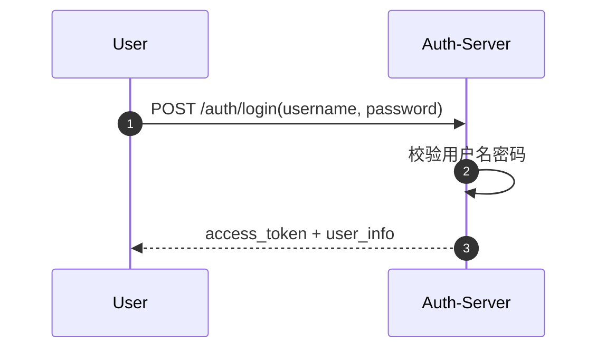
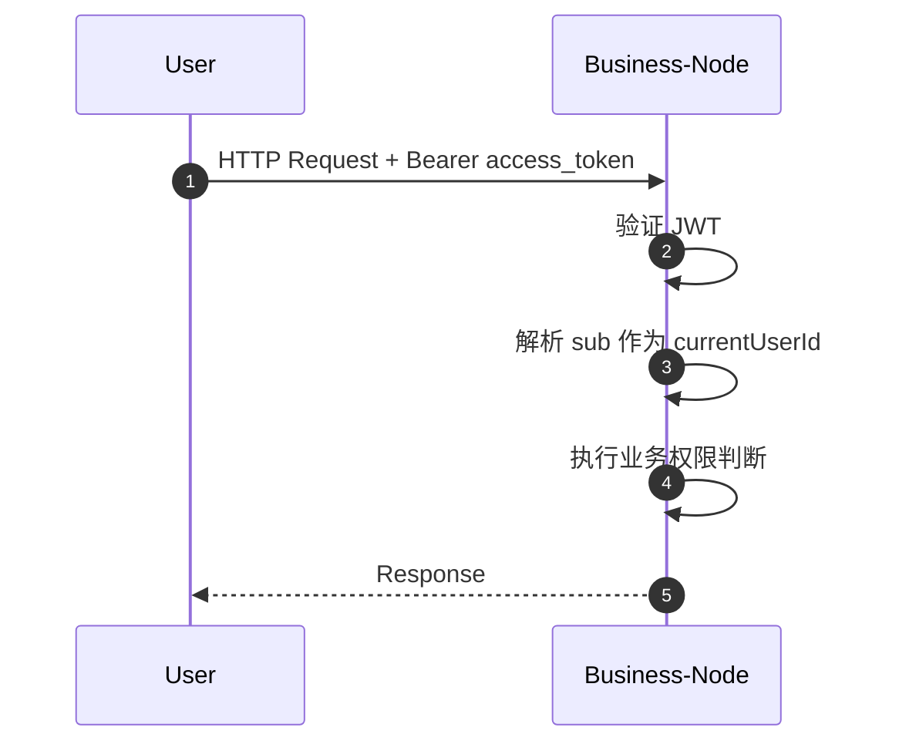
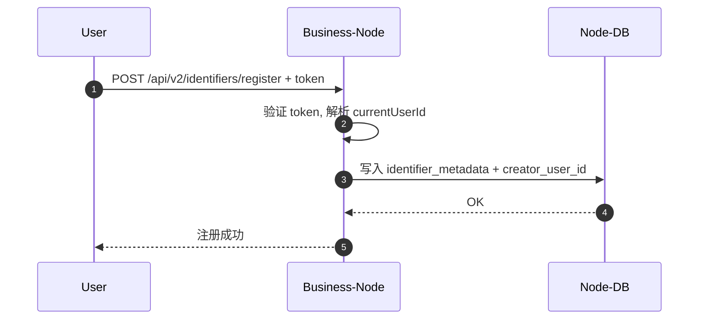
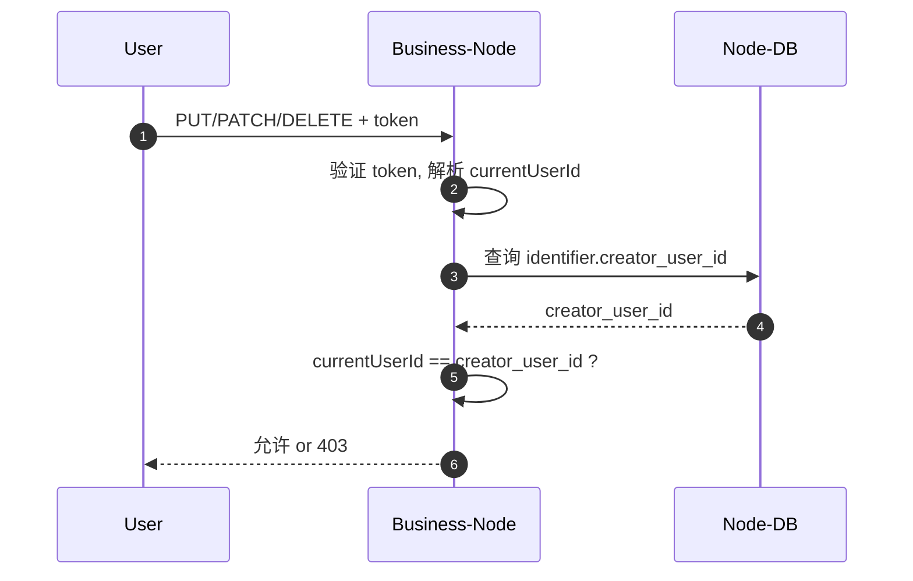
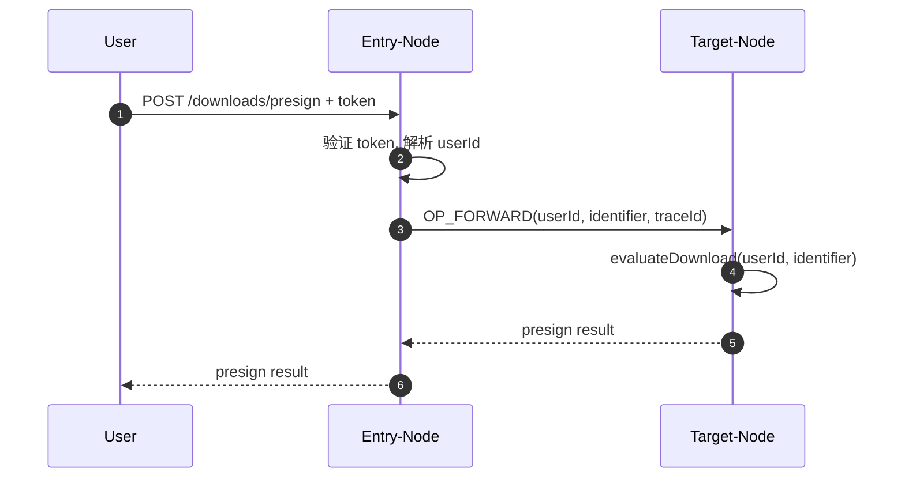
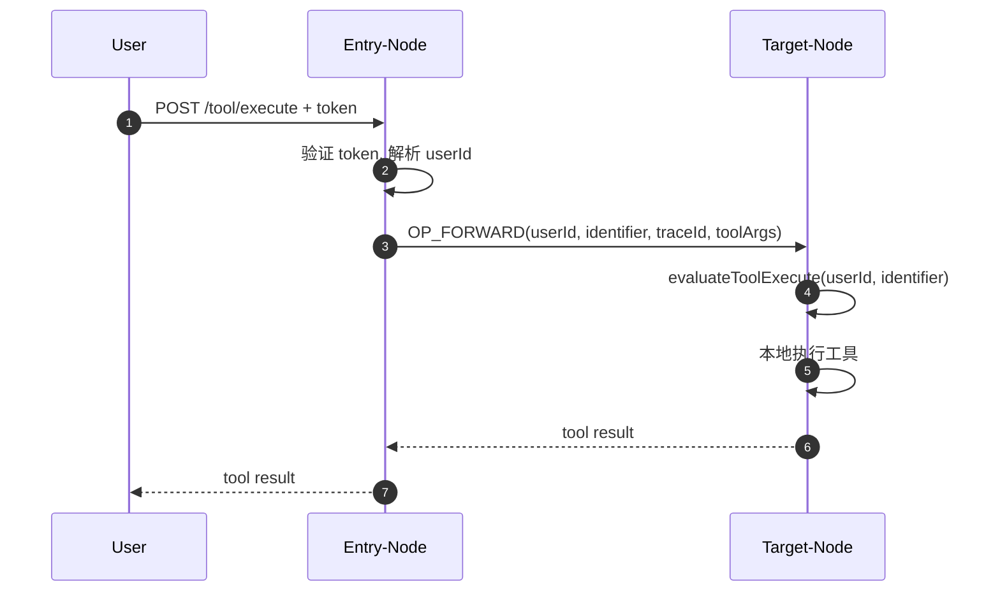

# 中心认证与业务节点权限设计（收敛版，2026-03-07）

## 1. 设计目标

本方案只解决两类问题：

- 外部用户统一认证
- 业务节点内部数据权限控制

本方案明确不在当前阶段解决下列复杂问题：

- 节点间零信任安全体系
- 外部第三方 OAuth2/OIDC 平台对接
- 智能体主体接入
- 跨节点写操作授权

当前业务边界如下：

- 用户可以访问任一业务节点
- 节点间交互默认相对安全
- 跨节点场景只有解析、读取、下载、工具执行、搜索
- 跨节点不存在写操作
- 对象写权限只发生在对象归属节点本地

## 2. 总体架构

系统分为两个层次：

### 2.1 中心认证服务

负责：

- 用户注册
- 用户登录
- 统一签发身份令牌
- 发布公钥供业务节点验签

不负责：

- 业务数据权限判定
- 数字对象归属管理
- 节点本地会话共享

### 2.2 业务节点

负责：

- 校验中心认证服务签发的 JWT
- 识别当前用户
- 判定当前用户是否可访问本地数字对象
- 本地执行下载、工具执行、元数据写操作权限检查

不负责：

- 用户密码存储
- 用户密码校验
- 用户注册登录流程

## 3. 核心原则

### 3.1 认证和授权分离

- 认证中心只回答“这个用户是谁”
- 业务节点只回答“这个用户能对哪个 identifier 做什么”

### 3.2 用户主键统一

- 所有节点只认统一用户主键 `user_id`
- JWT 中使用 `sub` 表示该用户主键
- 本地权限字段 `creator_user_id` 存储的就是这个全局 `user_id`

### 3.3 最小化改动现有模型

当前阶段只在 `identifier_metadata` 增加一个字段：

- `creator_user_id`

不在当前阶段引入下列字段：

- `creator_org_code`
- `visibility_level`
- `authz_version`

如未来需要增强，再单独设计扩展。

### 3.4 跨节点不做远程写授权

- 因为当前业务没有跨节点写接口
- 所以 `creator_user_id` 只用于本地写权限控制
- 跨节点只处理读类、下载、工具执行、搜索等权限

## 4. 用户身份模型

当前系统只考虑一个主体：

- `USER`

统一字段：

- `user_id`
- `username`
- `display_name`
- `org_code`
- `roles`

说明：

- `user_id` 是全局唯一主键
- `username` 用于登录和展示
- `display_name` 用于界面显示
- `org_code` 用于后续组织级扩展
- `roles` 当前仅作管理用途预留

## 5. Token 设计

中心认证服务签发 `JWT access_token`，推荐使用 `RSA` 非对称签名。

### 5.1 Access Token 最少字段

- `iss`：签发者
- `sub`：用户唯一 ID，即 `user_id`
- `username`
- `roles`
- `org`
- `iat`
- `exp`
- `jti`

### 5.2 业务节点使用方式

业务节点只依赖：

- 验签成功
- `sub`
- `roles`
- `org`

其中最关键的是：

- `currentUserId = token.sub`

## 6. 本地数据权限模型

### 6.1 核心字段

在 `identifier_metadata` 中增加：

- `creator_user_id`

含义：

- 记录该数字对象的创建人是谁
- 后续所有写操作都基于该字段判断

### 6.2 动作划分

建议按动作粒度区分权限：

- `READ_METADATA`
- `READ_OBJECT`
- `READ_COMPONENT`
- `DOWNLOAD`
- `TOOL_EXECUTE`
- `WRITE_METADATA`
- `WRITE_COMPONENT`
- `DELETE_IDENTIFIER`
- `UPLOAD_WRITE`
- `SEARCH`

### 6.3 当前阶段权限规则

#### 本地写操作

以下动作只允许对象创建人执行：

- 修改元数据
- 修改组件
- 删除对象
- 上传写入

统一规则：

- `currentUserId == creator_user_id`

#### 读取动作

当前阶段采用最简单策略：

- 已登录用户可以读取 metadata、object、component

这是为了收敛复杂度，后续如需增强，再增加对象可见性模型。

#### 下载与工具执行

下载和工具执行不并入普通读取，单独走“自动判定”流程。

当前阶段先实现：

- `RiskDecisionService`
- 默认实现 `PermitAllRiskDecisionService`
- 所有下载和工具执行判定直接返回 `ALLOW`

后续只替换判定逻辑，不改主流程。

## 7. 跨节点权限模型

### 7.1 跨节点原则

- 入口节点先认证用户身份
- 入口节点透传用户身份给目标节点
- 目标节点基于本地对象数据执行最终权限判定

### 7.2 跨节点透传字段

建议当前阶段透传：

- `userId`
- `traceId`

如有必要，可补充：

- `username`
- `org`

### 7.3 为什么目标节点仍要终审

因为：

- 数据归属在目标节点
- 目标节点最清楚本地对象是否允许该用户下载或执行工具
- 入口节点不能代替目标节点完成对象级授权判断

### 7.4 当前跨节点权限策略

#### 跨节点读取

- 入口节点完成用户认证
- 目标节点按当前读策略允许返回

#### 跨节点下载

- 入口节点识别用户身份并转发 `userId`
- 目标节点调用 `evaluateDownload(userId, identifier, request)`
- 当前实现恒 `ALLOW`

#### 跨节点工具执行

- 入口节点识别用户身份并转发 `userId`
- 目标节点调用 `evaluateToolExecute(userId, identifier, request)`
- 当前实现恒 `ALLOW`

## 8. 流程设计

### 8.1 用户登录流程

### 8.2 业务节点访问流程

### 8.3 对象注册流程

### 8.4 本地写权限流程

### 8.5 跨节点下载流程

### 8.6 跨节点工具执行流程

## 9. 自动判定服务

### 9.1 目标

为了避免一开始引入复杂 ACL 和审批流，下载与工具执行统一接入自动判定服务。

### 9.2 当前阶段实现

当前实现策略：

- 所有请求默认允许

建议抽象接口：

- `evaluateDownload(userId, identifier, request)`
- `evaluateToolExecute(userId, identifier, request)`

返回结构建议：

- `decision`：`ALLOW | DENY | MANUAL`
- `reason`

当前默认实现统一返回：

- `decision = ALLOW`
- `reason = permit-all-for-thesis`

### 9.3 后续增强方向

未来只替换实现，不变更主流程。可逐步加入：

- 下载风控
- 工具白名单
- 参数约束
- 用户级 ACL
- 人工审批

## 10. 审计建议

建议增加一张最小审计表，记录高价值动作：

- 用户登录
- 对象注册
- 元数据修改
- 下载
- 工具执行
- 权限拒绝

最小字段建议：

- `trace_id`
- `user_id`
- `action`
- `identifier`
- `node_code`
- `result`
- `reason`
- `created_at`

## 11. 当前阶段的最小实现范围

### 必做

- 中心认证服务的注册/登录/JWT 签发
- 业务节点 JWT 验签
- `identifier_metadata.creator_user_id`
- 本地写权限 creator 校验
- 下载自动判定服务（当前恒允许）
- 工具执行自动判定服务（当前恒允许）
- 跨节点透传 `userId`

### 可后做

- 对象可见性模型
- ACL 表
- 下载审批
- 工具执行审批
- 统一审计报表

## 12. 最终收敛结论

本方案的最小闭环非常明确：

- 统一用户身份由中心认证服务通过 JWT 提供
- 所有业务节点通过 JWT 识别当前用户
- 对象写权限只看 `creator_user_id`
- 跨节点没有写操作，因此不需要远程写权限控制
- 下载和工具执行统一接入自动判定服务，当前先全部允许，后续逐步增强

