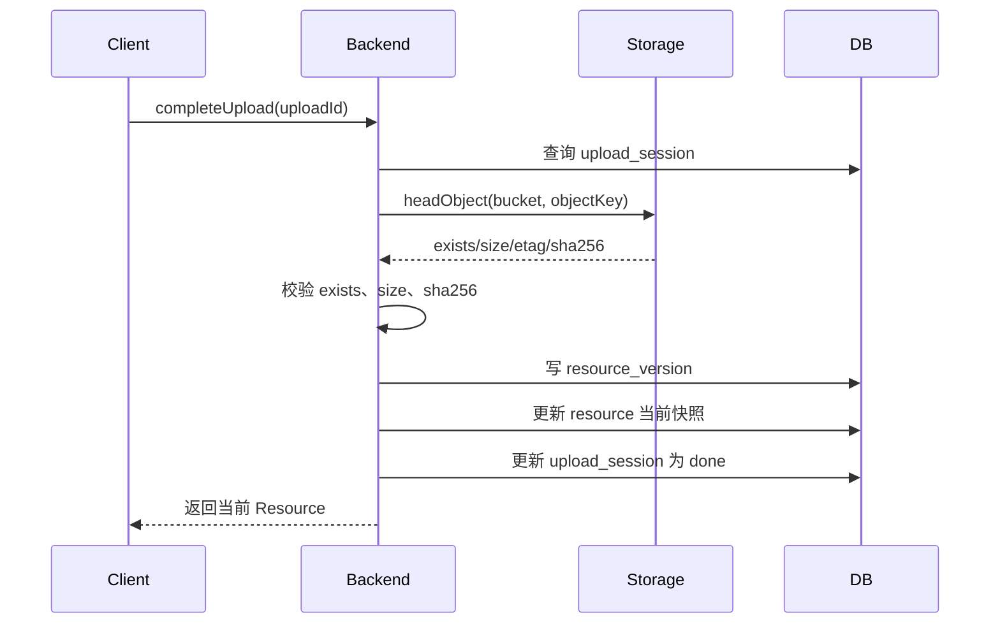

# 资源共享能力增强修改设计文档（上传校验、版本治理、组件语义）

日期：2026-03-09  
适用项目：`dris-enterprise-backend-v2`、`dris-java-sdk`

## 1. 文档目标

本文档用于指导 DRIS 系统在“数据共享互通”目标下，对现有资源上传、绑定、解析流程进行增强设计，重点解决以下三个问题：

1. 上传完成时缺少实体存在校验，可能出现“数据库已绑定、对象存储中实际不存在”的脏资源。
2. 同一标识重复上传采用固定 `objectKey`，本质是覆盖，不具备资源版本治理能力。
3. `resource / tool / service` 三类组件虽然已有基础区分，但在上传、下载、调用语义上仍不够清晰。

本文档明确“怎么改、改哪些表、改哪些逻辑、接口怎么兼容、测试怎么做”，作为后续编码实施和毕设设计说明的依据。

## 2. 现状分析

### 2.1 当前主流程

现有主链如下：

1. 注册标识：`POST /api/v2/identifiers/register`
2. 创建上传会话：`POST /api/v2/identifiers/{identifier}/upload-sessions`
3. 客户端根据返回的 `put.url` 上传对象
4. 完成上传绑定：`POST /api/v2/upload-sessions/{uploadId}/complete`
5. 查询组件：`GET /api/v2/identifiers/{identifier}/component`
6. 下载访问：`POST /api/v2/downloads/presign`

### 2.2 当前实现中的关键问题

#### 问题一：`completeUpload()` 未校验实体对象

当前 `completeUpload` 的逻辑是：

- 读取 `upload_session`
- 根据 session 直接组装 `Resource`
- 将 `Resource` 绑定到数字对象并落库
- 标记 session 为 `done`

对应实现：

- `dris-java-sdk/src/main/java/com/dris/sdk/server/handler/CompleteUploadHandler.java`
- `dris-java-sdk/src/main/java/com/dris/sdk/server/repository/jdbc/JdbcDigitalObjectRepository.java`

现状缺陷：

- 未校验对象存储中该对象是否真实存在
- 未校验对象真实大小是否与 `expected_size` 一致
- 未校验对象摘要是否与 `expected_sha256` 一致
- 会出现“标识已绑定资源，但资源实体并不存在或不完整”的情况

这会直接影响共享互通的可信性。

#### 问题二：`objectKey` 固定，重复上传是覆盖而不是版本化

当前 `CreateUploadSessionHandler.makeObjectKey()` 固定返回：

- `identifiers/{identifier}/resource`
- `identifiers/{identifier}/tool`
- `identifiers/{identifier}/service`

对应实现：

- `dris-java-sdk/src/main/java/com/dris/sdk/server/handler/CreateUploadSessionHandler.java`

现状缺陷：

- 同一标识同一组件重复上传时会覆盖对象存储中的旧对象
- 数字对象 revision 虽然会加一，但资源实体没有独立版本历史
- 无法回答“当前共享的是哪个版本”“上一版本资源是什么”
- 不利于审计、回滚、跨节点共享治理

#### 问题三：`resource / tool / service` 语义边界不够清晰

当前 `DrisBusinessRules.validateComponent()` 已对三类组件做了基础区分：

- `resource`：`external_uri + download`
- `service`：`api_service + api_call`
- `tool`：具备 `tool` 语义约束

对应实现：

- `dris-java-sdk/src/main/java/com/dris/sdk/server/business/DrisBusinessRules.java`

现状问题：

- `service` 组件理论上是“可调用服务”，但当前上传会话也可用于它
- `downloadPresign` 逻辑没有在接口层面明确限制 `service` 的下载语义
- `tool` 有的场景是“可下载包”，有的场景是“本地执行入口”，语义混用

### 2.3 当前对象存储接入能力存在“伪签名”问题

当前 `StorageAddresses` 只是根据 `bucket + objectKey + endpoint` 拼出 URL，并不是真正调用 COS SDK 生成签名 URL。

对应实现：

- `dris-java-sdk/src/main/java/com/dris/sdk/server/handler/StorageAddresses.java`

这意味着：

- 当前 upload/download 更接近“地址构造”，不是严格意义上的签名上传/签名下载
- 若后续要做强校验，建议抽象真正的对象存储接入层

### 2.4 当前数据库现状

当前核心表：

- `identifier_metadata`
- `resource`
- `upload_session`
- `identifier_vector_index`

此外，数据库中还有 `resource_blob` 表，但现状如下：

- 表结构仅有 `id + content + created_at`
- 没有 `identifier`、`resource_id`、`object_key`
- 当前代码未引用
- 当前数据为空表

结论：`resource_blob` 不应纳入当前主链改造范围，可保留为历史遗留或未来可选缓存能力。

## 3. 改造目标

本次改造目标如下：

1. 确保共享资源“真实存在、大小正确、摘要可信”。
2. 支持资源版本治理，避免同路径覆盖导致的历史丢失。
3. 明确三类组件的共享语义，增强系统设计可解释性。
4. 尽量少动 `dris-java-sdk` 的对外模型，优先采用兼容式扩展。
5. 不引入内容抽取能力，不引入独立“发布”流程，不改成数据库二进制主存储。

## 4. 设计原则

1. 标识仍然是系统主键，资源版本是附属治理信息。
2. 实体文件主存储仍然是对象存储/外部 URI，而不是 MySQL Blob。
3. `resource` 表保存“当前生效快照”，`resource_version` 保存“历史版本事实”。
4. 上传流程要从“逻辑确认”升级为“实体校验后提交”。
5. 对外接口尽量兼容，优先通过新增字段和新增查询接口扩展能力。

## 5. 总体改造方案

本次方案分为三部分：

1. 上传完成校验增强
2. 资源版本治理增强
3. 组件语义收敛增强

总体上保留现有三张主表：

- `identifier_metadata`
- `resource`
- `upload_session`

新增一张历史事实表：

- `resource_version`

并引入一个对象存储探测抽象：

- `StorageGateway` / `StorageObjectVerifier`

## 6. 详细设计

### 6.1 上传完成校验增强

#### 6.1.1 新增对象存储探测抽象

建议在 `dris-java-sdk` 中新增抽象接口：

```java
public interface StorageGateway {
    StorageObjectHead headObject(String bucket, String objectKey);
    String createUploadUrl(String bucket, String objectKey, Map<String, String> headers, int expiresSeconds);
    String createDownloadUrl(String bucket, String objectKey, int expiresSeconds);
}
```

返回模型：

```java
public class StorageObjectHead {
    private boolean exists;
    private long contentLength;
    private String etag;
    private String sha256;
    private Map<String, String> metadata;
}
```

建议提供两种实现：

1. `LegacyHttpStorageGateway`
   - 仅通过构造 URL + HTTP HEAD 做弱校验
   - 适用于当前最小改造阶段
2. `CosStorageGateway`
   - 通过腾讯云 COS SDK 做真实 `HEAD Object` 和签名 URL
   - 适用于推荐阶段

#### 6.1.2 `createUploadSession()` 改造

当前固定路径：

- `identifiers/{identifier}/resource`
- `identifiers/{identifier}/tool`
- `identifiers/{identifier}/service`

建议改为唯一路径：

- `identifiers/{identifier}/resource/{uploadId}`
- `identifiers/{identifier}/tool/{uploadId}`
- `identifiers/{identifier}/service/{uploadId}`

原因：

- 创建 upload session 时就能拿到 `uploadId`
- 以 `uploadId` 作为路径后缀，可天然避免覆盖
- 后续版本号可在 `completeUpload()` 时再分配，不受并发创建 session 影响

同时，上传响应中应返回对象存储元数据建议头，例如：

- `Content-Type`
- `x-meta-sha256`
- `x-meta-filename`
- `x-meta-component-type`

若使用 COS SDK，可落为 provider-specific metadata 头。

#### 6.1.3 `completeUpload()` 新流程

建议流程如下：



#### 6.1.4 校验规则

必须校验：

1. 对象存在
2. 对象大小与 `expected_size` 一致

建议校验：

3. 若 `expected_sha256` 不为空，则对象元数据中的 `sha256` 必须一致

新增失败码建议：

- `OBJECT_NOT_FOUND`
- `OBJECT_SIZE_MISMATCH`
- `OBJECT_HASH_MISMATCH`
- `OBJECT_VERIFY_FAILED`
- `OBJECT_VERIFY_UNSUPPORTED`

#### 6.1.5 推荐与最小方案的区别

最小方案：

- 只做对象存在校验 + size 校验
- 仍沿用地址构造方式
- 若对象公开可 HEAD，则能落地

推荐方案：

- 接入 COS SDK
- 生成真正上传/下载签名 URL
- 用对象元数据保存 `sha256`
- 完整做 `exists + size + hash` 校验

### 6.2 资源版本治理增强

#### 6.2.1 设计目标

- `resource` 保留“当前快照”
- `resource_version` 保留“历史事实”
- 同一标识的每次成功上传都会产生一个新版本

#### 6.2.2 `resource` 表增强

建议对当前 `resource` 表增加以下字段：

| 字段 | 类型 | 说明 |
|---|---|---|
| `bucket` | VARCHAR(128) | 当前资源所在 bucket |
| `object_key` | VARCHAR(512) | 当前资源对象路径 |
| `version_no` | BIGINT | 当前资源版本号 |
| `source_upload_id` | VARCHAR(64) | 来源上传会话 |
| `verify_status` | VARCHAR(32) | 校验状态 |
| `last_verified_at` | VARCHAR(64) | 最后一次校验时间 |

说明：

- 当前下载逻辑不要再依赖 `extra_json.objectKey` 作为唯一来源
- `bucket/object_key` 应成为资源主字段，而不是隐藏在 `extra_json` 里

#### 6.2.3 新增 `resource_version` 表

建议建表：

```sql
CREATE TABLE IF NOT EXISTS resource_version (
    id BIGINT NOT NULL AUTO_INCREMENT PRIMARY KEY,
    identifier VARCHAR(30) NOT NULL,
    version_no BIGINT NOT NULL,
    component_type VARCHAR(32) NOT NULL,
    role VARCHAR(32) NOT NULL DEFAULT 'primary',
    storage_type VARCHAR(64) NOT NULL,
    access_method VARCHAR(64) NOT NULL,
    content_type VARCHAR(128) NOT NULL,
    format VARCHAR(128) NOT NULL,
    locator TEXT NOT NULL,
    bucket VARCHAR(128) DEFAULT '',
    object_key VARCHAR(512) DEFAULT '',
    size_bytes BIGINT NOT NULL DEFAULT 0,
    hash_value VARCHAR(255) DEFAULT '',
    etag VARCHAR(255) DEFAULT '',
    version_id VARCHAR(255) DEFAULT '',
    source_upload_id VARCHAR(64) DEFAULT '',
    verify_status VARCHAR(32) NOT NULL DEFAULT 'UNKNOWN',
    created_at VARCHAR(64) NOT NULL,
    extra_json TEXT,
    UNIQUE KEY uk_resource_version_identifier_no (identifier, version_no),
    KEY idx_resource_version_identifier_time (identifier, created_at),
    CONSTRAINT fk_resource_version_identifier FOREIGN KEY (identifier) REFERENCES identifier_metadata(identifier) ON DELETE CASCADE
) ENGINE=InnoDB DEFAULT CHARSET=utf8mb4;
```

#### 6.2.4 版本号分配规则

建议在 `completeUpload()` 成功校验后分配：

- 当前无版本：`version_no = 1`
- 当前已存在：`version_no = current.version_no + 1`

注意：

- 版本号不在 `createUploadSession()` 阶段预分配
- 避免多个并发 session 抢占同一个版本号

#### 6.2.5 数据写入策略

`completeUpload()` 成功后：

1. 插入 `resource_version`
2. 更新 `resource` 当前快照
3. 数字对象 revision + 1
4. `upload_session.status = done`

#### 6.2.6 兼容旧数据迁移

建议迁移策略：

1. 为 `resource` 表新增字段并设置默认值
2. 对已有 `resource` 数据：
   - `version_no = 1`
   - `verify_status = 'LEGACY'`
   - `source_upload_id = ''`
3. 可选执行一次回填：
   - 将当前 `resource` 快照补写一条到 `resource_version`

### 6.3 三类组件语义收敛

#### 6.3.1 `resource`

语义：真实共享数据实体

特点：

- 表示一个真实可访问的数据文件/对象
- 支持上传会话创建
- 支持 `completeUpload`
- 支持 `downloadPresign`
- 支持跨节点共享下载

约束：

- `storageType = external_uri`
- `accessMethod = download`

#### 6.3.2 `tool`

语义：共享可执行能力

特点：

- 表示一个可以执行的数据处理工具
- 可以通过上传包方式绑定，也可以直接绑定本地工具描述
- 若 `storageType = external_uri`，可下载工具包
- 若 `storageType = local_exec`，只能执行，不提供下载

建议：

- `tool` 的下载行为应根据 `storageType` 决定
- 若是 `local_exec`，`downloadPresign` 应返回不支持

#### 6.3.3 `service`

语义：共享服务能力

特点：

- 表示一个 API 服务入口
- 主体语义是“调用”，不是“下载”
- 优先推荐通过 `PUT /component` 直接绑定 endpoint
- 若使用上传会话，上传的对象应视为“服务描述文件”，不是服务实体本身

建议：

- `downloadPresign` 对 `service` 默认返回 `UNSUPPORTED_COMPONENT_TYPE`
- 若未来需要下载 OpenAPI 描述文件，可新增专门接口：
  - `POST /api/v2/services/descriptors/presign`

#### 6.3.4 接口行为建议

| 组件类型 | createUploadSession | completeUpload | downloadPresign | invoke |
|---|---|---|---|---|
| resource | 支持 | 支持 | 支持 | 不适用 |
| tool(external_uri) | 支持 | 支持 | 支持 | 支持 |
| tool(local_exec) | 不需要 | 不需要 | 不支持 | 支持 |
| service | 可选（用于描述文件） | 可选 | 默认不支持 | 支持 |

## 7. 接口改造设计

### 7.1 保持兼容的既有接口

保留：

- `POST /api/v2/identifiers/{identifier}/upload-sessions`
- `POST /api/v2/upload-sessions/{uploadId}/complete`
- `POST /api/v2/downloads/presign`
- `GET /api/v2/identifiers/{identifier}/component`

### 7.2 既有接口响应增强

#### `completeUpload()` 返回的 `Resource`

建议在返回结果中补充以下信息，优先放入 `resource.extra`：

- `_versionNo`
- `_sourceUploadId`
- `_verifyStatus`
- `_bucket`
- `_objectKey`

这样可减少对 `Resource` 模型结构的大改动，兼容 DRIRP、MCP、DeepResearch 等已有依赖。

### 7.3 新增版本查询接口

建议新增：

1. `GET /api/v2/identifiers/{identifier}/component/versions?page=1&size=10`
2. `GET /api/v2/identifiers/{identifier}/component/versions/{versionNo}`

返回 DTO 建议：

```json
{
  "identifier": "1100ABCD...",
  "versionNo": 3,
  "componentType": "resource",
  "locator": "cos://bucket/identifiers/.../resource/up-9",
  "bucket": "dris-repo-prod-1330585503",
  "objectKey": "identifiers/.../resource/up-9",
  "sizeBytes": 1024,
  "hashValue": "sha256:...",
  "verifyStatus": "VERIFIED",
  "sourceUploadId": "up-9",
  "createdAt": "2026-03-09T10:00:00Z"
}
```

## 8. 数据库变更方案

### 8.1 `upload_session` 表建议新增字段

| 字段 | 类型 | 说明 |
|---|---|---|
| `actual_size` | BIGINT | 实际校验到的对象大小 |
| `actual_hash` | VARCHAR(128) | 实际校验到的摘要 |
| `verify_status` | VARCHAR(32) | `PENDING/VERIFIED/FAILED/SKIPPED` |
| `verify_message` | VARCHAR(255) | 校验失败原因 |
| `completed_at` | VARCHAR(64) | 完成时间 |

### 8.2 `resource` 表建议新增字段

| 字段 | 类型 | 说明 |
|---|---|---|
| `bucket` | VARCHAR(128) | 当前 bucket |
| `object_key` | VARCHAR(512) | 当前对象路径 |
| `version_no` | BIGINT | 当前版本号 |
| `source_upload_id` | VARCHAR(64) | 来源 uploadId |
| `verify_status` | VARCHAR(32) | 当前快照校验状态 |
| `last_verified_at` | VARCHAR(64) | 最后校验时间 |

### 8.3 `resource_version` 表新增

见 6.2.3。

## 9. 代码修改点说明

### 9.1 `dris-java-sdk`

重点修改：

1. `CreateUploadSessionHandler`
   - 改唯一 `objectKey` 生成策略
   - 返回 provider-specific 上传头
   - 使用 `StorageGateway.createUploadUrl()`

2. `CompleteUploadHandler`
   - 增加对象探测与校验逻辑
   - 成功后写入 `resource_version`
   - 更新 `resource` 当前快照
   - 回写 `upload_session` 校验结果

3. `CreateDownloadPresignHandler`
   - 使用 `bucket/object_key` 生成下载地址
   - 根据 `componentType + storageType` 区分是否允许下载

4. `JdbcUploadSessionRepository`
   - 读写新增校验字段

5. `JdbcDigitalObjectRepository`
   - 读写 `resource` 新增字段
   - 新增 `resource_version` 的插入、查询能力

6. `DrisCoreOptions`
   - 增加存储接入与校验模式配置

7. `StorageAddresses`
   - 降级为 legacy 地址工具，推荐将签名逻辑迁入 `StorageGateway`

### 9.2 `dris-enterprise-backend-v2`

重点修改：

1. `BackendV2Properties`
   - 增加对象存储接入配置
   - 增加校验模式配置

2. `BackendV2Configuration`
   - 注入 `StorageGateway`
   - 组装到 `DrisCoreService`

3. `IdentifierResourceController`
   - 新增版本查询接口

4. `IdentifierResourceService`
   - 版本查询服务封装

5. 接口文档与测试文档同步更新

## 10. 配置设计

建议新增配置项：

```yaml
dris:
  v2:
    storage-provider: cos
    storage-region: ap-beijing
    storage-endpoint: https://cos.ap-beijing.myqcloud.com
    default-bucket: dris-repo-prod-1330585503
    storage-public-base-url: ""

    storage-auth-mode: legacy_url
    storage-verify-enabled: true
    storage-verify-mode: size_then_hash
    storage-require-hash-match: false
    storage-cos-secret-id: ""
    storage-cos-secret-key: ""
```

说明：

- `legacy_url`：沿用当前地址构造模式
- `cos_sdk`：启用真实 COS SDK
- `size_then_hash`：先校验大小，再校验摘要

## 11. 兼容性设计

### 11.1 对现有 API 的兼容

- 原上传接口路径不变
- 原资源解析接口路径不变
- 原下载接口路径不变
- 新增能力通过字段扩展和新增版本接口提供

### 11.2 对现有 SDK/MCP/DeepResearch 的兼容

建议不立即修改 `Resource` Java 类结构，而是：

- 版本号、uploadId、verifyStatus 先写入 `resource.extra`
- DRIRP 分布解析和 MCP 返回结构可继续复用 `Resource`
- 减少对 `dris-mcp-server` 和 `dris-deepresearch-orchestrator` 的连锁改动

## 12. 测试方案

### 12.1 单元测试

1. `createUploadSession()` 唯一路径生成测试
2. `completeUpload()` 对象不存在应失败
3. `completeUpload()` size 不一致应失败
4. `completeUpload()` hash 不一致应失败
5. `completeUpload()` 成功后应写入 `resource_version`
6. `downloadPresign()` 对 `service` 应拒绝
7. `downloadPresign()` 对 `tool(local_exec)` 应拒绝

### 12.2 集成测试

1. 同一标识连续两次上传，版本号应从 1 增为 2
2. 查询组件时应返回当前版本信息
3. 查询版本历史时应返回两条记录
4. `resource` 当前快照应指向最新 `objectKey`
5. 历史版本记录应保留旧 `objectKey`

### 12.3 回归测试

1. 原注册流程不受影响
2. 原元数据更新流程不受影响
3. 原跨节点 metadata/object/component 解析不受影响
4. 原 DeepResearch / MCP 工具调用仍能正常读取 `Resource`

## 13. 分阶段实施建议

### 第一阶段：最小可行改造

目标：尽快提升共享可信性

实施内容：

1. `objectKey` 改为唯一路径（带 `uploadId`）
2. `completeUpload()` 增加对象存在与 size 校验
3. `resource_version` 建表并写入
4. `resource` 增加 `version_no/source_upload_id/verify_status`
5. `downloadPresign()` 对 `service` 返回不支持

优点：

- 改造收益最大
- 与现有架构兼容最好
- 可直接作为毕设“共享可信增强”内容

### 第二阶段：推荐增强改造

目标：提高对象存储接入真实性

实施内容：

1. 接入 COS SDK
2. 生成真实上传/下载签名 URL
3. 通过对象元数据读取 `sha256`
4. 完整支持 `exists + size + hash` 校验

### 第三阶段：治理扩展（可选）

目标：增强运维与审计能力

实施内容：

1. 版本历史分页查询
2. 资源版本审计串联
3. 版本回滚接口（可选）

## 14. 对毕设表述的价值

完成本次改造后，系统可在论文中明确表述为：

“本系统不是仅提供标识和元数据解析，而是在数据共享互通场景下，进一步实现了共享资源的真实性校验、版本化治理以及资源/工具/服务三类共享对象的统一建模，从而提升了跨节点数据共享的可信性、可追溯性和可治理性。”

这比单纯“能上传文件、能绑定标识、能解析资源”更有系统性，也更适合作为毕设中的设计亮点。

## 15. 最终结论

建议当前优先实施以下两项：

1. 上传完成实体校验
2. 资源版本治理

并同步做一项语义收敛：

3. 明确 `resource / tool / service` 的下载与调用边界

不建议当前阶段：

- 将实体二进制主存储迁移到 MySQL Blob
- 引入复杂内容抽取链
- 额外新增“共享发布”状态机

当前这套方案最符合你的系统定位：

- 以标识为核心
- 以元数据为发现基础
- 以对象存储为实体承载
- 以版本和校验为共享治理手段
- 以清晰组件语义为能力共享扩展基础
