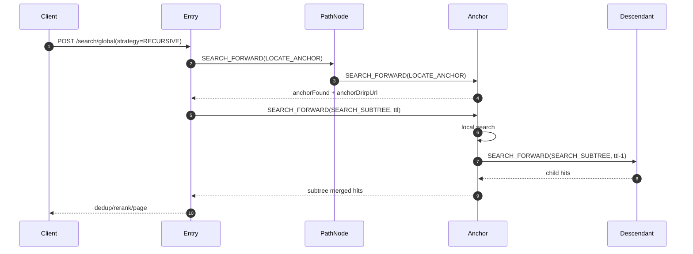
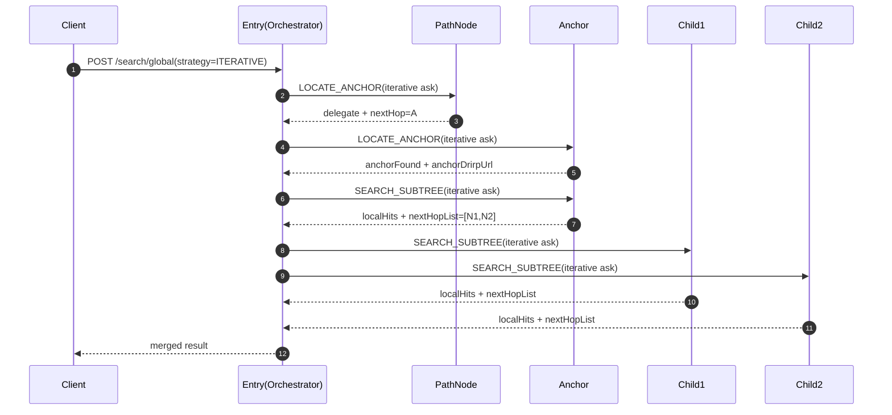

# 跨节点全网搜索设计（锚点子树，递归与迭代对比）

## 1. 目标

- 保留本地检索接口不变：`POST /api/v2/search`
- 新增跨节点全网检索接口：`POST /api/v2/search/global`
- 支持锚点子树搜索：默认锚点=入口节点，可指定 `anchorNodeCode`
- 同时支持两种实验模式：
  - `RECURSIVE`：节点递归聚合
  - `ITERATIVE`：入口节点迭代调度

## 2. 范围定义

- 当 `anchorNodeCode` 为空：仅检索入口节点及其后代（入口子树）
- 当 `anchorNodeCode` 有值：仅检索该锚点及其后代（锚点子树）
- 不跨出锚点子树边界

## 3. 总体流程

所有策略都拆成两段：

1. 锚点定位（`LOCATE_ANCHOR`）
2. 子树搜索（`SEARCH_SUBTREE`）

### 3.1 关键原则

- 锚点定位和搜索计算解耦
- 锚点定位阶段不做检索
- 搜索阶段支持 `ttl`、`visited`、`partial` 保护

## 4. 协议扩展

### 4.1 DRIRP Opcode

- `SEARCH_FORWARD = 7401`

### 4.2 请求体 `SearchForwardRequestPayload`

- `phase`: `LOCATE_ANCHOR | SEARCH_SUBTREE`
- `strategy`: `RECURSIVE | ITERATIVE`
- `anchorNodeCode`
- `entryNodeCode`
- `searchRequest`
- `ttl`
- `maxFanout`
- `perNodeLimit`
- `visitedNodeCodes`
- `visitedUrls`
- `traceId`

### 4.3 响应体 `SearchForwardResponsePayload`

- `anchorFound`
- `anchorNodeCode`
- `anchorDrirpUrl`
- `delegate`
- `nextHopCode`
- `nextHopDrirpUrl`
- `nextHopList`
- `hits`
- `partial`
- `errors`
- `ttlRemaining`
- `visitedNodeCodes`
- `visitedUrls`
- `traceId`

## 5. 锚点定位策略

### 5.1 递归模式锚点定位

- 当前节点不是锚点：按 `resolveNextHop(anchorNodeCode)` 递归转发
- 当前节点是锚点：返回 `anchorFound=true + anchorDrirpUrl`

### 5.2 迭代模式锚点定位（入口迭代）

- 入口节点循环发送 `LOCATE_ANCHOR(ITERATIVE)`
- 中间节点不递归，只返回：
  - 命中锚点：`anchorFound=true`
  - 未命中：`delegate=true + nextHopDrirpUrl`
- 入口节点根据 `nextHop` 继续循环，直到命中/失败

## 6. 子树搜索策略

### 6.1 递归模式子树搜索

- 入口先定位锚点，再直连锚点发 `SEARCH_SUBTREE`
- 锚点执行本地检索
- 锚点递归调用活跃子节点（`ttl-1`）
- 各层节点上行聚合，入口最终做去重、重排、分页

### 6.2 迭代模式子树搜索

- 入口先定位锚点，再建立 BFS 队列
- 入口逐个向队列节点发送 `SEARCH_SUBTREE(ITERATIVE)`
- 节点返回“本地 hits + 活跃子节点列表”
- 入口把子节点入队并持续调度，最终统一聚合

## 7. 时序图

### 7.1 递归模式



### 7.2 迭代模式（锚点定位也是迭代）



## 8. 聚合与可靠性

- 去重键：`identifier`
- 跨节点融合：RRF（`k=60`）
- 支持部分成功：`ok=true, partial=true`
- 失败语义：
  - `ROUTE_NOT_FOUND`
  - `TTL_EXCEEDED`
  - `UPSTREAM_ERROR`
  - `LOOP_DETECTED`

## 9. 当前实现映射（2026-03-07）

- 已实现 `DrirpSearchService`
- 已实现 `POST /api/v2/search/global`
- 已实现 `SEARCH_FORWARD(7401)` 分发
- 已实现递归/迭代两种锚点定位
- 已实现递归/迭代两种子树搜索
- 已实现跨分支集成测试 `NodeDrirpCrossBranchSearchIntegrationTest`

## 10. 示例请求

```json
{
  "naturalQuery": "global search marker county b",
  "mode": "KEYWORD",
  "strategy": "ITERATIVE",
  "anchorNodeCode": "1100AAAA",
  "ttl": 16,
  "maxFanout": 16,
  "perNodeLimit": 20,
  "limit": 20,
  "offset": 0
}
```

