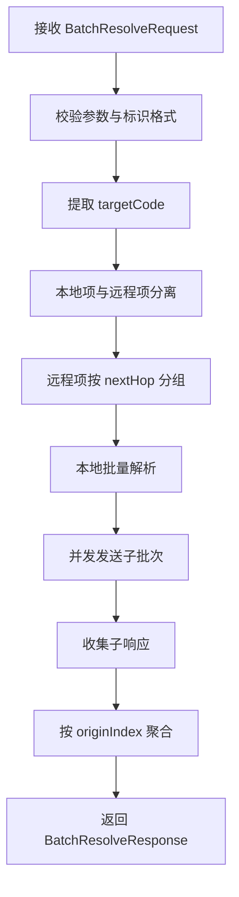
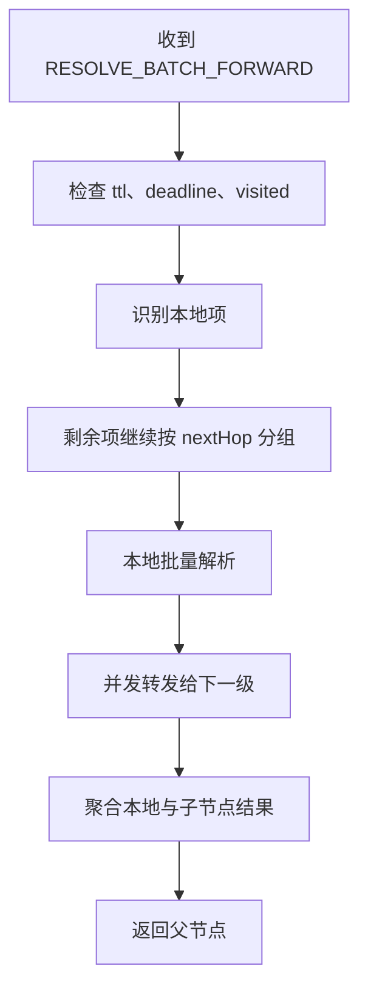
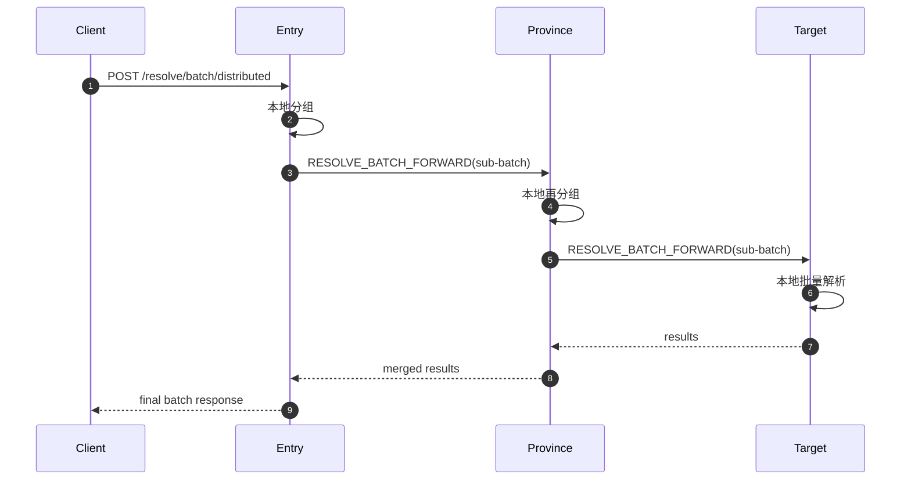

# 跨节点批量解析详细设计

## 1. 文档定位

- 文档名称：跨节点批量解析详细设计
- 适用系统：`dris-enterprise-backend-v2`
- 文档日期：2026-03-08
- 文档用途：用于毕业设计中的详细设计章节、后续实现依据与测试依据

## 2. 设计背景

当前系统已经具备以下能力：

- 单条标识解析：本地解析 + 跨节点分布式解析
- 节点注册与路由传播：`dris_direct_descendant`、`dris_route_forward`
- 单条解析协议：`RESOLVE_FORWARD = 7201`
- 本地批量解析接口：`POST /api/v2/identifiers/resolve/batch`

但现有批量解析仍然存在明显限制：

- 仅调用本地 `resolveIdentifierBatch`，不能跨节点聚合
- 返回结构仅为 `List<IdentifierMetadata>`，无法表达部分成功、超时、路由缺失等状态
- 入口节点无法对不同目标节点进行分组调度，远程解析效率低
- 无法统计批量请求在不同节点上的耗时、命中率、失败原因

因此，需要设计一套“跨节点批量解析”方案，使系统能够在保持现有单条解析能力的基础上，支持面向全网的批量解析、部分成功返回、并发转发与结果聚合。

## 3. 设计目标

### 3.1 功能目标

- 支持一次请求解析多个标识
- 支持跨节点分组转发，而不是逐条串行远程调用
- 支持部分成功返回，每个标识都能独立给出状态
- 支持保持输入顺序，便于客户端与原始请求对齐
- 支持链路跟踪、限时执行、跳数控制、环路检测

### 3.2 非功能目标

- 尽量复用现有 `DrirpResolutionService`、路由表和 DRIRP 通信能力
- 尽量不改数据库结构，降低实现复杂度
- 批量场景下优先控制网络放大效应和入口节点压力
- 保持向后兼容，不破坏现有单条解析接口和现有本地批量接口

### 3.3 非目标

- 本阶段不改变现有标识编码规则
- 本阶段不重构现有权限模型
- 本阶段不以 `identifier_history` 记录所有读操作明细，避免高频读写放大
- 本阶段优先支持 `METADATA` 批量解析；`DIGITAL_OBJECT`、`RESOURCE` 作为后续扩展

## 4. 方案选型

### 4.1 可选方案

#### 方案 A：复用单条解析，逐条远程调用

- 入口节点遍历每个 identifier
- 每条都执行一次现有单条分布式解析
- 最终聚合结果

优点：

- 复用最多，改动最小

缺点：

- 网络调用次数等于标识数量，性能差
- 无法充分利用“同一下一跳节点”的批量优势
- 节点数与标识数增加后，吞吐量下降明显

#### 方案 B：入口节点按目标节点分组，集中扇出

- 入口节点先按下一跳节点分组
- 每组发起一次批量 DRIRP 请求
- 中间节点继续分组并递归下发
- 目标节点本地批量解析后回传聚合结果

优点：

- 远程请求次数显著减少
- 能发挥同一节点批处理优势
- 与现有递归式 DRIRP 解析风格一致
- 每个中间节点只处理与自己相关的子批次，压力相对分散

缺点：

- 协议与聚合逻辑比方案 A 更复杂

#### 方案 C：入口节点全程迭代调度所有子节点

- 入口节点维护完整的批量状态机
- 中间节点只返回“下一跳建议”或“局部结果”
- 所有转发决策由入口节点完成

优点：

- 控制集中，实验观测更直观

缺点：

- 入口节点状态最重
- 批量场景下连接数、内存与调度开销更高
- 实现复杂度最高

### 4.2 方案选择

本文选择 **方案 B：按下一跳分组的递归批量转发方案**。

选择理由：

- 与现有单条递归解析实现最匹配，复用现有路由能力最多
- 对网络调用次数最敏感的部分有明显优化
- 中间节点可以继续进行二次分组，天然适合多层节点结构
- 对毕业设计而言，结构完整、思路清晰、可测性和可解释性较强

## 5. 总体设计原则

- 本地优先：本节点负责的 identifier 在本地直接解析
- 分组转发：远程请求按 `nextHopCode + nextHopDrirpUrl` 分组发送
- 部分成功：批量请求整体可成功返回，但单项可失败
- 顺序保持：输出顺序与输入顺序一致
- 幂等无状态：批量解析不依赖数据库事务，不要求跨节点事务一致性
- 有界执行：通过 `ttl`、`deadlineEpochMs`、`maxParallelNodes` 控制资源消耗

## 6. 总体架构设计

### 6.1 入口层次

- REST 接口层：接收客户端批量解析请求
- 协调服务层：负责校验、去重、分组、扇出、聚合、排序
- DRIRP 转发层：负责节点间批量转发
- 本地解析层：负责节点本地批量解析
- 聚合层：负责恢复顺序、填充失败项、输出统计信息

### 6.2 建议模块划分

- `IdentifierBatchResolveController`
- `IdentifierBatchResolveService`
- `DrirpBatchResolutionService`
- `BatchResolvePlanner`
- `BatchResolveAggregator`
- `BatchResolveMapper`

设计说明：

- `IdentifierCoreService` 继续负责单条解析与旧本地批量接口
- 新增服务专门承接跨节点批量解析，避免与单条逻辑强耦合
- `DrirpResolutionService` 不直接堆叠批量逻辑，保持职责单一

## 7. 对现有系统的映射关系

当前已有代码和表结构中可直接复用的部分如下：

- 控制器入口：`IdentifierCoreController`
- 单条分布式解析服务：`DrirpResolutionService`
- 节点拓扑数据：`dris_direct_descendant`、`dris_route_forward`
- 路由计算：`RouteForwardDao`、`DirectDescendantDao`
- DRIRP 服务启动与 opcode 分发：`NodeDrirpServerLifecycle`
- 单条解析协议号：`NodeDrirpOpcode.RESOLVE_FORWARD = 7201`
- DRIRP 安全：`dris.v2.drirp-security.*`
- DRIRP 审计：`api_audit_log`

本方案建议新增：

- 新 REST 接口，不覆盖现有 `POST /api/v2/identifiers/resolve/batch`
- 新 DRIRP opcode：`RESOLVE_BATCH_FORWARD = 7203`
- 新 DTO 和 payload 类型
- 新线程池配置，用于批量解析并发扇出

## 8. 接口设计

### 8.1 兼容性策略

为避免破坏现有客户端，采用“双接口并存”策略：

- 保留现有本地批量接口：`POST /api/v2/identifiers/resolve/batch`
- 新增跨节点批量接口：`POST /api/v2/identifiers/resolve/batch/distributed`

说明：

- 旧接口仍然返回 `List<IdentifierMetadata>`
- 新接口返回结构化的批量结果对象，支持部分成功和错误细分

### 8.2 REST 请求对象

建议新增 `BatchResolveRequest`：

```json
{
  "identifiers": [
    "1100ABCD019320260101AAAAAAAAAA",
    "3701WXYZ019320260101BBBBBBBBBB"
  ],
  "resolveType": "METADATA",
  "timeoutMs": 8000,
  "ttl": 8,
  "maxParallelNodes": 8,
  "perNodeBatchSize": 100,
  "allowPartial": true,
  "preserveOrder": true,
  "includeNodeStats": true,
  "traceId": "trace-batch-001"
}
```

字段说明：

- `identifiers`：标识列表，必填，建议最大不超过 500
- `resolveType`：本阶段推荐仅支持 `METADATA`
- `timeoutMs`：整批解析的总超时时间
- `ttl`：跨节点最大跳数
- `maxParallelNodes`：单次最多并发请求的远程节点数
- `perNodeBatchSize`：每个子批次最大数量
- `allowPartial`：是否允许部分成功
- `preserveOrder`：是否按输入顺序返回，建议固定为 `true`
- `includeNodeStats`：是否返回节点维度统计信息
- `traceId`：链路跟踪 ID，可选，不传则服务端生成

### 8.3 REST 响应对象

建议新增 `BatchResolveResponse`：

```json
{
  "traceId": "trace-batch-001",
  "partial": true,
  "total": 2,
  "successCount": 1,
  "failureCount": 1,
  "elapsedMs": 126,
  "items": [
    {
      "index": 0,
      "identifier": "1100ABCD019320260101AAAAAAAAAA",
      "targetCode": "1100ABCD",
      "status": "OK",
      "handledByNodeCode": "1100ABCD",
      "hopCount": 0,
      "message": "ok",
      "data": {
        "identifier": "1100ABCD019320260101AAAAAAAAAA"
      }
    },
    {
      "index": 1,
      "identifier": "3701WXYZ019320260101BBBBBBBBBB",
      "targetCode": "3701WXYZ",
      "status": "ROUTE_NOT_FOUND",
      "handledByNodeCode": "1100ABCD",
      "hopCount": 0,
      "message": "route not found"
    }
  ],
  "nodeStats": [
    {
      "nodeCode": "1100ABCD",
      "requestCount": 1,
      "itemCount": 2,
      "successCount": 1,
      "failureCount": 1,
      "elapsedMs": 126
    }
  ]
}
```

### 8.4 HTTP 语义

- 请求级参数非法：返回 `400`
- 协议不支持：返回 `400`
- 协调节点自身故障：返回 `500/502`
- 批量内部部分失败：返回 `200`，`partial=true`
- 整批无命中但请求执行完成：返回 `200`，由 `items[].status` 表达失败原因

设计原因：

- 对批量请求而言，是否成功应首先看“调度流程是否完成”
- 单条失败不应直接导致整批 HTTP 失败，否则客户端无法获取其余结果

## 9. DRIRP 协议设计

### 9.1 新增 Opcode

- `RESOLVE_BATCH_FORWARD = 7203`

### 9.2 请求载荷 `BatchResolveForwardRequestPayload`

```json
{
  "traceId": "trace-batch-001",
  "requestId": "req-001",
  "entryNodeCode": "1100ABCD",
  "senderNodeCode": "1100ABCD",
  "resolveType": "METADATA",
  "ttl": 8,
  "deadlineEpochMs": 1772938800000,
  "allowPartial": true,
  "visitedNodeCodes": ["1100ABCD"],
  "items": [
    {
      "originIndex": 0,
      "identifier": "3701WXYZ019320260101AAAAAAAAAA",
      "targetCode": "3701WXYZ"
    }
  ]
}
```

字段说明：

- `traceId`：跨节点全链路跟踪 ID
- `requestId`：当前子请求 ID，便于排查并发子批次
- `entryNodeCode`：最初接收请求的入口节点
- `senderNodeCode`：当前发送方节点编码
- `ttl`：剩余最大跳数
- `deadlineEpochMs`：整批最晚完成时间戳
- `visitedNodeCodes`：已访问节点列表，用于环路检测
- `items`：当前子批次待处理的标识列表

### 9.3 响应载荷 `BatchResolveForwardResponsePayload`

```json
{
  "traceId": "trace-batch-001",
  "handledByNodeCode": "3700ABCD",
  "partial": false,
  "ttlRemaining": 6,
  "results": [
    {
      "originIndex": 0,
      "identifier": "3701WXYZ019320260101AAAAAAAAAA",
      "targetCode": "3701WXYZ",
      "status": "OK",
      "handledByNodeCode": "3701WXYZ",
      "hopCount": 2,
      "message": "ok",
      "data": {
        "identifier": "3701WXYZ019320260101AAAAAAAAAA"
      }
    }
  ],
  "nodeStats": [
    {
      "nodeCode": "3700ABCD",
      "itemCount": 1,
      "elapsedMs": 20
    }
  ]
}
```

## 10. 核心算法设计

### 10.1 总体流程

1. 接收批量请求
2. 执行参数校验、identifier 格式校验、去重与索引映射
3. 将本地项与远程项分开
4. 远程项按 `nextHopCode + nextHopDrirpUrl` 分桶
5. 对每个桶按 `perNodeBatchSize` 分片
6. 对分片任务并发调用 `RESOLVE_BATCH_FORWARD`
7. 子节点收到请求后重复执行“本地处理 + 继续分组转发”
8. 目标节点本地批量解析后返回结果
9. 父节点聚合全部子结果，并按 `originIndex` 回填
10. 入口节点输出最终响应

### 10.2 关键思想：按下一跳分组

若一个批次中包含多个目标编码，而它们当前都应从同一个省级节点进入，则这些 identifier 应合并成一个子批次发送给该省级节点。

这样可以显著降低以下成本：

- DRIRP 连接建立次数
- 节点间消息条数
- 入口节点线程切换开销
- 下游节点重复解析路由的开销

### 10.3 伪代码

```text
function distributedBatchResolve(request):
    validate(request)
    normalized = normalizeAndIndex(request.identifiers)
    localBucket = []
    remoteBuckets = Map<NextHop, List<Item>>()

    for item in normalized:
        targetCode = extractTargetCode(item.identifier)
        if targetCode == selfNodeCode:
            localBucket.add(item)
        else:
            nextHop = resolveNextHop(targetCode)
            if nextHop == null:
                mark(item, ROUTE_NOT_FOUND)
            else:
                remoteBuckets[nextHop].add(item)

    resolveLocalBatch(localBucket)
    parallelForward(remoteBuckets)
    mergeResultsByOriginIndex()
    fillMissingItemsIfNecessary()
    return finalResponse
```

### 10.4 去重与顺序保持

为提高效率，应对输入进行去重，但要保留原始位置：

- `originIndex` 记录原始位置
- `identifier -> firstResult` 只实际解析一次
- 如果输入中同一个 identifier 出现多次，则将结果复制回多个位置

这可以避免重复远程调用，同时满足客户端“结果顺序必须与请求顺序一致”的要求。

## 11. 节点侧处理流程

### 11.1 入口节点处理流程



### 11.2 中间节点处理流程



### 11.3 时序图



## 12. 本地解析策略设计

### 12.1 MVP 范围

MVP 阶段仅支持 `METADATA` 批量解析。

原因：

- `dris-java-sdk` 已有 `resolveIdentifierBatch`
- `DIGITAL_OBJECT` 与 `RESOURCE` 尚无成熟批量接口
- 先完成最核心场景，可显著降低实现复杂度和测试风险

### 12.2 后续扩展

后续可扩展为：

- `DIGITAL_OBJECT`：节点本地循环调用单条接口，再在服务层聚合
- `RESOURCE`：节点本地循环调用单条接口，再在服务层聚合

协议层已预留 `resolveType` 字段，无需改动 DRIRP 基本结构。

## 13. 模块详细设计

### 13.1 `IdentifierBatchResolveController`

职责：

- 暴露 REST 接口
- 接收并反序列化 `BatchResolveRequest`
- 调用 `IdentifierBatchResolveService`
- 返回统一 `ApiResponse`

### 13.2 `IdentifierBatchResolveService`

职责：

- 处理入口节点批量请求
- 执行请求级校验、traceId 生成、响应包装
- 调用 `DrirpBatchResolutionService`

### 13.3 `DrirpBatchResolutionService`

职责：

- 负责本地分组、远程扇出、子结果聚合
- 负责处理 `RESOLVE_BATCH_FORWARD` 的服务端逻辑
- 负责路由失败、超时失败、环路失败回填

### 13.4 `BatchResolvePlanner`

职责：

- 从 identifier 中提取 `targetCode`
- 调用现有路由能力找到 `nextHop`
- 输出 `localBucket + remoteBuckets`

### 13.5 `BatchResolveAggregator`

职责：

- 按 `originIndex` 合并多来源结果
- 统计 `successCount/failureCount/partial`
- 生成 `nodeStats`

### 13.6 `BatchResolveMapper`

职责：

- REST DTO、DRIRP Payload、内部对象之间的转换
- 避免控制器和服务层直接操作低层协议字段

## 14. 错误码设计

建议错误码如下：

- `VALIDATION_ERROR`：请求参数非法
- `UNSUPPORTED_RESOLVE_TYPE`：暂不支持的解析类型
- `ROUTE_NOT_FOUND`：路由不存在
- `TTL_EXCEEDED`：跳数耗尽
- `DEADLINE_EXCEEDED`：总超时耗尽
- `LOOP_DETECTED`：发现环路
- `UPSTREAM_ERROR`：下游节点调用失败
- `PARTIAL_SUCCESS`：整批成功返回但存在部分失败
- `INTERNAL_MERGE_MISSING`：聚合阶段结果缺失

说明：

- `PARTIAL_SUCCESS` 更适合作为响应内状态，而非 HTTP 错误
- `ROUTE_NOT_FOUND`、`UPSTREAM_ERROR` 等应落到 `items[].status`

## 15. 并发与性能设计

### 15.1 并发模型

建议使用独立线程池执行远程子批次并发调用，例如：

- 核心线程数：`4`
- 最大线程数：`8`
- 队列长度：`200`

线程池与现有业务审计线程池分离，避免互相影响。

### 15.2 限流参数建议

- 单次请求最大 identifier 数：`500`
- 单节点子批次大小：`100`
- 最大并发远程节点数：`8`
- 默认超时：`8000ms`
- 默认最大跳数：`8`

### 15.3 复杂度分析

- 路由分组复杂度：`O(N)`
- 聚合复杂度：`O(N)`
- 空间复杂度：`O(N)`
- 网络调用复杂度：近似为 `O(G)`，其中 `G` 为分组后的远程桶数，而不是原始条目数 `N`

这是该方案相较逐条远程调用的核心优势。

## 16. 容错设计

### 16.1 部分成功

若某个远程节点超时或失败：

- 不中断整批请求
- 将该子批次内所有未返回项标记为失败
- 其余成功项继续返回

### 16.2 超时策略

- 入口节点记录 `deadlineEpochMs`
- 每一跳都检查当前时间是否超过 deadline
- 超时则立即停止进一步转发

### 16.3 环路检测

- 每个请求携带 `visitedNodeCodes`
- 若下一个节点已在列表中，则判定为环路
- 将相关项标记为 `LOOP_DETECTED`

### 16.4 结果缺失兜底

聚合结束后，若发现某个 `originIndex` 没有结果：

- 自动回填 `INTERNAL_MERGE_MISSING`
- 避免客户端出现结果数量不一致的问题

## 17. 安全与审计设计

### 17.1 消息安全

直接复用当前已实现的 DRIRP 安全机制：

- 消息签名
- 防重放
- 时间窗校验
- 可插拔启停

批量解析不需要新增独立鉴权体系。

### 17.2 审计策略

建议分层审计：

- `api_audit_log`：记录批量请求摘要
- DRIRP 审计：记录每次子批次跨节点转发
- 业务审计：本阶段不将批量读解析逐条写入 `identifier_history`

原因：

- `identifier_history` 当前更适合承载写操作历史
- 对读请求逐条写审计会带来明显写放大，不适合高频批量解析场景

建议在 `api_audit_log` 中记录以下摘要字段：

- `trace_id`
- `path=/api/v2/identifiers/resolve/batch/distributed`
- `status`
- `duration_ms`
- `success`
- `error_message` 中附带 `total/successCount/failureCount/partial`

## 18. 数据库设计

### 18.1 MVP 结论

MVP 不要求新增数据库表。

理由：

- 路由与节点关系已可复用现有表
- 批量解析属于在线编排逻辑，不依赖持久化中间状态
- 统计与审计可暂时复用现有日志表

### 18.2 可选扩展

若后续需要长期统计，可新增聚合统计表，例如：

- `batch_resolve_metric_daily`
- `batch_resolve_node_metric`

但这不是核心功能的前置条件。

## 19. 配置设计

建议新增如下配置项：

```yaml
dris:
  v2:
    batch-resolve:
      enabled: true
      max-identifiers: 500
      default-timeout-ms: 8000
      default-ttl: 8
      max-parallel-nodes: 8
      per-node-batch-size: 100
      include-node-stats: true
```

配置说明：

- `enabled`：总开关
- `max-identifiers`：控制单次请求体积
- `default-timeout-ms`：未传入超时参数时的默认值
- `default-ttl`：默认最大跳数
- `max-parallel-nodes`：限制远程并发数量
- `per-node-batch-size`：限制单次子批次大小

## 20. 测试设计

### 20.1 单元测试

应覆盖：

- identifier 提取与路由分组
- 去重与顺序恢复
- ttl、deadline、visited 校验
- 聚合与缺失回填

### 20.2 集成测试

建议至少覆盖以下场景：

- 单节点全本地批量解析
- 两节点跨节点批量解析
- 七节点树形拓扑批量解析
- 路由缺失的部分成功返回
- 中间节点超时后的部分成功返回
- 错误路由引发的环路检测

### 20.3 性能测试

建议测试规模：

- `100` 条、`300` 条、`500` 条 identifier
- 入口节点与远程节点分布比例变化
- 对比“逐条解析”与“分组批量解析”在以下指标上的差异：
  - 平均耗时
  - P95 延迟
  - 节点间请求条数
  - CPU 与线程池占用

## 21. 分阶段实施计划

### 阶段 1：最小可用版本

- 支持 `METADATA`
- 支持新 REST 接口
- 支持 `RESOLVE_BATCH_FORWARD`
- 支持按下一跳分组转发
- 支持部分成功与顺序恢复

### 阶段 2：增强版本

- 增加 `DIGITAL_OBJECT`、`RESOURCE`
- 增加节点统计信息与监控指标
- 增加失败重试与熔断策略

### 阶段 3：实验与论文支撑版本

- 增加性能测试报告
- 增加逐条解析对照实验
- 增加七节点以上拓扑下的性能分析图表

## 22. 预期收益

该设计落地后，系统将在以下方面获得提升：

- 从“本地批量解析”升级为“全网批量解析”
- 从“仅能返回成功列表”升级为“能表达每条状态的结构化批量响应”
- 从“逐条调用放大网络成本”升级为“按下一跳分组的批量转发”
- 为毕业设计中的系统设计、性能分析、协议扩展和实验评估提供完整支撑

## 23. 结论

跨节点批量解析的核心不是简单地“把单条解析循环多次”，而是要构建一套面向多节点网络的批量编排机制。本文选择的“按下一跳分组 + 递归批量转发 + 部分成功聚合”方案，能够在复用现有单条解析与路由体系的基础上，以较低耦合完成跨节点批量解析能力扩展。

该方案适合作为 `dris-enterprise-backend-v2` 的下一步重点演进方向，也适合作为毕业设计中“详细设计”与“系统优化设计”的核心章节。
